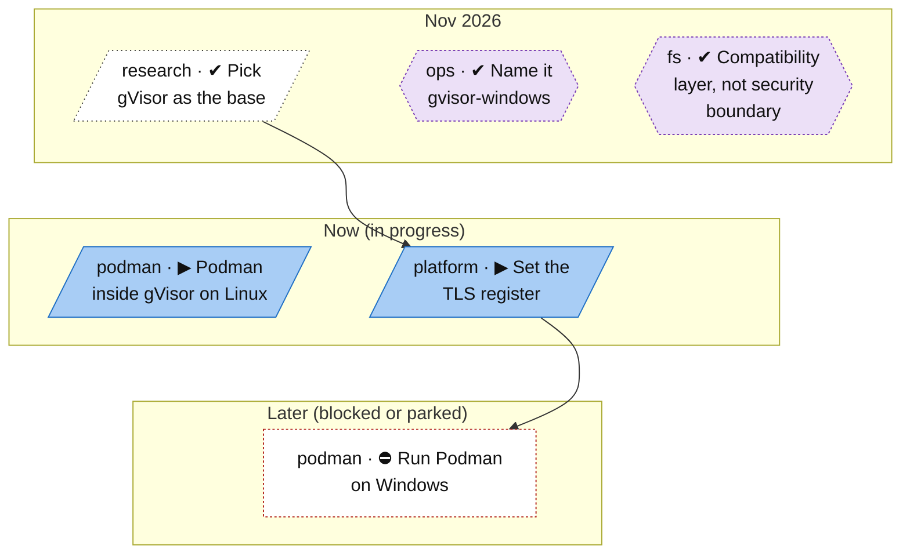

# Roadmap

Everything between the GENERATED markers is rebuilt from `roadmap/nodes.yaml`; edit that file, not the regions. Text outside the markers is kept.

## Legend

<!-- BEGIN GENERATED: legend -->

Owner calls are the purple shape. A decided owner call is drawn in the overview only, never in the track trees; an open one is listed under *Waiting on the owner*. The prefix on an overview box is its track. A prerequisite implied by a longer chain is not drawn; the node tables keep every edge.
<!-- END GENERATED: legend -->

## Ratings

<!-- BEGIN GENERATED: ratings -->
0 of 4 rated nodes are confirmed by the owner.

Not yet confirmed: `research-lkl-nommu`, `research-unkernel`, `research-flinux-translation`, `research-qemu-emulation`.
<!-- END GENERATED: ratings -->

## Overview

<!-- BEGIN GENERATED: overview -->

<!-- END GENERATED: overview -->

## In plain words

<!-- BEGIN GENERATED: plain-words -->
| title | status | in plain words |
|---|---|---|
| Pick gVisor as the base | ✔ done · unrated | Of all ways to run Linux code on Windows without admin, gVisor's user-space Linux kernel is the only one that already runs containers. |
| Benchmark gVisor against native Linux | ▶ in progress | Measure how much slower process start, small files and CPU work are inside gVisor than natively. |
| Test WHPX on this machine | ▶ in progress | Check whether QEMU can use the Windows hypervisor here without admin, as a fast stopgap. |
| Survey ELF segment alignment | ▶ in progress | Count how often program files place code at addresses Windows cannot map directly (64 KB alignment). |
| Measure syscall trap cost | ▶ in progress | Measure what it costs to catch one Linux system call on Windows and hand it to another process. |
| Test 4 KB section views | ▶ in progress | Check whether Windows can map shared memory at the 4 KB steps Linux programs expect, instead of 64 KB. |
| Set the TLS register | ▶ in progress | Check whether a normal Windows program can set the register Linux programs use for thread-local data; without it native execution fails. |
| Restrict the stub process | ▶ in progress | Check that the process running Linux code can be locked down, so a missed system call does little harm. |
| Recover faults in Go | ▶ in progress | Check that the Go kernel process can survive reading bad guest memory on Windows, as it does on Linux. |
| Compatibility layer, not security boundary | ✔ done · n/a | The sandbox may open the user's files directly with the user's rights; it isolates containers from each other, not from the user. |
| Test persistent image storage | ▶ in progress | Find out where Podman's images can live so they survive a restart of the sandbox, and how fast each option is. |
| Write the Podman acceptance test | ▶ in progress | One test of ten steps defines when Podman counts as working: pull, run, build, mounts, ports, compose, restart, isolation. |
| Podman inside gVisor on Linux | ▶ in progress | Check on Linux whether Podman's engine runs inside gVisor at all; this is the baseline for the Windows port. |
| Run Podman on Windows | ⛔ blocked | The goal: a standard Windows user runs Podman containers with no admin, VM, WSL or Hyper-V. |
| Name it gvisor-windows | ✔ done · n/a | The project is an unofficial fork of gVisor's Go branch called gvisor-windows. |
| Go or no-go after Phase 0 | ⛔ blocked | The owner decides, from the Phase 0 results, whether the port goes ahead. |
<!-- END GENERATED: plain-words -->

## Ready now

<!-- BEGIN GENERATED: ready-now -->
_None._
<!-- END GENERATED: ready-now -->

## Running

<!-- BEGIN GENERATED: running -->
**linux-ci**

- `podman-acceptance-test`: Write the Podman acceptance test
- `podman-inside-gvisor-linux`: Podman inside gVisor on Linux
- `research-gvisor-benchmark`: Benchmark gVisor against native Linux
- `platform-elf-alignment-survey`: Survey ELF segment alignment
- `fs-persistent-image-storage`: Test persistent image storage

**windows-local**

- `platform-trap-cost`: Measure syscall trap cost
- `platform-4k-section-views`: Test 4 KB section views
- `platform-tls-register`: Set the TLS register
- `platform-restricted-stub`: Restrict the stub process
- `sentry-go-fault-recovery`: Recover faults in Go
- `research-whpx-this-machine`: Test WHPX on this machine
<!-- END GENERATED: running -->

## Built, waiting

<!-- BEGIN GENERATED: built-waiting -->
_None._
<!-- END GENERATED: built-waiting -->

## Waiting on the owner

<!-- BEGIN GENERATED: waiting-on-owner -->
- `ops-phase0-go-no-go`: Go or no-go after Phase 0
<!-- END GENERATED: waiting-on-owner -->

## Timeline

<!-- BEGIN GENERATED: timeline -->
[The timeline](roadmap/timeline.md) shows every dated node as a bar from its start to its end.

Generated on 2026-11-26.
<!-- END GENERATED: timeline -->

## Done, by month

<!-- BEGIN GENERATED: done-by-month -->

<b>Nov 2026</b>: 5 done, 4 abandoned

- `fs-compat-layer-not-boundary`: Compatibility layer, not security boundary (✔ done · n/a). The sandbox may open the user's files directly with the user's rights; it isolates containers from each other, not from the user.
- `ops-borrow-code`: Borrow code, check licenses later (✔ done · n/a). Code from other projects may be reused; its origin is recorded so the owner can review licences later.
- `ops-linux-tests-on-actions`: Run Linux tests on GitHub Actions (✔ done · n/a). Everything that needs a Linux host runs on GitHub's hosted runners.
- `ops-name-and-fork`: Name it gvisor-windows (✔ done · n/a). The project is an unofficial fork of gVisor's Go branch called gvisor-windows.
- `research-flinux-translation`: Translate syscalls like flinux (✖ dead end). Mapping each Linux call onto a Windows call cannot provide what containers need, such as namespaces and cgroups.
- `research-gvisor-base`: Pick gVisor as the base (✔ done · unrated). Of all ways to run Linux code on Windows without admin, gVisor's user-space Linux kernel is the only one that already runs containers.
- `research-lkl-nommu`: Revive LKL or nommu UML (✖ dead end). Running the real Linux kernel as a library was rejected: without memory management it cannot fork, and its Windows support is gone.
- `research-qemu-emulation`: QEMU software emulation (✖ dead end). Emulating a whole computer in software works today but is several times slower; it stays only as a stopgap.
- `research-unkernel`: Build on unkernel (✖ dead end). Linux compiled to WebAssembly runs anywhere, but it always emulates the programs, so it cannot reach native speed.

<!-- END GENERATED: done-by-month -->

## Tracks

<!-- BEGIN GENERATED: tracks -->
Each track has its own page with its tree, node table and per-node details.

- [research - research](roadmap/tracks/research.md): 7 nodes (1 done, 2 in progress, 4 abandoned)
- [platform - platform](roadmap/tracks/platform.md): 5 nodes (5 in progress)
- [sentry - sentry](roadmap/tracks/sentry.md): 1 nodes (1 in progress)
- [fs - files](roadmap/tracks/fs.md): 2 nodes (1 done, 1 in progress)
- [net - network](roadmap/tracks/net.md): 0 nodes
- [podman - podman](roadmap/tracks/podman.md): 3 nodes (2 in progress, 1 blocked)
- [ops - operations](roadmap/tracks/ops.md): 4 nodes (3 done, 1 blocked)
<!-- END GENERATED: tracks -->
