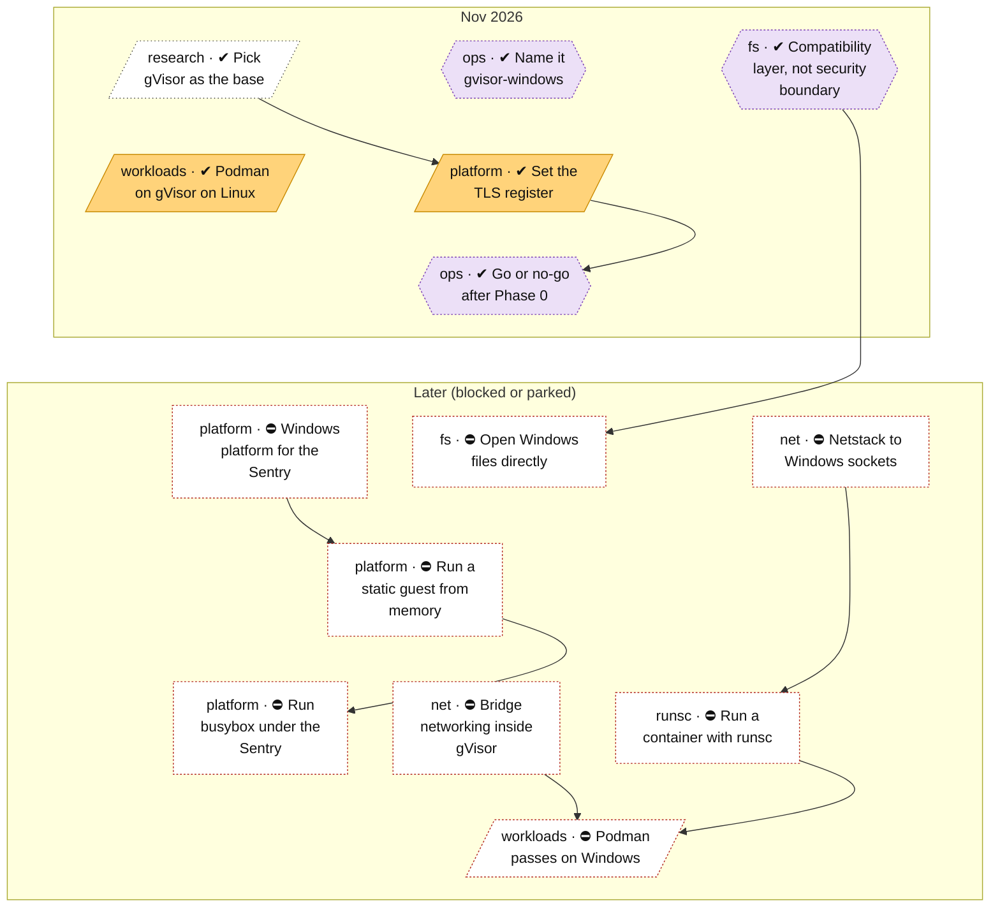

# Roadmap

Everything between the GENERATED markers is rebuilt from `roadmap/nodes.yaml`; edit that file, not the regions. Text outside the markers is kept.

## Legend

<!-- BEGIN GENERATED: legend -->

Owner calls are the purple shape. A decided owner call is drawn in the overview only, never in the track trees; an open one is listed under *Waiting on the owner*. The prefix on an overview box is its track. A prerequisite implied by a longer chain is not drawn; the node tables keep every edge.
<!-- END GENERATED: legend -->

## Ratings

<!-- BEGIN GENERATED: ratings -->
0 of 17 rated nodes are confirmed by the owner.

Not yet confirmed: `research-lkl-nommu`, `research-unkernel`, `research-flinux-translation`, `research-qemu-emulation`, `workloads-podman-on-gvisor-linux`, `research-gvisor-benchmark`, `platform-elf-alignment-survey`, `fs-persistent-image-storage`, `platform-trap-cost`, `platform-4k-section-views`, `platform-tls-register`, `platform-restricted-stub`, `sentry-go-fault-recovery`, `research-whpx-this-machine`, `runsc-measure-cli`, `research-file-protocol`, `platform-zpoline-hooks`.
<!-- END GENERATED: ratings -->

## Overview

<!-- BEGIN GENERATED: overview -->

<!-- END GENERATED: overview -->

## In plain words

<!-- BEGIN GENERATED: plain-words -->
| title | status | in plain words |
|---|---|---|
| Run a container with runsc | ⛔ blocked | The main goal: gVisor's runtime runs an OCI container on Windows for a standard user, with no admin, VM, WSL or Hyper-V. |
| Start and stop sandboxes on Windows | ⛔ blocked | runsc creates, starts, signals and deletes a sandbox process on Windows. |
| Set the TLS register | ✔ done · mixed | Check whether a normal Windows program can set the register Linux programs use for thread-local data; without it native execution fails. |
| Stub and controller prototype | ⛔ blocked | A tiny Windows process runs a static Linux program while a second process catches and answers its system calls. |
| Scan code pages for syscalls | ⛔ blocked | Before guest code may run, each page is scanned for every instruction that enters the Windows kernel and those are rewritten to traps. |
| Patch hot syscall sites | ⛔ blocked | Call sites that trapped once are patched to jump straight into the controller hand-off, avoiding the exception cost. |
| Own vDSO for clock calls | ⛔ blocked | Time and CPU queries are answered inside the stub, so they need no trap at all. |
| Handle 64 KB mapping conflicts | ⏸ parked | When Linux puts two file pieces inside one 64 KB Windows window, the Sentry copies them into one fresh range instead. |
| Windows platform for the Sentry | ⛔ blocked | gVisor's platform interface implemented for Windows: address spaces, context switches and syscall delivery through stub processes. |
| Run busybox under the Sentry | ⛔ blocked | First end-to-end milestone: gVisor's kernel runs an unmodified busybox shell on Windows. |
| Use hardware acceleration when available | ⏸ parked | Where the Windows Hypervisor Platform is enabled, a second platform could run guests in a hardware VM, chosen automatically like runsc's autoplatform. |
| Restore the TLS register after switches | ⛔ blocked | Windows resets the guest's thread-local register on every context switch; the stub's fault handler puts it back before the guest notices. |
| Support CPUs without FSGSBASE | ⏸ parked | On CPUs or VMs without the instruction to set the register, rewrite the guest's %fs accesses instead. |
| Check what exceptions do to stacks | ▶ in progress | Windows writes exception data onto the faulting thread stack; check whether that destroys data Linux code keeps there, and what happens on unmapped stacks. |
| Run a static guest from memory | ⛔ blocked | Thinnest end-to-end slice: the Sentry on Windows runs one embedded static program from its own memory filesystem, without host files, network or threads. |
| Sentry builds for Windows | ⛔ blocked | gVisor's kernel compiles as a Windows program, with host-specific parts stubbed out. |
| Guest memory on Windows sections | ⛔ blocked | The Sentry's memory file becomes a Windows section object, allocated in 64 KB units. |
| Event waiting on IOCP | ⛔ blocked | Waiting for many host events at once (epoll on Linux) moves to Windows completion ports. |
| Timers and clocks on Windows | ⛔ blocked | The Sentry's clocks and timers run on Windows' high-resolution timers. |
| Port fault recovery to Windows | ⛔ blocked | The Sentry's safe copies of guest memory recover from access violations on Windows instead of crashing. |
| Guest terminal and stdio | ⛔ blocked | A guest program's input, output and terminal connect to the Windows console (ConPTY), including Ctrl-C. |
| Guest threads and signals | ⛔ blocked | Multi-threaded guests (such as Go programs) get one stub thread per guest thread, with signals delivered correctly. |
| Make Linux names resolve on Windows | ○ next | A Windows copy of x/sys/unix defines the Linux constants and types and stubs the calls, so the Sentry compiles with few edits. |
| Compatibility layer, not security boundary | ✔ done · n/a | The sandbox may open the user's files directly with the user's rights; it isolates containers from each other, not from the user. |
| Open Windows files directly | ⛔ blocked | The Sentry opens NTFS files itself for bind mounts, with its own caches, instead of going through a file protocol. |
| Windows changes reach the guest | ⛔ blocked | Edits made on Windows invalidate the Sentry's caches and arrive in the guest as inotify events. |
| Linux file metadata on NTFS | ⛔ blocked | Owner, mode bits, symlinks and special files survive on NTFS, using a fixed owner and alternate data streams. |
| Files stay editable on Windows | ⛔ blocked | The Sentry holds Windows file handles only briefly, so editors and git can still rename and delete files. |
| Root filesystem from an OCI bundle | ⛔ blocked | The guest's root filesystem comes from an unpacked OCI bundle directory on Windows. |
| Storage that survives restarts | ⛔ blocked | Implement the chosen writable filesystem so data inside the sandbox outlives a restart. |
| Netstack to Windows sockets | ⛔ blocked | gVisor's own TCP/IP stack sends guest traffic out through ordinary Windows sockets, like a user-space NAT. |
| Publish guest ports on localhost | ⛔ blocked | A port opened in the guest becomes reachable on the Windows machine's localhost. |
| Bridge networking inside gVisor | ⛔ blocked | Podman's default network creates a bridge and veth pairs over netlink; gVisor lacks part of that, so it fails today. Fix it in gVisor itself, first on Linux, then it carries over to Windows. |
| Podman on gVisor on Linux | ✔ done · mixed ⚠ | Run the acceptance test on stock gVisor on Linux; whatever fails there is a gap in gVisor itself, not in the port. |
| Podman passes on Windows | ⛔ blocked | The bar for enough features: an unmodified Podman engine passes the acceptance test on gVisor on Windows. |
| Acceptance test for Windows | ⛔ blocked | The ten acceptance steps written for Windows, driving the stock Podman and docker clients. |
| Serve Podman to Windows clients | ⛔ blocked | The test harness runs the Podman engine on runsc and exposes its API to the stock Windows clients. |
| Bridge networking fails in gVisor | ⚠ open | In stock gVisor, Podman's default bridge network fails because netavark cannot open its netlink socket; only host networking works. |
| Port publishing untested in gVisor | ⚠ open | Publishing container ports with -p and service-name lookup in compose never worked or were never exercised inside gVisor. |
| Strict bar on stock gVisor | ▶ in progress | Find out what stock gVisor on Linux needs for -p port publishing and compose service names, across Podman versions and network modes. |
| Pick gVisor as the base | ✔ done · unrated | Of all ways to run Linux code on Windows without admin, gVisor's user-space Linux kernel is the only one that already runs containers. |
| Name it gvisor-windows | ✔ done · n/a | The project is an unofficial fork of gVisor's Go branch called gvisor-windows. |
| Go or no-go after Phase 0 | ✔ done · n/a | Go: the owner asked for the full project; ADR 0004 lists the conditions. |
| Windows CI as a standard user | ○ next | CI on windows-latest creates a standard user and runs every Windows test as that user. |
| gVisor syscall tests on Windows | ⛔ blocked | gVisor's own syscall test suite runs against the Windows port to show which Linux calls work. |
| Merge upstream gVisor regularly | ○ next | Regularly take in upstream gVisor's Go branch so the port does not drift. |
| Portable zip, no installer | ⛔ blocked | Ship runsc for Windows as a zip or per-user installer that needs no admin. |
<!-- END GENERATED: plain-words -->

## Ready now

<!-- BEGIN GENERATED: ready-now -->
**linux-ci**

- `ops-upstream-merges`: Merge upstream gVisor regularly
- `workloads-gvisor-bridge-netlink`: Bridge networking fails in gVisor
- `workloads-gvisor-port-publishing`: Port publishing untested in gVisor

**windows-ci**

- `ops-windows-ci-standard-user`: Windows CI as a standard user

**none**

- `sentry-unix-shim`: Make Linux names resolve on Windows
<!-- END GENERATED: ready-now -->

## Running

<!-- BEGIN GENERATED: running -->
**linux-ci**

- `workloads-strict-bar-linux`: Strict bar on stock gVisor

**windows-ci**

- `platform-exception-stack`: Check what exceptions do to stacks
<!-- END GENERATED: running -->

## Built, waiting

<!-- BEGIN GENERATED: built-waiting -->
_None._
<!-- END GENERATED: built-waiting -->

## Waiting on the owner

<!-- BEGIN GENERATED: waiting-on-owner -->
_None._
<!-- END GENERATED: waiting-on-owner -->

## Timeline

<!-- BEGIN GENERATED: timeline -->
[The timeline](roadmap/timeline.md) shows every dated node as a bar from its start to its end.

Generated on 2026-11-26.
<!-- END GENERATED: timeline -->

## Done, by month

<!-- BEGIN GENERATED: done-by-month -->

<b>Nov 2026</b>: 22 done, 7 abandoned

- `fs-compat-layer-not-boundary`: Compatibility layer, not security boundary (✔ done · n/a). The sandbox may open the user's files directly with the user's rights; it isolates containers from each other, not from the user.
- `fs-persistent-image-storage`: Test persistent image storage (✔ done · mixed). Find a writable filesystem inside the sandbox that survives a restart, and how fast each option is.
- `fs-persistent-storage-choice`: Choose the persistent storage (✔ done · n/a). Decided: persistent data lives as real files in a Windows folder, with Linux metadata in an NTFS stream.
- `ops-borrow-code`: Borrow code, check licenses later (✔ done · n/a). Code from other projects may be reused; its origin is recorded so the owner can review licences later.
- `ops-linux-tests-on-actions`: Run Linux tests on GitHub Actions (✔ done · n/a). Everything that needs a Linux host runs on GitHub's hosted runners.
- `ops-name-and-fork`: Name it gvisor-windows (✔ done · n/a). The project is an unofficial fork of gVisor's Go branch called gvisor-windows.
- `ops-phase0-go-no-go`: Go or no-go after Phase 0 (✔ done · n/a). Go: the owner asked for the full project; ADR 0004 lists the conditions.
- `ops-podman-only-the-bar`: Podman only as the bar (✔ done · n/a). The project is gVisor for Windows hosts; Podman is only the workload that shows enough features work.
- `ops-syscall-test-strategy`: Choose how to run gVisor's tests (✔ done · n/a). The Go branch ships no tests; decide whether gVisor's unit and syscall tests run from a master checkout with Bazel or get ported.
- `platform-4k-section-views`: Test 4 KB section views (✔ done · successful). Check whether Windows can map shared memory at the 4 KB steps Linux programs expect, instead of 64 KB.
- `platform-elf-alignment-survey`: Survey ELF segment alignment (✔ done · successful). Count how often program files place code at addresses Windows cannot map directly (64 KB alignment).
- `platform-restricted-stub`: Restrict the stub process (✔ done · mixed). Check that the process running Linux code can be locked down, so a missed system call does little harm.
- `platform-tls-register`: Set the TLS register (✔ done · mixed). Check whether a normal Windows program can set the register Linux programs use for thread-local data; without it native execution fails.
  - Fails on the QEMU-guest dev machine without FSGSBASE (2026-11-26)
  - Base lost on every deschedule, repaired by a fault handler (2026-11-26)
- `platform-trap-cost`: Measure syscall trap cost (✔ done · successful). Measure what it costs to catch one Linux system call on Windows and hand it to another process.
- `platform-zpoline-hooks`: Hook syscalls like zpoline (✖ dead end). Rewriting each syscall into a call to a trampoline at address 0 cannot work on Windows.
- `research-file-protocol`: Reach host files over a protocol (✖ dead end). Serving Windows files to the sandbox over NFS, 9P or gVisor's lisafs was rejected: the sandbox runs on the same machine and can open them itself.
- `research-flinux-translation`: Translate syscalls like flinux (✖ dead end). Mapping each Linux call onto a Windows call cannot provide what containers need, such as namespaces and cgroups.
- `research-gvisor-base`: Pick gVisor as the base (✔ done · unrated). Of all ways to run Linux code on Windows without admin, gVisor's user-space Linux kernel is the only one that already runs containers.
  - Low addresses unmappable for a standard user, so zpoline cannot work (2026-11-26)
  - Sandbox side measured: 265 packages, 88 using Linux host calls (2026-11-26)
  - gVisor's gofer uses lisafs, not 9P; directfs exists (2026-11-26)
- `research-gvisor-benchmark`: Benchmark gVisor against native Linux (✔ done · successful). Measure how much slower process start, small files and CPU work are inside gVisor than natively.
- `research-lkl-nommu`: Revive LKL or nommu UML (✖ dead end). Running the real Linux kernel as a library was rejected: without memory management it cannot fork, and its Windows support is gone.
- `research-qemu-emulation`: QEMU software emulation (✖ dead end). Emulating a whole computer in software works but is several times slower, so it is no base for the port.
- `research-unkernel`: Build on unkernel (✖ dead end). Linux compiled to WebAssembly runs anywhere, but it always emulates the programs, so it cannot reach native speed.
- `research-whpx-this-machine`: Test WHPX on this machine (✖ dead end). Check whether QEMU can use the Windows hypervisor here without admin, as a fast stopgap.
- `runsc-measure-cli`: Measure runsc's command side (✔ done · successful). Measure how much of runsc's container management (commands, sandbox, gofer, cli) is Linux-only.
- `runsc-windows-commands`: Choose runsc commands for Windows (✔ done · n/a). Decide which runsc commands the Windows build supports first and how it is driven.
- `sentry-go-fault-recovery`: Recover faults in Go (✔ done · successful). Check that the Go kernel process can survive reading bad guest memory on Windows, as it does on Linux.
- `workloads-acceptance-test`: Write the Podman acceptance test (✔ done · unrated). One test of ten steps defines when Podman counts as working: pull, run, build, mounts, ports, compose, restart, isolation.
  - Native Podman baseline passes all 10 steps (2026-11-26)
- `workloads-bar-host-network`: Does host networking meet the bar (✔ done · n/a). Decided: host networking is only an interim state; -p and compose service names are required.
- `workloads-podman-on-gvisor-linux`: Podman on gVisor on Linux (✔ done · mixed). Run the acceptance test on stock gVisor on Linux; whatever fails there is a gap in gVisor itself, not in the port.

<!-- END GENERATED: done-by-month -->

## Tracks

<!-- BEGIN GENERATED: tracks -->
Each track has its own page with its tree, node table and per-node details.

- [runsc - runsc](roadmap/tracks/runsc.md): 4 nodes (2 done, 2 blocked)
- [platform - platform](roadmap/tracks/platform.md): 18 nodes (5 done, 1 in progress, 8 blocked, 3 parked, 1 abandoned)
- [sentry - sentry](roadmap/tracks/sentry.md): 9 nodes (1 done, 1 next, 7 blocked)
- [fs - files](roadmap/tracks/fs.md): 9 nodes (3 done, 6 blocked)
- [net - network](roadmap/tracks/net.md): 3 nodes (3 blocked)
- [workloads - workloads](roadmap/tracks/workloads.md): 9 nodes (3 done, 1 in progress, 2 next, 3 blocked)
- [research - research](roadmap/tracks/research.md): 8 nodes (2 done, 6 abandoned)
- [ops - operations](roadmap/tracks/ops.md): 10 nodes (6 done, 2 next, 2 blocked)
<!-- END GENERATED: tracks -->
