# Roadmap

Everything between the GENERATED markers is rebuilt from `roadmap/nodes.yaml`; edit that file, not the regions. Text outside the markers is kept.

## Legend

```mermaid
flowchart TB
    %% legend
    subgraph lg_g0["Done: colour is the rating"]
        direction LR
        lg_s0["✔ very successful"]
        lg_s1["✔ successful, or fixed"]
        lg_s2["✔ mixed"]
        lg_s3["✔ bad (regression)"]
        lg_s4["✔ done, not rated"]
    end
    subgraph lg_g1["Closed"]
        direction LR
        lg_s5["✖ dead end"]
        lg_s6["↷ superseded"]
    end
    subgraph lg_g2["Open: colour is the state"]
        direction LR
        lg_s7["▶ in progress"]
        lg_s8["⏳ built, waiting"]
        lg_s9["○ next"]
        lg_s10["⛔ blocked"]
        lg_s11["⏸ parked"]
        lg_s12>"⚠ open, never rated"]
    end
    subgraph lg_shape["Shape: kind"]
        direction LR
        lg_k0["○ feature"]
        lg_k1[/"○ experiment"/]
        lg_k2["○ tooling"]
        lg_k3>"⚠ defect"]
        lg_k4{{"○ owner-decision<br/>(open, not drawn)"}}
        lg_k5{{"✔ owner-decision<br/>(decided)"}}
    end
    subgraph lg_edge["Arrow (in the trees every arrow points down, forward in time)"]
        direction LR
        lg_e0a["prerequisite"]
        lg_e0b["depends on it"]
        lg_e1a["old design"]
        lg_e1b["replaced by"]
        lg_e2a["rated node"]
        lg_e2b["qualified by a later finding"]
    end
    lg_g0 ~~~ lg_g1 ~~~ lg_g2 ~~~ lg_shape ~~~ lg_edge
    lg_e0a --> lg_e0b
    lg_e1a -.-> lg_e1b
    lg_e2a -.-> lg_e2b
    linkStyle 6 stroke:#e69500,stroke-width:3px,stroke-dasharray:2 3
    classDef vsucc fill:#2e9e4f,stroke:#1b6b34,color:#fff
    classDef succ fill:#bfe8c8,stroke:#2e9e4f,color:#111
    classDef mixed fill:#ffd37a,stroke:#c98a00,color:#111
    classDef bad fill:#f28b82,stroke:#b3261e,color:#111
    classDef dead fill:#e6e6e6,stroke:#777,stroke-dasharray:5 5,color:#555
    classDef inprog fill:#a8cdf5,stroke:#1f6fc5,color:#111
    classDef next fill:#fff,stroke:#333,color:#111
    classDef blocked fill:#fff,stroke:#b3261e,stroke-dasharray:2 2,color:#111
    classDef parked fill:#f3f3f3,stroke:#999,color:#555
    classDef unrated fill:#fff,stroke:#333,stroke-dasharray:1 3,color:#111
    classDef gate fill:#d9c2f0,stroke:#7b3fb5,color:#111
    classDef decided fill:#ece0f7,stroke:#7b3fb5,stroke-dasharray:2 2,color:#111
    classDef finding fill:#ffe0b2,stroke:#d84315,stroke-width:2px,color:#111
    classDef waiting fill:#e3f2fd,stroke:#1f6fc5,stroke-dasharray:5 5,color:#111
    class lg_s0 vsucc
    class lg_s1 succ
    class lg_s2 mixed
    class lg_s3 bad
    class lg_s4 unrated
    class lg_s5,lg_s6 dead
    class lg_s7 inprog
    class lg_s8 waiting
    class lg_s9,lg_k0,lg_k1,lg_k2,lg_e0a,lg_e0b,lg_e1a,lg_e1b,lg_e2a,lg_e2b next
    class lg_s10 blocked
    class lg_s11 parked
    class lg_s12,lg_k3 finding
    class lg_k4 gate
    class lg_k5 decided
```

<!-- BEGIN GENERATED: legend -->

Owner calls are the purple shape. A decided owner call is drawn; an open one is not, and is listed under *Waiting on the owner*. The prefix on an overview box is its track. A prerequisite implied by a longer chain is not drawn; the node tables keep every edge.
<!-- END GENERATED: legend -->

## Ratings

<!-- BEGIN GENERATED: ratings -->
0 of 64 rated nodes are confirmed by the owner.

Not yet confirmed: `research-lkl-nommu`, `research-unkernel`, `research-flinux-translation`, `research-qemu-emulation`, `workloads-podman-on-gvisor-linux`, `research-gvisor-benchmark`, `platform-elf-alignment-survey`, `fs-persistent-image-storage`, `platform-trap-cost`, `platform-4k-section-views`, `platform-tls-register`, `platform-restricted-stub`, `sentry-go-fault-recovery`, `research-whpx-this-machine`, `workloads-podman-on-windows`, `runsc-container-on-windows`, `platform-stub-controller`, `platform-page-verification`, `platform-syscall-fast-path`, `platform-own-vdso`, `platform-winstub`, `platform-busybox-on-windows`, `sentry-timers-and-clocks`, `fs-windows-directfs`, `fs-change-notifications`, `fs-linux-metadata-on-ntfs`, `fs-handles-do-not-block-users`, `net-netstack-windows-link`, `net-port-forwarding`, `runsc-measure-cli`, `runsc-sandbox-lifecycle`, `ops-windows-ci-standard-user`, `ops-syscall-tests-on-windows`, `ops-upstream-merges`, `sentry-fault-recovery`, `sentry-host-stdio-and-tty`, `fs-root-filesystem-source`, `sentry-threads-and-signals`, `research-file-protocol`, `platform-zpoline-hooks`, `platform-no-fsgsbase-fallback`, `sentry-unix-shim`, `platform-exception-stack`, `workloads-strict-bar-linux`, `platform-static-guest-from-memory`, `net-bridge-networking`, `platform-debug-event-cost`, `platform-syscall-site-survey`, `platform-faults-per-exec`, `platform-controller-wakeups`, `platform-fp-state`, `platform-retire-prototype`, `platform-fast-process-start`, `runsc-windows-boot`, `sentry-dynamic-elf-and-exec`, `fs-attribute-cache`, `runsc-windows-lifecycle-commands`, `workloads-end-to-end-speed`, `sentry-profile-small-file-path`, `platform-recycle-stubs`, `workloads-podman-without-fsgsbase`, `platform-exception-dispatch-depth`, `ops-podman-on-the-dev-vm`, `research-linux-rootless-podman`.
<!-- END GENERATED: ratings -->

## Overview

```mermaid
flowchart TB
    subgraph bd_0["Nov 2026"]
        research_gvisor_base[/"research · ✔ Pick<br/>gVisor as the base"/]
        ops_name_and_fork{{"ops · ✔ Name it<br/>gvisor-windows"}}
        fs_compat_layer_not_boundary{{"fs · ✔ Compatibility<br/>layer, not security<br/>boundary"}}
        workloads_podman_on_gvisor_linux[/"workloads · ✔ Podman<br/>on gVisor on Linux"/]
        platform_tls_register[/"platform · ✔ Set the<br/>TLS register"/]
        ops_phase0_go_no_go{{"ops · ✔ Go or no-go<br/>after Phase 0"}}
        fs_windows_directfs["fs · ✔ Open Windows<br/>files directly"]
        net_netstack_windows_link["net · ✔ Netstack to<br/>Windows sockets"]
        net_bridge_networking["net · ✔ Bridge<br/>networking inside<br/>gVisor"]
        platform_veh_on_guest_stack_unsafe>"platform · ✔<br/>Exceptions overwrite<br/>guest stacks"]
        platform_winstub["platform · ✔ Windows<br/>platform for the<br/>Sentry"]
        platform_static_guest_from_memory["platform · ✔ Run a<br/>static guest from<br/>memory"]
        platform_fast_process_start["platform · ✔ Start<br/>guest processes fast"]
        runsc_container_on_windows["runsc · ✔ Run a<br/>container with runsc"]
        platform_busybox_on_windows["platform · ✔ Run<br/>busybox under the<br/>Sentry"]
        sentry_profile_small_file_path[/"sentry · ✔ Profile the<br/>slow file and exec<br/>path"/]
        workloads_podman_on_windows[/"workloads · ✔ Podman<br/>passes on Windows"/]
        workloads_podman_without_fsgsbase["workloads · ✔ Podman<br/>on CPUs without<br/>FSGSBASE"]
    end
    research_gvisor_base ~~~ workloads_podman_on_gvisor_linux
    ops_name_and_fork ~~~ platform_tls_register
    fs_compat_layer_not_boundary ~~~ platform_tls_register
    workloads_podman_on_gvisor_linux ~~~ ops_phase0_go_no_go
    platform_tls_register ~~~ fs_windows_directfs
    platform_tls_register ~~~ net_netstack_windows_link
    ops_phase0_go_no_go ~~~ net_bridge_networking
    fs_windows_directfs ~~~ platform_veh_on_guest_stack_unsafe
    net_netstack_windows_link ~~~ platform_winstub
    net_bridge_networking ~~~ platform_static_guest_from_memory
    platform_veh_on_guest_stack_unsafe ~~~ platform_static_guest_from_memory
    platform_winstub ~~~ platform_static_guest_from_memory
    platform_static_guest_from_memory ~~~ platform_fast_process_start
    platform_static_guest_from_memory ~~~ runsc_container_on_windows
    platform_static_guest_from_memory ~~~ platform_busybox_on_windows
    platform_fast_process_start ~~~ sentry_profile_small_file_path
    runsc_container_on_windows ~~~ workloads_podman_on_windows
    platform_busybox_on_windows ~~~ workloads_podman_on_windows
    sentry_profile_small_file_path ~~~ workloads_podman_without_fsgsbase
    workloads_podman_on_windows ~~~ workloads_podman_without_fsgsbase
    research_gvisor_base --> platform_tls_register
    platform_tls_register -.-> platform_veh_on_guest_stack_unsafe
    platform_tls_register --> ops_phase0_go_no_go
    fs_compat_layer_not_boundary --> fs_windows_directfs
    platform_static_guest_from_memory --> platform_fast_process_start
    fs_windows_directfs --> runsc_container_on_windows
    runsc_container_on_windows --> workloads_podman_on_windows
    net_bridge_networking --> workloads_podman_on_windows
    workloads_podman_on_windows --> workloads_podman_without_fsgsbase
    linkStyle 21 stroke:#e69500,stroke-width:3px,stroke-dasharray:2 3
    classDef vsucc fill:#2e9e4f,stroke:#1b6b34,color:#fff
    classDef succ fill:#bfe8c8,stroke:#2e9e4f,color:#111
    classDef mixed fill:#ffd37a,stroke:#c98a00,color:#111
    classDef bad fill:#f28b82,stroke:#b3261e,color:#111
    classDef dead fill:#e6e6e6,stroke:#777,stroke-dasharray:5 5,color:#555
    classDef inprog fill:#a8cdf5,stroke:#1f6fc5,color:#111
    classDef next fill:#fff,stroke:#333,color:#111
    classDef blocked fill:#fff,stroke:#b3261e,stroke-dasharray:2 2,color:#111
    classDef parked fill:#f3f3f3,stroke:#999,color:#555
    classDef unrated fill:#fff,stroke:#333,stroke-dasharray:1 3,color:#111
    classDef gate fill:#d9c2f0,stroke:#7b3fb5,color:#111
    classDef decided fill:#ece0f7,stroke:#7b3fb5,stroke-dasharray:2 2,color:#111
    classDef finding fill:#ffe0b2,stroke:#d84315,stroke-width:2px,color:#111
    classDef waiting fill:#e3f2fd,stroke:#1f6fc5,stroke-dasharray:5 5,color:#111
    class research_gvisor_base unrated
    class ops_name_and_fork,fs_compat_layer_not_boundary,ops_phase0_go_no_go decided
    class workloads_podman_on_gvisor_linux,platform_tls_register,sentry_profile_small_file_path mixed
    class workloads_podman_on_windows,runsc_container_on_windows,platform_winstub,platform_busybox_on_windows,fs_windows_directfs,net_netstack_windows_link,platform_static_guest_from_memory,net_bridge_networking,platform_veh_on_guest_stack_unsafe,workloads_podman_without_fsgsbase succ
    class platform_fast_process_start vsucc
```

<!-- BEGIN GENERATED: overview -->

<!-- END GENERATED: overview -->

## In plain words

<!-- BEGIN GENERATED: plain-words -->
| title | status | in plain words |
|---|---|---|
| Run a container with runsc | ✔ done · successful | The main goal: gVisor's runtime runs an OCI container on Windows for a standard user, with no admin, VM, WSL or Hyper-V. |
| Set the TLS register | ✔ done · mixed ⚠ | Check whether a normal Windows program can set the register Linux programs use for thread-local data; without it native execution fails. |
| Handle 64 KB mapping conflicts | ⏸ parked | When Linux puts two file pieces inside one 64 KB Windows window, the Sentry copies them into one fresh range instead. |
| Windows platform for the Sentry | ✔ done · successful | gVisor's platform interface implemented for Windows: address spaces, context switches and syscall delivery through stub processes. |
| Run busybox under the Sentry | ✔ done · successful | First end-to-end milestone: gVisor's kernel runs an unmodified busybox shell on Windows. |
| Use hardware acceleration when available | ⏸ parked | Where the Windows Hypervisor Platform is enabled, a second platform could run guests in a hardware VM, chosen automatically like runsc's autoplatform. |
| Run a static guest from memory | ✔ done · successful | Thinnest end-to-end slice: the Sentry on Windows runs one embedded static program from its own memory filesystem, without host files, network or threads. |
| Exceptions overwrite guest stacks | ✔ fixed | Windows writes about 3 KB of exception data below the faulting thread stack pointer, so in-process handlers can corrupt Linux code; faults must go to the Sentry as debugger instead. |
| Binary translation as a fallback | ⏸ parked | Translate guest code (as the owner's v3compat does with DynamoRIO on Linux) only if debugger faults or unpatchable syscalls prove too slow, or to support CPUs without FSGSBASE. |
| Start guest processes fast | ✔ done · very-successful | A guest process takes 280-560 ms to start through the Sentry, against 18 ms for a bare stub; profile the gap and keep a pool of ready stubs. |
| Event waiting on IOCP | ⏸ parked | Waiting for many host events at once (epoll on Linux) moves to Windows completion ports. |
| Profile the slow file and exec path | ✔ done · mixed | Creating a file on tmpfs costs about 1 ms and a fork+exec 32 ms on Windows; find where the time goes (syscall round trips, page faults, debug events, Sentry work) and fix the top causes. |
| One-off negative WaitGroup panic | ⚠ open | A "negative WaitGroup counter" panic seen once in safecopy tests is not explained by stack overrun and did not recur in 1600 runs. |
| Compatibility layer, not security boundary | ✔ done · n/a | The sandbox may open the user's files directly with the user's rights; it isolates containers from each other, not from the user. |
| Open Windows files directly | ✔ done · successful | The Sentry opens NTFS files itself for bind mounts, with its own caches, instead of going through a file protocol. |
| Netstack to Windows sockets | ✔ done · successful | gVisor's own TCP/IP stack sends guest traffic out through ordinary Windows sockets, like a user-space NAT. |
| Bridge networking inside gVisor | ✔ done · successful | Podman's default network creates a bridge and veth pairs over netlink; gVisor lacks part of that, so it fails today. Fix it in gVisor itself, first on Linux, then it carries over to Windows. |
| Podman on gVisor on Linux | ✔ done · mixed ⚠ | Run the acceptance test on stock gVisor on Linux; whatever fails there is a gap in gVisor itself, not in the port. |
| Podman passes on Windows | ✔ done · successful | The bar for enough features: an unmodified Podman engine passes the acceptance test on gVisor on Windows. |
| Podman on CPUs without FSGSBASE | ✔ done · successful | The same acceptance in rewrite mode, which older CPUs and this development VM need because they cannot set the %fs base from user mode. |
| Pick gVisor as the base | ✔ done · unrated | Of all ways to run Linux code on Windows without admin, gVisor's user-space Linux kernel is the only one that already runs containers. |
| Name it gvisor-windows | ✔ done · n/a | The project is an unofficial fork of gVisor's Go branch called gvisor-windows. |
| Go or no-go after Phase 0 | ✔ done · n/a | Go: the owner asked for the full project; ADR 0004 lists the conditions. |
| Try it on a real work machine | ○ next | All evidence comes from GitHub hosted Windows images; the owner runs runsc.exe once on a work machine to check FSGSBASE and whether security software tolerates the generated stub being debugged. |
<!-- END GENERATED: plain-words -->

## Ready now

<!-- BEGIN GENERATED: ready-now -->
**windows-ci**

- `sentry-waitgroup-panic`: One-off negative WaitGroup panic
<!-- END GENERATED: ready-now -->

## Running

<!-- BEGIN GENERATED: running -->
_None._
<!-- END GENERATED: running -->

## Built, waiting

<!-- BEGIN GENERATED: built-waiting -->
_None._
<!-- END GENERATED: built-waiting -->

## Waiting on the owner

<!-- BEGIN GENERATED: waiting-on-owner -->
- `ops-run-on-a-work-machine`: Try it on a real work machine
<!-- END GENERATED: waiting-on-owner -->

## Timeline

<!-- BEGIN GENERATED: timeline -->
[The timeline](roadmap/timeline.md) shows every dated node as a bar from its start to its end.

Generated on 2026-11-28.
<!-- END GENERATED: timeline -->

## Done, by month

<!-- BEGIN GENERATED: done-by-month -->

<b>Nov 2026</b>: 130 done, 7 abandoned

- `fs-attribute-cache`: Faster stat walks on host folders (✔ done · mixed). A git-status-like walk of 20000 files takes 1.2-2.4 s through the host folder; an attribute cache fed by the change watcher would bring stat near native.
  - Cold stat walk on a fresh mount is still about 4x native, 99-105 us per file (2026-11-26)
  - erofs xattrs and a persistent safe-save index added (2026-11-26)
  - Watched cache made opt-in (cache=watched); overflow drops the whole cache (2026-11-26)
- `fs-change-notifications`: Windows changes reach the guest (✔ done · successful). Edits made on Windows invalidate the Sentry's caches and arrive in the guest as inotify events.
- `fs-compat-layer-not-boundary`: Compatibility layer, not security boundary (✔ done · n/a). The sandbox may open the user's files directly with the user's rights; it isolates containers from each other, not from the user.
- `fs-handles-do-not-block-users`: Files stay editable on Windows (✔ done · successful). The Sentry holds Windows file handles only briefly, so editors and git can still rename and delete files.
- `fs-linux-metadata-on-ntfs`: Linux file metadata on NTFS (✔ done · successful). Owner, mode bits, symlinks and special files survive on NTFS, using a fixed owner and alternate data streams.
- `fs-persistent-image-storage`: Test persistent image storage (✔ done · mixed). Find a writable filesystem inside the sandbox that survives a restart, and how fast each option is.
- `fs-persistent-storage-choice`: Choose the persistent storage (✔ done · n/a). Decided: persistent data lives as real files in a Windows folder, with Linux metadata in an NTFS stream.
- `fs-root-filesystem-source`: Root filesystem from an erofs image (✔ done · successful). The guest's root filesystem comes from an unpacked OCI bundle directory on Windows.
  - Booting from the image fails until the platform maps non-memory-file pages (2026-11-26)
- `fs-rootfs-import`: Bring container images onto NTFS (✔ done · n/a). Decided: the sandbox root is a read-only erofs image with an overlay on top; persistent data such as Podman storage lives in Windows folders.
- `fs-safe-save-keeps-metadata`: Editor safe-saves keep Linux metadata (✔ fixed). An editor's safe-save replaces the file, which drops its metadata stream, so the guest falls back to the mount defaults for mode and owner.
- `fs-standard-user-delete-rights`: Deletes fail for standard users (✔ fixed). On a host folder as a standard Windows user, rename over an existing file, rmdir and unlink fail with permission denied; Podman cannot extract layers or write images.json.
- `fs-windows-directfs`: Open Windows files directly (✔ done · successful). The Sentry opens NTFS files itself for bind mounts, with its own caches, instead of going through a file protocol.
  - Per-directory case sensitivity works without admin on empty folders (2026-11-26)
  - FIFO, socket and block device opens return ENXIO (2026-11-26)
- `net-bridge-networking`: Bridge networking inside gVisor (✔ done · successful). Podman's default network creates a bridge and veth pairs over netlink; gVisor lacks part of that, so it fails today. Fix it in gVisor itself, first on Linux, then it carries over to Windows.
- `net-netstack-windows-link`: Netstack to Windows sockets (✔ done · successful). gVisor's own TCP/IP stack sends guest traffic out through ordinary Windows sockets, like a user-space NAT.
  - Library-tested only: no guest process has used the NAT yet (2026-11-26)
- `net-nftables-thread-safety`: Make nftables safe for concurrent use (✔ fixed). Podman 6's netavark only speaks nftables, and gVisor's nftables package says it is not thread-safe, so --nftables stays off by default.
- `net-port-forwarding`: Publish guest ports on localhost (✔ done · successful). A port opened in the guest becomes reachable on the Windows machine's localhost.
- `ops-borrow-code`: Borrow code, check licenses later (✔ done · n/a). Code from other projects may be reused; its origin is recorded so the owner can review licences later.
- `ops-linux-tests-on-actions`: Run Linux tests on GitHub Actions (✔ done · n/a). Everything that needs a Linux host runs on GitHub's hosted runners.
- `ops-name-and-fork`: Name it gvisor-windows (✔ done · n/a). The project is an unofficial fork of gVisor's Go branch called gvisor-windows.
- `ops-phase0-go-no-go`: Go or no-go after Phase 0 (✔ done · n/a). Go: the owner asked for the full project; ADR 0004 lists the conditions.
- `ops-podman-only-the-bar`: Podman only as the bar (✔ done · n/a). The project is gVisor for Windows hosts; Podman is only the workload that shows enough features work.
- `ops-syscall-test-strategy`: Choose how to run gVisor's tests (✔ done · n/a). The Go branch ships no tests; decide whether gVisor's unit and syscall tests run from a master checkout with Bazel or get ported.
- `ops-windows-ci-standard-user`: Windows CI as a standard user (✔ done · successful). CI on windows-latest creates a standard user and runs every Windows test as that user.
- `platform-4k-section-views`: Test 4 KB section views (✔ done · successful). Check whether Windows can map shared memory at the 4 KB steps Linux programs expect, instead of 64 KB.
- `platform-busybox-on-windows`: Run busybox under the Sentry (✔ done · successful). First end-to-end milestone: gVisor's kernel runs an unmodified busybox shell on Windows.
- `platform-controller-wakeups`: Controller waits without busy polling (✔ done · successful). The prototype controller polls all stubs on one thread and starves guests on small machines; replace it with spin-then-wait hand-offs per stub thread.
  - Remaining 8-9 %fs repairs per Go run follow debug events, which stop all threads (2026-11-26)
- `platform-debug-event-cost`: Measure debugger fault handling (✔ done · successful). Measure what handling a guest fault as debugger costs without touching thread context, how many events a process start makes, and whether many stubs can be debugged at once.
- `platform-elf-alignment-survey`: Survey ELF segment alignment (✔ done · successful). Count how often program files place code at addresses Windows cannot map directly (64 KB alignment).
- `platform-exception-stack`: Check what exceptions do to stacks (✔ done · successful). Windows writes exception data onto the faulting thread stack; check whether that destroys data Linux code keeps there, and what happens on unmapped stacks.
- `platform-fast-process-start`: Start guest processes fast (✔ done · very-successful). A guest process takes 280-560 ms to start through the Sentry, against 18 ms for a bare stub; profile the gap and keep a pool of ready stubs.
  - Merged head: glibc hello 35 ms median, shell pipelines 150-170 ms (2026-11-26)
- `platform-faults-per-exec`: Count page faults per exec (✔ done · successful). Count how many page faults gVisor takes for one fork plus exec on Linux; times the debugger cost this gives the Windows process-start cost.
- `platform-fp-state`: Save and restore FPU and SSE state (✔ done · successful). Guest floating-point and vector registers must survive every switch into the Sentry and back; the platform does not carry them yet.
- `platform-fs-base-repair`: Restore the TLS register after switches (✔ done · unrated). The stub sets the guest thread-local register on every return to the guest; losses from preemption arrive as debug events and the Sentry restores it.
- `platform-map-files-without-sections`: Map files not in the memory file (✔ fixed). The platform can only map pages of the Sentry memory file; erofs image pages (and any other memmap.File) make the guest fault on its first instruction.
- `platform-memory-release`: Give freed guest memory back (✔ fixed). Decommitted guest memory only partly leaves the working set and never reduces commit charge, because pages stay committed in 1 GB sections.
- `platform-page-verification`: Scan code pages for syscalls (✔ done · successful). Before guest code may run, each page is scanned for syscall instructions; patchable sites become jumps into the stub trampoline, the rest are made to fault into the debugger.
  - Views must be mapped RWX and lowered, raising map cost to 7.9 us per page (2026-11-26)
- `platform-restricted-stub`: Restrict the stub process (✔ done · mixed). Check that the process running Linux code can be locked down, so a missed system call does little harm.
  - Low-integrity child dies at startup on the hosted runner, 0xC0000142 (2026-11-26)
- `platform-retire-prototype`: Retire the stub prototype (✔ done · successful). The prototype under tools/windows/stubproto duplicates the platform code; once its test guests run under the Sentry, delete it.
- `platform-static-guest-from-memory`: Run a static guest from memory (✔ done · successful). Thinnest end-to-end slice: the Sentry on Windows runs one embedded static program from its own memory filesystem, without host files, network or threads.
  - Process start through the Sentry 280-560 ms, fork +260-410 ms (2026-11-26)
- `platform-stub-controller`: Stub and controller prototype (✔ done · successful). The Sentry debugs a tiny Windows stub process that runs a static Linux program; patched syscalls arrive over shared memory and faults as debug events.
  - Patched syscall 0.30 us, ud2 path 60 us, process start 17.7 ms, fork 19.8 ms (2026-11-26)
  - Trap table moved to 0xB0000: Windows maps fixed regions at 0x10000-0x94000 (2026-11-26)
  - One view per 4 KB page: parts of a view cannot be unmapped (2026-11-26)
- `platform-syscall-fast-path`: Patch syscall sites into jumps (✔ done · successful). Syscall sites are patched like gVisor's usertrap into a jump through a table at 0x60000, so syscalls never raise an exception.
- `platform-syscall-site-survey`: Survey patchable syscall sites (✔ done · mixed). Count how many syscall instructions in real images can be patched into jumps, and how many would need the slow debugger path.
- `platform-tls-register`: Set the TLS register (✔ done · mixed). Check whether a normal Windows program can set the register Linux programs use for thread-local data; without it native execution fails.
  - Fails on the QEMU-guest dev machine without FSGSBASE (2026-11-26)
  - Base lost on every deschedule, repaired by a fault handler (2026-11-26)
- `platform-trap-cost`: Measure syscall trap cost (✔ done · successful). Measure what it costs to catch one Linux system call on Windows and hand it to another process.
- `platform-veh-on-guest-stack-unsafe`: Exceptions overwrite guest stacks (✔ fixed). Windows writes about 3 KB of exception data below the faulting thread stack pointer, so in-process handlers can corrupt Linux code; faults must go to the Sentry as debugger instead.
- `platform-winstub`: Windows platform for the Sentry (✔ done · successful). gVisor's platform interface implemented for Windows: address spaces, context switches and syscall delivery through stub processes.
  - Six platform tests pass with the real memory file (2026-11-26)
- `platform-zpoline-hooks`: Hook syscalls like zpoline (✖ dead end). Rewriting each syscall into a call to a trampoline at address 0 cannot work on Windows.
- `research-file-protocol`: Reach host files over a protocol (✖ dead end). Serving Windows files to the sandbox over NFS, 9P or gVisor's lisafs was rejected: the sandbox runs on the same machine and can open them itself.
- `research-flinux-translation`: Translate syscalls like flinux (✖ dead end). Mapping each Linux call onto a Windows call cannot provide what containers need, such as namespaces and cgroups.
- `research-gvisor-base`: Pick gVisor as the base (✔ done · unrated). Of all ways to run Linux code on Windows without admin, gVisor's user-space Linux kernel is the only one that already runs containers.
  - Low addresses unmappable for a standard user, so zpoline cannot work (2026-11-26)
  - Sandbox side measured: 265 packages, 88 using Linux host calls (2026-11-26)
  - gVisor's gofer uses lisafs, not 9P; directfs exists (2026-11-26)
- `research-gvisor-benchmark`: Benchmark gVisor against native Linux (✔ done · successful). Measure how much slower process start, small files and CPU work are inside gVisor than natively.
- `research-lkl-nommu`: Revive LKL or nommu UML (✖ dead end). Running the real Linux kernel as a library was rejected: without memory management it cannot fork, and its Windows support is gone.
- `research-qemu-emulation`: QEMU software emulation (✖ dead end). Emulating a whole computer in software works but is several times slower, so it is no base for the port.
- `research-unkernel`: Build on unkernel (✖ dead end). Linux compiled to WebAssembly runs anywhere, but it always emulates the programs, so it cannot reach native speed.
- `research-whpx-this-machine`: Test WHPX on this machine (✖ dead end). Check whether QEMU can use the Windows hypervisor here without admin, as a fast stopgap.
- `runsc-container-on-windows`: Run a container with runsc (✔ done · successful). The main goal: gVisor's runtime runs an OCI container on Windows for a standard user, with no admin, VM, WSL or Hyper-V.
- `runsc-measure-cli`: Measure runsc's command side (✔ done · successful). Measure how much of runsc's container management (commands, sandbox, gofer, cli) is Linux-only.
- `runsc-windows-boot`: Boot runsc on Windows (✔ done · successful). runsc's real boot path on Windows (spec, mounts, stdio, network) replaces the test harness that builds the kernel by hand.
  - Each runsc run takes 0.4-0.5 s (2026-11-26)
- `runsc-windows-commands`: Choose runsc commands for Windows (✔ done · n/a). Decide which runsc commands the Windows build supports first and how it is driven.
- `sentry-dynamic-elf-and-exec`: Dynamic programs, exec and pipes (✔ done · successful). Run dynamically linked programs with their interpreter and shared libraries, exec a second program, and connect processes with pipes.
- `sentry-fault-recovery`: Port fault recovery to Windows (✔ done · successful). The Sentry's safe copies of guest memory recover from access violations on Windows instead of crashing.
- `sentry-go-fault-recovery`: Recover faults in Go (✔ done · successful). Check that the Go kernel process can survive reading bad guest memory on Windows, as it does on Linux.
- `sentry-host-stdio-and-tty`: Guest terminal and stdio (✔ done · successful). A guest program's input, output and terminal connect to the Windows console (ConPTY), including Ctrl-C.
- `sentry-memory-file-sections`: Guest memory on Windows sections (✔ done · unrated). The Sentry's memory file becomes Windows section objects, one per 1 GB chunk.
- `sentry-threads-and-signals`: Guest threads and signals (✔ done · successful). Multi-threaded guests (such as Go programs) get one stub thread per guest thread, with signals delivered correctly.
  - A new process inside a guest costs 0.9-1.2 s; busybox pipelines take 3.3-3.8 s (2026-11-26)
- `sentry-unix-shim`: Make Linux names resolve on Windows (✔ done · successful). A Windows copy of x/sys/unix defines the Linux constants and types and stubs the calls, so the Sentry compiles with few edits.
- `sentry-windows-build`: Sentry builds for Windows (✔ done · unrated). gVisor's kernel compiles as a Windows program, with host-specific parts stubbed out.
  - GOOS=windows build of runsc/boot succeeds, CI green (2026-11-26)
- `workloads-acceptance-test`: Write the Podman acceptance test (✔ done · unrated). One test of ten steps defines when Podman counts as working: pull, run, build, mounts, ports, compose, restart, isolation.
  - Native Podman baseline passes all 10 steps (2026-11-26)
- `workloads-acceptance-test-windows`: Acceptance test for Windows (✔ done · unrated). The ten acceptance steps written for Windows, driving the stock Podman and docker clients.
- `workloads-bar-host-network`: Does host networking meet the bar (✔ done · n/a). Decided: host networking is only an interim state; -p and compose service names are required.
- `workloads-gvisor-bridge-netlink`: Bridge networking fails in gVisor (✔ fixed). netavark dies on setsockopt(NETLINK_DUMP_STRICT_CHK) (ENOPROTOOPT) and then on RTM_SETLINK with NLM_F_CREATE (EINVAL); nftables (NETLINK_NETFILTER) is only enabled by a test-only flag.
- `workloads-gvisor-cgroupfs-readonly`: Cgroup filesystem mounted read-only (✔ fixed). With Podman managing cgroups, crun cannot write cgroup.subtree_control because gVisor mounts /sys/fs/cgroup read-only; a remount makes it pass.
- `workloads-gvisor-port-publishing`: Port publishing untested in gVisor (✔ fixed). Publishing container ports with -p and service-name lookup in compose never worked or were never exercised inside gVisor.
- `workloads-podman-api-named-pipe`: Podman API on a named pipe (✔ done · unrated). Expose the Podman engine API on a Windows named pipe owned by the user, instead of a loopback TCP port.
- `workloads-podman-on-gvisor-linux`: Podman on gVisor on Linux (✔ done · mixed). Run the acceptance test on stock gVisor on Linux; whatever fails there is a gap in gVisor itself, not in the port.
- `workloads-podman-probe`: Probe Podman inside the sandbox (✔ done · unrated). Right after busybox works, run podman --version and podman info inside the sandbox; their failures are the real gap list.
- `workloads-strict-bar-linux`: Strict bar on stock gVisor (✔ done · mixed). Find out what stock gVisor on Linux needs for -p port publishing and compose service names, across Podman versions and network modes.
- `fs-case-sensitivity-without-admin`: Case-sensitive names without admin (✔ fixed). A standard user on the hosted runner cannot set per-directory case sensitivity (access denied), so Linux images with names differing only in case need another way, without an admin setup step.
- `fs-copied-file-too-short`: Copied library reads as too short (✔ fixed). "libc.so.6: file too short" in podman build was an unpatched read syscall at a MapFile seam in Debian ld.so; a gofer change fills whole executable VMAs, which fixes bind mounts; from the root folder it still needs the platform seam fix. apt renames on the storage folder still fail intermittently. Latest: dpkg cannot stat the archive apt just moved under /tmp/apt-dpkg-install-*. The root-folder loader case is fixed by the platform (padding before __read_nocancel).
- `fs-disown-children-nil-deref`: Nil dereference in gofer invalidation (✔ fixed). The Sentry panics with a nil dereference in gofer dentry.disownAllChildrenForInvalidation during the bench test in rewrite-mode CI legs.
- `fs-flaky-negative-cache-test`: Flaky negative-cache test on host folders (✔ fixed). TestVFSNegativeCacheAndQuickChange failed once on windows-fs after passing on the previous head; a timing race in the change watcher or the test.
- `fs-host-folder-mtime-resolution`: Host-folder writes keep the old mtime (✔ fixed). On host folders 45-60% of consecutive writes report the same mtime as the previous one (tmpfs: none), which can hide changes from tools that compare mtimes.
- `fs-layer-store-corrupt-after-restart`: Layer store unreadable after restart (✔ fixed). After a failed apt build, a layer directory (.../var/cache/apt/archives) cannot be removed ("directory not empty") although the Sentry lists it as empty; c/storage retries that removal on every load and fails the whole store, so steps 9-10 fail after the restart.
- `fs-layers-empty-on-slow-host`: Empty file read during a replace (✔ fixed). On the slow development VM, aptrename saw an empty layers.json in 2 of 5 runs while another process replaced it, which atomic replace should rule out.
- `fs-overlay-native-diff`: Fast layer diffs with overlay (✔ fixed). With overlay, c/storage's native-diff probe fails ("opaque flag erroneously copied up"), so it computes layer diffs the slow way.
- `fs-overlay-upper-on-host-folder`: Overlay with a host-folder upper layer (✔ fixed). Podman uses the slow vfs storage driver because native overlay with its upper layer on a Windows folder fails c/storage's probe: removing a directory in the merged view returns "directory not empty".
- `fs-persistent-storage-impl`: Storage that survives restarts (✔ done · unrated). Implement the chosen writable filesystem so data inside the sandbox outlives a restart.
- `fs-unix-sockets-on-host-folders`: Unix sockets on host folders (✔ fixed). Binding a Unix socket on a Windows folder and connecting to it (by path or via /proc/self/fd) is refused, so Podman cannot reach conmon's attach socket.
- `ops-ci-build-once`: Build once, run suites on demand (✔ done · unrated). One ci.yml builds runsc.exe and the test binaries once and calls every Windows suite; worker branches start no runs and dispatch only what they need. About 62 to 40 job-minutes per push.
  - Owner decision: CI on push only, no scheduled test runs; repeats are dispatched when needed (2026-11-28)
  - Artifacts: one download per run (runsc-windows-amd64-<shortsha>), job hand-offs as tmp- with 1-day retention or from cache, logs only on failure with results in job summaries (2026-11-28)
- `ops-portable-packaging`: Portable zip, no installer (✔ done · unrated). Ship runsc for Windows as a zip or per-user installer that needs no admin.
  - CI uploads a runsc-windows-amd64-<shortsha> package (runsc.exe, hello bundle, README, NOTICE, LICENSE) on each push to windows (2026-11-27)
  - Published gvisor-windows v0.1.0 (pre-release, runsc for Windows and Linux) from release run 46093187743 and podman-portable v0.1.0 (single exe and zip) (2026-11-28)
  - Published gvisor-windows v0.2.0 by hand from the gated assets of release run 46110083701: its publish step was refused because workflow files on windows changed during the gates; podman-portable v0.2.0 and v0.3.0 were published by its release workflow (2026-11-28)
  - podman-portable v0.4.0: the engine pipe name carries the user (a constant name blocked a second user on one machine); two-user isolation tests on Windows and Linux (2026-11-28)
- `ops-syscall-tests-on-windows`: gVisor syscall tests on Windows (✔ done · mixed). gVisor's own syscall test suite runs against the Windows port to show which Linux calls work.
  - Linux runsc 81.5%, Windows with network 77.3% of 14620 cases (2026-11-27)
- `ops-upstream-merges`: Merge upstream gVisor regularly (✔ done · successful). Regularly take in upstream gVisor's Go branch so the port does not drift.
- `platform-avx-on-non-avx-cpu`: glibc runs AVX code on a non-AVX CPU (✔ fixed). On the dev VM a static glibc hello dies with SIGILL on vmovd (AVX) in start-up code, although the CPU has no AVX; busybox runs fine.
- `platform-avx512-state-lost`: AVX-512 state lost across stops (✔ fixed). Podman's Go GC crashed at 0xfffffffffffffff8; a likely cause was found: a straddling instruction at a text-piece start swallowed Go's mov %fs:-8 load, now fixed. AVX-512 stays hidden until repeated acceptance runs are clean.
- `platform-exception-dispatch-depth`: Measure exception stack use (✔ done · mixed). How far below the stack pointer Windows writes when it delivers an exception on AVX-512 CPUs, against what Go reserves; safecopy keeps its stack headroom helper.
- `platform-fault-under-fs-jump`: Fault reported under a patch jump (✔ fixed). A fault in an instruction displaced into a veneer can still be reported at an address under the jump; a signal handler returning there with ret would run the jump bytes. No case is known.
- `platform-fs-veneer-capacity`: More room for %fs veneers (✔ fixed). python3 with libpython and libc needs about 8500 %fs veneers against room for about 7000, and 24% of far %fs sites in Rust PIE binaries such as netavark fall back to the 100 us debugger path.
  - A 32 MiB veneer area and PIE load base near it; 1-5% of far sites in high-mapped libraries still use the debugger (2026-11-27)
- `platform-no-fsgsbase-fallback`: Support CPUs without FSGSBASE (✔ done · mixed). On CPUs or VMs without the instruction to set the thread-local register (like the dev VM), rewrite every %fs-prefixed guest instruction into a veneer that reads the base from per-thread storage; chosen automatically by CPUID.
  - Dev VM lacks FSGSBASE, XSAVE, OSXSAVE and AVX; runsc.exe refuses to start (2026-11-27)
  - Static glibc hello still dies with SIGILL on an AVX instruction on the dev VM (2026-11-27)
  - About 1.4 ns more per %fs access in rewrite mode (2026-11-27)
- `platform-own-vdso`: Own vDSO for clock calls (✔ done · successful). Time and CPU queries are answered inside the stub, so they need no trap at all.
- `platform-rare-hang-under-exec-load`: Rare hang under heavy exec load (✔ fixed). A guest that forks many children hangs now and then: about 1 in 50 gopodman runs, and 9 in 48 fork+exec loops through runsc.exe with the exclusive root cache (2 in 48 with the shared cache); the shell waits in wait4 with no child task. Syscall-test runs show the same root: a stub process that never finishes starting (one thread in a kernel wait), and newAS/Release wait forever on it. The Podman engine also hangs in vforkStop (2 of 8 runs): the vfork child never gets its new address space.
  - Debug loop no longer waits forever after TerminateProcess; unverified because CI did not reproduce the hang (2026-11-27)
  - Bounded anchor waits, thread restart and stub abandonment: 98 of 100 pass with the exclusive cache, 16 of 16 shared (2026-11-27)
- `platform-recycle-stubs`: Reuse stub processes across exec (✔ done · very-successful). Each fork+exec starts two stub processes at about 10 ms each; recycling a stub on release and execve and mapping memory up front would cut process start further.
  - Background spare stubs gave no gain: process creation is not the dominant fork+exec cost (2026-11-27)
  - Profile: 100 fork+exec take 2.49 s, 1.33 s with two spare address spaces; 87% of CPU time waits in the debug loop, about 30 access-violation events per exec (2026-11-27)
- `platform-resume-inside-fs-window`: Thread resumed inside a patch window (✔ fixed). In rewrite mode the platform can move a thread out of a veneer to an address inside the patch window; a Go signal handler then returns there and runs nop filler (one engine crash in 16 rewrite runs).
- `platform-rewrite-glibc-init-crash`: Static glibc crashes at start in rewrite mode (✔ fixed). The static glibc fsstress guest dies with SIGSEGV in libc init right after set_tid_address in rewrite mode, every run; native mode runs it.
- `platform-rewrite-heap-corruption`: glibc heap errors in rewrite mode (✔ fixed). In rewrite mode, aptrename dies with free(): invalid size and apt inside builds with segfaults or double free; native mode runs them, so a %fs veneer likely computes or clobbers something wrong.
- `platform-rewrite-mode-slow-engine`: Podman engine stalls in rewrite mode (✔ fixed). With %fs rewriting, the Podman engine answers version after 29-52 s instead of 2 s and then goes silent; no acceptance run completed in 8 tries.
- `platform-split-syscall-unpatched`: Syscalls split across mappings (✔ fixed). A syscall instruction whose two bytes fall into two separately mapped ranges is not found by the scan, so it would reach the Windows kernel.
- `platform-unrewritten-fs-in-library`: Unrewritten %fs site in a library (✔ fixed). In rewrite mode the engine once died at start with SIGSEGV addr=0x28 during a cgo call, which looks like a %fs:0x28 stack-canary access with a zero base in a shared library.
- `platform-unsupported-errno`: Unsupported platform calls return errnos (✔ fixed). arch_prctl(ARCH_SET_GS) and ptrace preparation return a raw error from the platform instead of an errno, so the Sentry panics with "Unknown syscall 158".
- `platform-veneer-address-in-child`: Veneer addresses differ after clone (✔ fixed). A syscall through a relocated veneer returns into the veneer; after clone into a new address space the veneers sit elsewhere, so the child resumes on a zero page and crashes.
- `runsc-sandbox-lifecycle`: Start and stop sandboxes on Windows (✔ done · successful). runsc creates, starts, signals and deletes a sandbox process on Windows that outlives runsc.exe.
- `runsc-windows-lifecycle-commands`: Container lifecycle commands on Windows (✔ done · successful). create, start, state, kill, delete, exec, ps and list need a sandbox process that outlives runsc.exe and a named control pipe; only run and version exist today.
- `sentry-fchmod-std-stream`: fchmod on a standard stream fails (✔ fixed). conmon logs "Failed to chmod stderr" and container logs are lost, so the compose check cannot read them.
- `sentry-netpoll-failure`: Sentry stalls after many socket tests (✔ fixed). After a few hundred socket test cases in one kernel the Sentry dies with "fatal error: runtime: netpoll failed" or stalls; about 1,700 syscall-test cases fail only because of this.
- `sentry-pasta-in-sandbox`: pasta networking inside the sandbox (✔ fixed). buildah RUN uses pasta, which fails: /proc/sys/net/ipv4/ip_local_port_range is missing and switching into the namespace returns EPERM.
- `sentry-profile-small-file-path`: Profile the slow file and exec path (✔ done · mixed). Creating a file on tmpfs costs about 1 ms and a fork+exec 32 ms on Windows; find where the time goes (syscall round trips, page faults, debug events, Sentry work) and fix the top causes.
  - Fork+exec only 1.7-2.1x faster with a pool of ready address spaces; stub creation is the floor (2026-11-27)
- `sentry-timers-and-clocks`: Timers and clocks on Windows (✔ done · successful). The Sentry's clocks and timers run on Windows' high-resolution timers.
- `workloads-buildah-thinks-rootless`: buildah picks rootless isolation (✔ fixed). Without BUILDAH_ISOLATION=oci every build fails in pasta, because buildah resolves the default isolation to rootless inside the sandbox, although euid, uid_map and capabilities all look rootful.
- `workloads-conmon-attach-second-cause`: Second attach-socket failure (✔ fixed). Even with container directories on a tmpfs, Podman's connect to conmon's attach socket is refused; a second cause is not isolated.
- `workloads-conmon-sync-pipe`: conmon sees no data on its sync pipe (✔ fixed). Every podman run fails with "conmon bytes \"\": found \x00": conmon reads nothing from its sync pipe while creating the first container inside the sandbox on Windows.
  - Cause 1 fixed: FIFO opens on host folders were rejected by policy, now in-Sentry named pipes (2026-11-27)
- `workloads-dev-null-eacces`: Rare permission error opening the null device (✔ fixed). Intermittently, apt's unprivileged _apt user gets "cannot create /dev/null: Permission denied" inside a build container, so step 5 fails; dpkg's "cannot stat" of an extracted .deb also still shows up rarely.
- `workloads-end-to-end-speed`: Measure end-to-end speed on Windows (✔ done · mixed). Run the Phase 0 workloads (fork+exec loop, untar of small files, a CPU job) through runsc.exe on Windows and compare with runsc and native on Linux.
- `workloads-isolation-flake`: Isolation step failed once (✔ fixed). Remaining acceptance flakes: step 3 sometimes loses the race between --rm cleanup and attach (podman remote, widened by sandbox slowness), and step 10 once timed out with the engine and a new Go helper idle for 123 s, which looks like the stuck process start.
- `workloads-overlay-userxattr`: Overlay mounts with userxattr rejected (✔ fixed). podman build fails: the Sentry overlay rejects the userxattr option (or the layer setup) when Podman storage sits on a Windows folder.
  - Overlay upperdir must be tmpfs; /var/tmp is now a tmpfs in the engine spec (2026-11-27)
- `workloads-podman-harness`: Serve Podman to Windows clients (✔ done · unrated). The test harness runs the Podman engine on runsc and exposes its API to the stock Windows clients.
  - Podman 6.2.0 pulls and stores images on a Windows folder; steps 1-2 pass (2026-11-26)
  - Runtime -p via the forwarder expose API works as a standard user (2026-11-26)
  - Steps 1, 2 and 7 pass; nginx published with -p answers on 127.0.0.1 (2026-11-27)
  - Eight of ten acceptance steps pass; tty and build remain (2026-11-27)
  - Native: 7 of 8 runs pass every step but the build; no hangs or GC crashes in 16 runs (2026-11-27)
  - Graceful engine stop via runsc kill TERM; GODEBUG and stale env workarounds removed; no GC crash or hang in 16 runs (2026-11-27)
  - Native: steps 1-4 and 6-8 pass 8 of 8; steps 9-10 fail only after a failed build left an undeletable layer directory (2026-11-27)
- `workloads-podman-on-windows`: Podman passes on Windows (✔ done · successful). The bar for enough features: an unmodified Podman engine passes the acceptance test on gVisor on Windows.
- `workloads-podman-without-fsgsbase`: Podman on CPUs without FSGSBASE (✔ done · successful). The same acceptance in rewrite mode, which older CPUs and this development VM need because they cannot set the %fs base from user mode.
  - Rewrite Podman: all 10 steps 7 of 8, then 8 of 8 (runs 46016231319, 46020575644) (2026-11-27)
- `workloads-tty-through-windows-client`: Interactive TTY through the Windows client (✔ fixed). The Windows podman client says "The input device is not a TTY" inside the ConPTY test driver, so the interactive step cannot type into the container.
- `workloads-volume-lost-on-restart`: Volume data lost across engine restart (✔ fixed). In 2 of 5 complete native runs, the named volume written before the engine restart is empty afterwards (step 9).
- `net-linux-nat-seccomp`: User-space NAT on rootless Linux (✔ fixed). With --network=windows-nat on Linux the engine starts and answers through the published port, but the sandbox dies from seccomp (SIGSYS) at the first podman pull; the syscall is not identified yet.
- `ops-podman-on-the-dev-vm`: Podman on the development VM (✔ done · successful). Podman has passed in rewrite-fxsave mode only on CI runners that force it; on the development VM (no FSGSBASE, XSAVE or AVX) only runsc bundles ran, because the engine opens a network listener.
- `platform-shared-veneers-fill`: Shared veneer area fills up (✔ fixed). Shared veneers (where a syscall returns into) are allocated per site address and never freed; after about 500 dynamic execs at new addresses in one sandbox the 224 KiB area is full and those sites fall back to the slow debugger path.
- `platform-text-cache-pie`: Patched-text cache for PIE programs (✔ fixed). The patched-text cache is keyed by address, so PIE and dynamically linked programs loaded at random addresses miss it; the 4 to 6 times fork+exec gain was measured with static busybox.
- `research-linux-rootless-podman`: Podman on Linux without root (✔ done · mixed). This branch's runsc runs an unmodified Podman engine as an ordinary Linux user without Docker; 9 of 10 steps pass with host networking.
- `sentry-epoll-timeout-overshoot`: Rare long epoll timeout overshoot (✔ fixed). A 30 ms timer signal meant to interrupt epoll_wait took 212 ms once in about 12 leg runs (rewrite-fxsave); the clocks test now retries, so CI would hide a repeat.
- `sentry-host-io-under-locks`: Host writes that block for seconds (✔ fixed). A WriteFile to the debug log blocked for seconds on CI runners, mostly at the first boot; any other host I/O done while holding a Sentry lock would stall the guest the same way.
- `sentry-sh-wait-status-flake`: Flaky shell wait status test (✔ fixed). The sentry-guests case sh_wait_status sometimes gets 2 instead of 143 from wait on a killed background job (native and rewrite-fxsave).
- `workloads-podman-client-on-pipe`: Podman client over the named pipe (✔ fixed). The stock Windows podman client connects over a unix socket path without a drive letter, so the zip only works from drive C:; the docker CLI uses the named pipe.

<!-- END GENERATED: done-by-month -->

## Tracks

<!-- BEGIN GENERATED: tracks -->
Each track has its own page with its tree, node table and per-node details.

- [runsc - runsc](roadmap/tracks/runsc.md): 6 nodes (6 done)
- [platform - platform](roadmap/tracks/platform.md): 46 nodes (42 done, 3 parked, 1 abandoned)
- [sentry - sentry](roadmap/tracks/sentry.md): 18 nodes (16 done, 1 next, 1 parked)
- [fs - files](roadmap/tracks/fs.md): 23 nodes (23 done)
- [net - network](roadmap/tracks/net.md): 5 nodes (5 done)
- [workloads - workloads](roadmap/tracks/workloads.md): 23 nodes (23 done)
- [research - research](roadmap/tracks/research.md): 9 nodes (3 done, 6 abandoned)
- [ops - operations](roadmap/tracks/ops.md): 13 nodes (12 done, 1 next)
<!-- END GENERATED: tracks -->
