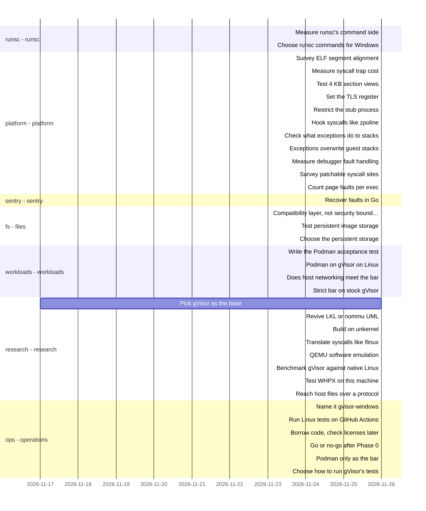

<!-- Generated by build.py from roadmap/nodes.yaml. Do not edit. -->

# Timeline

[Back to the page](../roadmap.md)

Generated on 2026-11-26. Open bars end on that date.

<!-- BEGIN GENERATED: timeline -->

Not shown (no `start`): `runsc-container-on-windows`, `runsc-sandbox-lifecycle`, `platform-stub-controller`, `platform-page-verification`, `platform-syscall-fast-path`, `platform-own-vdso`, `platform-64k-mapping-conflicts`, `platform-winstub`, `platform-busybox-on-windows`, `platform-hardware-acceleration`, `platform-fs-base-repair`, `platform-no-fsgsbase-fallback`, `platform-static-guest-from-memory`, `sentry-windows-build`, `sentry-memory-file-sections`, `sentry-event-loop-iocp`, `sentry-timers-and-clocks`, `sentry-fault-recovery`, `sentry-host-stdio-and-tty`, `sentry-threads-and-signals`, `sentry-unix-shim`, `fs-windows-directfs`, `fs-change-notifications`, `fs-linux-metadata-on-ntfs`, `fs-handles-do-not-block-users`, `fs-root-filesystem-source`, `fs-persistent-storage-impl`, `net-netstack-windows-link`, `net-port-forwarding`, `net-bridge-networking`, `workloads-podman-on-windows`, `workloads-acceptance-test-windows`, `workloads-podman-harness`, `workloads-gvisor-bridge-netlink`, `workloads-gvisor-port-publishing`, `ops-windows-ci-standard-user`, `ops-syscall-tests-on-windows`, `ops-upstream-merges`, `ops-portable-packaging`
<!-- END GENERATED: timeline -->
