<!-- Generated by build.py from roadmap/nodes.yaml. Do not edit. -->

# Timeline

[Back to the page](../roadmap.md)

Generated on 2026-11-28. Open bars end on that date.

```mermaid
gantt
    dateFormat YYYY-MM-DD
    axisFormat %Y-%m-%d
    section runsc - runsc
    Run a container with runsc :runsc_container_on_windows, 2026-11-26, 2026-11-26
    Measure runsc's command side :runsc_measure_cli, 2026-11-26, 2026-11-26
    Choose runsc commands for Windows :runsc_windows_commands, 2026-11-26, 2026-11-26
    Start and stop sandboxes on Windows :runsc_sandbox_lifecycle, 2026-11-27, 2026-11-27
    Boot runsc on Windows :runsc_windows_boot, 2026-11-26, 2026-11-26
    Container lifecycle commands on Windows :runsc_windows_lifecycle_commands, 2026-11-27, 2026-11-27
    section platform - platform
    Survey ELF segment alignment :platform_elf_alignment_survey, 2026-11-26, 2026-11-26
    Measure syscall trap cost :platform_trap_cost, 2026-11-26, 2026-11-26
    Test 4 KB section views :platform_4k_section_views, 2026-11-26, 2026-11-26
    Set the TLS register :platform_tls_register, 2026-11-26, 2026-11-26
    Restrict the stub process :platform_restricted_stub, 2026-11-26, 2026-11-26
    Stub and controller prototype :platform_stub_controller, 2026-11-26, 2026-11-26
    Scan code pages for syscalls :platform_page_verification, 2026-11-26, 2026-11-26
    Patch syscall sites into jumps :platform_syscall_fast_path, 2026-11-26, 2026-11-26
    Own vDSO for clock calls :platform_own_vdso, 2026-11-27, 2026-11-27
    Windows platform for the Sentry :platform_winstub, 2026-11-26, 2026-11-26
    Run busybox under the Sentry :platform_busybox_on_windows, 2026-11-26, 2026-11-26
    Hook syscalls like zpoline :crit, platform_zpoline_hooks, 2026-11-26, 2026-11-26
    Restore the TLS register after switches :platform_fs_base_repair, 2026-11-26, 2026-11-26
    Support CPUs without FSGSBASE :platform_no_fsgsbase_fallback, 2026-11-27, 2026-11-27
    Check what exceptions do to stacks :platform_exception_stack, 2026-11-26, 2026-11-26
    Run a static guest from memory :platform_static_guest_from_memory, 2026-11-26, 2026-11-26
    Exceptions overwrite guest stacks :platform_veh_on_guest_stack_unsafe, 2026-11-26, 2026-11-26
    Measure debugger fault handling :platform_debug_event_cost, 2026-11-26, 2026-11-26
    Survey patchable syscall sites :platform_syscall_site_survey, 2026-11-26, 2026-11-26
    Count page faults per exec :platform_faults_per_exec, 2026-11-26, 2026-11-26
    Controller waits without busy polling :platform_controller_wakeups, 2026-11-26, 2026-11-26
    Save and restore FPU and SSE state :platform_fp_state, 2026-11-26, 2026-11-26
    Retire the stub prototype :platform_retire_prototype, 2026-11-26, 2026-11-26
    Give freed guest memory back :platform_memory_release, 2026-11-26, 2026-11-26
    Start guest processes fast :platform_fast_process_start, 2026-11-26, 2026-11-26
    Syscalls split across mappings :platform_split_syscall_unpatched, 2026-11-26, 2026-11-27
    Map files not in the memory file :platform_map_files_without_sections, 2026-11-26, 2026-11-26
    Veneer addresses differ after clone :platform_veneer_address_in_child, 2026-11-27, 2026-11-27
    Rare hang under heavy exec load :platform_rare_hang_under_exec_load, 2026-11-27, 2026-11-27
    Unsupported platform calls return errnos :platform_unsupported_errno, 2026-11-27, 2026-11-27
    Reuse stub processes across exec :platform_recycle_stubs, 2026-11-27, 2026-11-27
    AVX-512 state lost across stops :platform_avx512_state_lost, 2026-11-27, 2026-11-27
    glibc runs AVX code on a non-AVX CPU :platform_avx_on_non_avx_cpu, 2026-11-27, 2026-11-27
    More room for %fs veneers :platform_fs_veneer_capacity, 2026-11-27, 2026-11-27
    Podman engine stalls in rewrite mode :platform_rewrite_mode_slow_engine, 2026-11-27, 2026-11-27
    Static glibc crashes at start in rewrit… :platform_rewrite_glibc_init_crash, 2026-11-27, 2026-11-27
    Unrewritten %fs site in a library :platform_unrewritten_fs_in_library, 2026-11-27, 2026-11-27
    glibc heap errors in rewrite mode :platform_rewrite_heap_corruption, 2026-11-27, 2026-11-27
    Measure exception stack use :platform_exception_dispatch_depth, 2026-11-27, 2026-11-27
    Thread resumed inside a patch window :platform_resume_inside_fs_window, 2026-11-27, 2026-11-27
    Fault reported under a patch jump :platform_fault_under_fs_jump, 2026-11-27, 2026-11-27
    Patched-text cache for PIE programs :platform_text_cache_pie, 2026-11-28, 2026-11-28
    section sentry - sentry
    Recover faults in Go :sentry_go_fault_recovery, 2026-11-26, 2026-11-26
    Sentry builds for Windows :sentry_windows_build, 2026-11-26, 2026-11-26
    Guest memory on Windows sections :sentry_memory_file_sections, 2026-11-26, 2026-11-26
    Timers and clocks on Windows :sentry_timers_and_clocks, 2026-11-27, 2026-11-27
    Port fault recovery to Windows :sentry_fault_recovery, 2026-11-26, 2026-11-26
    Guest terminal and stdio :sentry_host_stdio_and_tty, 2026-11-26, 2026-11-26
    Guest threads and signals :sentry_threads_and_signals, 2026-11-26, 2026-11-26
    Make Linux names resolve on Windows :sentry_unix_shim, 2026-11-26, 2026-11-26
    Dynamic programs, exec and pipes :sentry_dynamic_elf_and_exec, 2026-11-26, 2026-11-26
    Profile the slow file and exec path :sentry_profile_small_file_path, 2026-11-27, 2026-11-27
    Sentry stalls after many socket tests :sentry_netpoll_failure, 2026-11-27, 2026-11-27
    fchmod on a standard stream fails :sentry_fchmod_std_stream, 2026-11-27, 2026-11-27
    pasta networking inside the sandbox :sentry_pasta_in_sandbox, 2026-11-27, 2026-11-27
    One-off negative WaitGroup panic :sentry_waitgroup_panic, 2026-11-27, 2026-11-28
    Rare long epoll timeout overshoot :sentry_epoll_timeout_overshoot, 2026-11-27, 2026-11-28
    section fs - files
    Compatibility layer, not security bound… :fs_compat_layer_not_boundary, 2026-11-26, 2026-11-26
    Test persistent image storage :fs_persistent_image_storage, 2026-11-26, 2026-11-26
    Open Windows files directly :fs_windows_directfs, 2026-11-26, 2026-11-26
    Windows changes reach the guest :fs_change_notifications, 2026-11-26, 2026-11-26
    Linux file metadata on NTFS :fs_linux_metadata_on_ntfs, 2026-11-26, 2026-11-26
    Files stay editable on Windows :fs_handles_do_not_block_users, 2026-11-26, 2026-11-26
    Choose the persistent storage :fs_persistent_storage_choice, 2026-11-26, 2026-11-26
    Root filesystem from an erofs image :fs_root_filesystem_source, 2026-11-26, 2026-11-26
    Storage that survives restarts :fs_persistent_storage_impl, 2026-11-27, 2026-11-27
    Editor safe-saves keep Linux metadata :fs_safe_save_keeps_metadata, 2026-11-26, 2026-11-26
    Bring container images onto NTFS :fs_rootfs_import, 2026-11-26, 2026-11-26
    Faster stat walks on host folders :fs_attribute_cache, 2026-11-26, 2026-11-26
    Flaky negative-cache test on host folde… :fs_flaky_negative_cache_test, 2026-11-26, 2026-11-27
    Deletes fail for standard users :fs_standard_user_delete_rights, 2026-11-26, 2026-11-26
    Case-sensitive names without admin :fs_case_sensitivity_without_admin, 2026-11-26, 2026-11-27
    Unix sockets on host folders :fs_unix_sockets_on_host_folders, 2026-11-27, 2026-11-27
    Copied library reads as too short :fs_copied_file_too_short, 2026-11-27, 2026-11-27
    Nil dereference in gofer invalidation :fs_disown_children_nil_deref, 2026-11-27, 2026-11-27
    Host-folder writes keep the old mtime :fs_host_folder_mtime_resolution, 2026-11-27, 2026-11-27
    Layer store unreadable after restart :fs_layer_store_corrupt_after_restart, 2026-11-27, 2026-11-27
    Overlay with a host-folder upper layer :fs_overlay_upper_on_host_folder, 2026-11-27, 2026-11-27
    Fast layer diffs with overlay :fs_overlay_native_diff, 2026-11-27, 2026-11-27
    Empty file read during a replace :fs_layers_empty_on_slow_host, 2026-11-27, 2026-11-27
    section net - network
    Netstack to Windows sockets :net_netstack_windows_link, 2026-11-26, 2026-11-26
    Publish guest ports on localhost :net_port_forwarding, 2026-11-26, 2026-11-26
    Bridge networking inside gVisor :net_bridge_networking, 2026-11-26, 2026-11-26
    Make nftables safe for concurrent use :net_nftables_thread_safety, 2026-11-26, 2026-11-26
    section workloads - workloads
    Write the Podman acceptance test :workloads_acceptance_test, 2026-11-26, 2026-11-26
    Podman on gVisor on Linux :workloads_podman_on_gvisor_linux, 2026-11-26, 2026-11-26
    Podman passes on Windows :workloads_podman_on_windows, 2026-11-27, 2026-11-27
    Acceptance test for Windows :workloads_acceptance_test_windows, 2026-11-26, 2026-11-26
    Serve Podman to Windows clients :workloads_podman_harness, 2026-11-26, 2026-11-27
    Bridge networking fails in gVisor :workloads_gvisor_bridge_netlink, 2026-11-26, 2026-11-26
    Port publishing untested in gVisor :workloads_gvisor_port_publishing, 2026-11-26, 2026-11-26
    Does host networking meet the bar :workloads_bar_host_network, 2026-11-26, 2026-11-26
    Strict bar on stock gVisor :workloads_strict_bar_linux, 2026-11-26, 2026-11-26
    Cgroup filesystem mounted read-only :workloads_gvisor_cgroupfs_readonly, 2026-11-26, 2026-11-26
    Podman API on a named pipe :workloads_podman_api_named_pipe, 2026-11-26, 2026-11-26
    Probe Podman inside the sandbox :workloads_podman_probe, 2026-11-26, 2026-11-26
    Measure end-to-end speed on Windows :workloads_end_to_end_speed, 2026-11-27, 2026-11-27
    conmon sees no data on its sync pipe :workloads_conmon_sync_pipe, 2026-11-26, 2026-11-27
    Overlay mounts with userxattr rejected :workloads_overlay_userxattr, 2026-11-26, 2026-11-27
    Second attach-socket failure :workloads_conmon_attach_second_cause, 2026-11-27, 2026-11-27
    Interactive TTY through the Windows cli… :workloads_tty_through_windows_client, 2026-11-27, 2026-11-27
    Isolation step failed once :workloads_isolation_flake, 2026-11-27, 2026-11-27
    Volume data lost across engine restart :workloads_volume_lost_on_restart, 2026-11-27, 2026-11-27
    buildah picks rootless isolation :workloads_buildah_thinks_rootless, 2026-11-27, 2026-11-27
    Rare permission error opening the null… :workloads_dev_null_eacces, 2026-11-27, 2026-11-27
    Podman on CPUs without FSGSBASE :workloads_podman_without_fsgsbase, 2026-11-27, 2026-11-27
    Podman client over the named pipe :workloads_podman_client_on_pipe, 2026-11-28, 2026-11-28
    section research - research
    Pick gVisor as the base :research_gvisor_base, 2026-11-17, 2026-11-26
    Revive LKL or nommu UML :crit, research_lkl_nommu, 2026-11-26, 2026-11-26
    Build on unkernel :crit, research_unkernel, 2026-11-26, 2026-11-26
    Translate syscalls like flinux :crit, research_flinux_translation, 2026-11-26, 2026-11-26
    QEMU software emulation :crit, research_qemu_emulation, 2026-11-26, 2026-11-26
    Benchmark gVisor against native Linux :research_gvisor_benchmark, 2026-11-26, 2026-11-26
    Test WHPX on this machine :crit, research_whpx_this_machine, 2026-11-26, 2026-11-26
    Reach host files over a protocol :crit, research_file_protocol, 2026-11-26, 2026-11-26
    section ops - operations
    Name it gvisor-windows :ops_name_and_fork, 2026-11-26, 2026-11-26
    Run Linux tests on GitHub Actions :ops_linux_tests_on_actions, 2026-11-26, 2026-11-26
    Borrow code, check licenses later :ops_borrow_code, 2026-11-26, 2026-11-26
    Go or no-go after Phase 0 :ops_phase0_go_no_go, 2026-11-26, 2026-11-26
    Podman only as the bar :ops_podman_only_the_bar, 2026-11-26, 2026-11-26
    Windows CI as a standard user :ops_windows_ci_standard_user, 2026-11-26, 2026-11-26
    Choose how to run gVisor's tests :ops_syscall_test_strategy, 2026-11-26, 2026-11-26
    gVisor syscall tests on Windows :ops_syscall_tests_on_windows, 2026-11-26, 2026-11-27
    Merge upstream gVisor regularly :ops_upstream_merges, 2026-11-27, 2026-11-27
    Portable zip, no installer :ops_portable_packaging, 2026-11-27, 2026-11-27
    Build once, run suites on demand :ops_ci_build_once, 2026-11-27, 2026-11-27
    Podman on the development VM :ops_podman_on_the_dev_vm, 2026-11-27, 2026-11-28
```

<!-- BEGIN GENERATED: timeline -->

Not shown (no `start`): `platform-64k-mapping-conflicts`, `platform-hardware-acceleration`, `platform-binary-translation-fallback`, `sentry-event-loop-iocp`, `ops-run-on-a-work-machine`
<!-- END GENERATED: timeline -->
