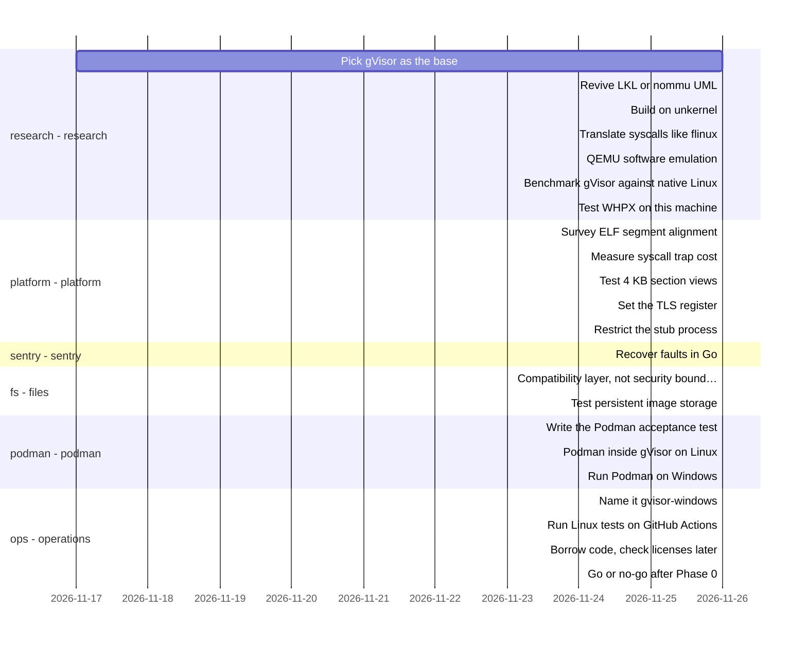

<!-- Generated by build.py from roadmap/nodes.yaml. Do not edit. -->

# Timeline

[Back to the page](../roadmap.md)

Generated on 2026-11-26. Open bars end on that date.

<!-- BEGIN GENERATED: timeline -->

<!-- END GENERATED: timeline -->
