<!-- Generated by build.py from roadmap/nodes.yaml. Do not edit. -->

# Timeline

[Back to the page](../roadmap.md)

Generated on 2026-11-26. Open bars end on that date.

```mermaid
gantt
    dateFormat YYYY-MM-DD
    axisFormat %Y-%m-%d
    section runsc - runsc
    Measure runsc's command side :runsc_measure_cli, 2026-11-26, 2026-11-26
    Choose runsc commands for Windows :runsc_windows_commands, 2026-11-26, 2026-11-26
    Boot runsc on Windows :active, runsc_windows_boot, 2026-11-26, 2026-11-26
    section platform - platform
    Survey ELF segment alignment :platform_elf_alignment_survey, 2026-11-26, 2026-11-26
    Measure syscall trap cost :platform_trap_cost, 2026-11-26, 2026-11-26
    Test 4 KB section views :platform_4k_section_views, 2026-11-26, 2026-11-26
    Set the TLS register :platform_tls_register, 2026-11-26, 2026-11-26
    Restrict the stub process :platform_restricted_stub, 2026-11-26, 2026-11-26
    Stub and controller prototype :platform_stub_controller, 2026-11-26, 2026-11-26
    Scan code pages for syscalls :platform_page_verification, 2026-11-26, 2026-11-26
    Patch syscall sites into jumps :platform_syscall_fast_path, 2026-11-26, 2026-11-26
    Windows platform for the Sentry :platform_winstub, 2026-11-26, 2026-11-26
    Hook syscalls like zpoline :crit, platform_zpoline_hooks, 2026-11-26, 2026-11-26
    Restore the TLS register after switches :platform_fs_base_repair, 2026-11-26, 2026-11-26
    Check what exceptions do to stacks :platform_exception_stack, 2026-11-26, 2026-11-26
    Run a static guest from memory :platform_static_guest_from_memory, 2026-11-26, 2026-11-26
    Exceptions overwrite guest stacks :platform_veh_on_guest_stack_unsafe, 2026-11-26, 2026-11-26
    Measure debugger fault handling :platform_debug_event_cost, 2026-11-26, 2026-11-26
    Survey patchable syscall sites :platform_syscall_site_survey, 2026-11-26, 2026-11-26
    Count page faults per exec :platform_faults_per_exec, 2026-11-26, 2026-11-26
    Controller waits without busy polling :platform_controller_wakeups, 2026-11-26, 2026-11-26
    Save and restore FPU and SSE state :platform_fp_state, 2026-11-26, 2026-11-26
    Retire the stub prototype :platform_retire_prototype, 2026-11-26, 2026-11-26
    Give freed guest memory back :active, platform_memory_release, 2026-11-26, 2026-11-26
    Start guest processes fast :platform_fast_process_start, 2026-11-26, 2026-11-26
    Syscalls split across mappings :platform_split_syscall_unpatched, 2026-11-26, 2026-11-26
    section sentry - sentry
    Recover faults in Go :sentry_go_fault_recovery, 2026-11-26, 2026-11-26
    Sentry builds for Windows :sentry_windows_build, 2026-11-26, 2026-11-26
    Guest memory on Windows sections :sentry_memory_file_sections, 2026-11-26, 2026-11-26
    Port fault recovery to Windows :sentry_fault_recovery, 2026-11-26, 2026-11-26
    Guest terminal and stdio :active, sentry_host_stdio_and_tty, 2026-11-26, 2026-11-26
    Guest threads and signals :sentry_threads_and_signals, 2026-11-26, 2026-11-26
    Make Linux names resolve on Windows :sentry_unix_shim, 2026-11-26, 2026-11-26
    Dynamic programs, exec and pipes :sentry_dynamic_elf_and_exec, 2026-11-26, 2026-11-26
    section fs - files
    Compatibility layer, not security bound… :fs_compat_layer_not_boundary, 2026-11-26, 2026-11-26
    Test persistent image storage :fs_persistent_image_storage, 2026-11-26, 2026-11-26
    Open Windows files directly :fs_windows_directfs, 2026-11-26, 2026-11-26
    Windows changes reach the guest :fs_change_notifications, 2026-11-26, 2026-11-26
    Linux file metadata on NTFS :fs_linux_metadata_on_ntfs, 2026-11-26, 2026-11-26
    Files stay editable on Windows :fs_handles_do_not_block_users, 2026-11-26, 2026-11-26
    Choose the persistent storage :fs_persistent_storage_choice, 2026-11-26, 2026-11-26
    Root filesystem from an erofs image :fs_root_filesystem_source, 2026-11-26, 2026-11-26
    Editor safe-saves keep Linux metadata :fs_safe_save_keeps_metadata, 2026-11-26, 2026-11-26
    Bring container images onto NTFS :fs_rootfs_import, 2026-11-26, 2026-11-26
    Faster stat walks on host folders :fs_attribute_cache, 2026-11-26, 2026-11-26
    section net - network
    Netstack to Windows sockets :net_netstack_windows_link, 2026-11-26, 2026-11-26
    Publish guest ports on localhost :net_port_forwarding, 2026-11-26, 2026-11-26
    Bridge networking inside gVisor :net_bridge_networking, 2026-11-26, 2026-11-26
    Make nftables safe for concurrent use :net_nftables_thread_safety, 2026-11-26, 2026-11-26
    section workloads - workloads
    Write the Podman acceptance test :workloads_acceptance_test, 2026-11-26, 2026-11-26
    Podman on gVisor on Linux :workloads_podman_on_gvisor_linux, 2026-11-26, 2026-11-26
    Bridge networking fails in gVisor :workloads_gvisor_bridge_netlink, 2026-11-26, 2026-11-26
    Port publishing untested in gVisor :workloads_gvisor_port_publishing, 2026-11-26, 2026-11-26
    Does host networking meet the bar :workloads_bar_host_network, 2026-11-26, 2026-11-26
    Strict bar on stock gVisor :workloads_strict_bar_linux, 2026-11-26, 2026-11-26
    Cgroup filesystem mounted read-only :workloads_gvisor_cgroupfs_readonly, 2026-11-26, 2026-11-26
    section research - research
    Pick gVisor as the base :research_gvisor_base, 2026-11-17, 2026-11-26
    Revive LKL or nommu UML :crit, research_lkl_nommu, 2026-11-26, 2026-11-26
    Build on unkernel :crit, research_unkernel, 2026-11-26, 2026-11-26
    Translate syscalls like flinux :crit, research_flinux_translation, 2026-11-26, 2026-11-26
    QEMU software emulation :crit, research_qemu_emulation, 2026-11-26, 2026-11-26
    Benchmark gVisor against native Linux :research_gvisor_benchmark, 2026-11-26, 2026-11-26
    Test WHPX on this machine :crit, research_whpx_this_machine, 2026-11-26, 2026-11-26
    Reach host files over a protocol :crit, research_file_protocol, 2026-11-26, 2026-11-26
    section ops - operations
    Name it gvisor-windows :ops_name_and_fork, 2026-11-26, 2026-11-26
    Run Linux tests on GitHub Actions :ops_linux_tests_on_actions, 2026-11-26, 2026-11-26
    Borrow code, check licenses later :ops_borrow_code, 2026-11-26, 2026-11-26
    Go or no-go after Phase 0 :ops_phase0_go_no_go, 2026-11-26, 2026-11-26
    Podman only as the bar :ops_podman_only_the_bar, 2026-11-26, 2026-11-26
    Windows CI as a standard user :ops_windows_ci_standard_user, 2026-11-26, 2026-11-26
    Choose how to run gVisor's tests :ops_syscall_test_strategy, 2026-11-26, 2026-11-26
    gVisor syscall tests on Windows :active, ops_syscall_tests_on_windows, 2026-11-26, 2026-11-26
```

<!-- BEGIN GENERATED: timeline -->

Not shown (no `start`): `runsc-container-on-windows`, `runsc-sandbox-lifecycle`, `platform-own-vdso`, `platform-64k-mapping-conflicts`, `platform-busybox-on-windows`, `platform-hardware-acceleration`, `platform-no-fsgsbase-fallback`, `platform-binary-translation-fallback`, `sentry-event-loop-iocp`, `sentry-timers-and-clocks`, `fs-persistent-storage-impl`, `workloads-podman-on-windows`, `workloads-acceptance-test-windows`, `workloads-podman-harness`, `workloads-podman-api-named-pipe`, `workloads-podman-probe`, `ops-upstream-merges`, `ops-portable-packaging`
<!-- END GENERATED: timeline -->
