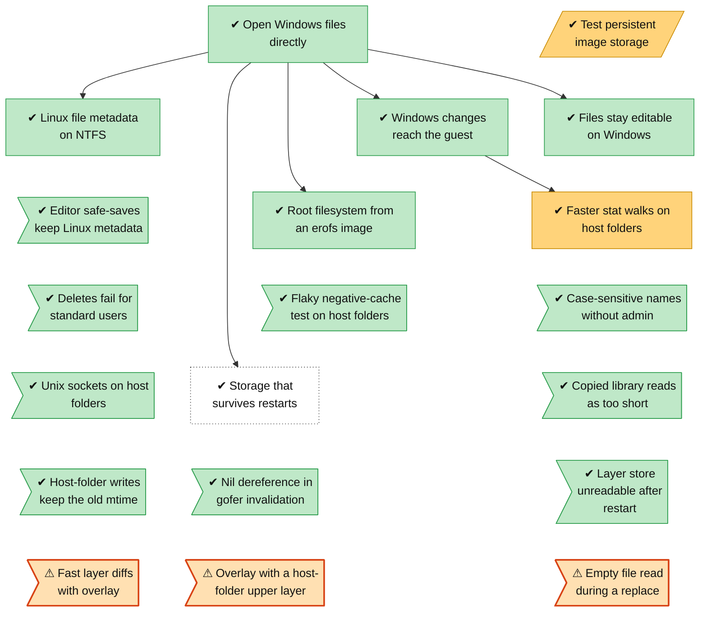

<!-- Generated by build.py from roadmap/nodes.yaml. Do not edit. -->

# fs - files

Scope: host files, bind mounts, image storage.

[Back to the page](../../roadmap.md) · [legend](../../roadmap.md#legend)

<!-- BEGIN GENERATED: track-fs -->

<!-- END GENERATED: track-fs -->

## Node table

<!-- BEGIN GENERATED: table-fs -->
| id | title | kind | lane | state | outcome | start | end | depends_on | replaced_by | qualified_by | headline | evidence |
|---|---|---|---|---|---|---|---|---|---|---|---|---|
| `fs-compat-layer-not-boundary` | Compatibility layer, not security boundary | owner-decision | owner | done | n/a | 2026-11-26 | 2026-11-26 |  |  |  |  | docs/adr/0005-host-files-accessed-directly.md |
| `fs-persistent-image-storage` | Test persistent image storage | experiment | linux-ci | done | mixed | 2026-11-26 | 2026-11-26 | workloads-podman-on-gvisor-linux |  |  | 3.7 s with overlay | docs/results/0a-linux.md |
| `fs-windows-directfs` | Open Windows files directly | feature | windows-ci | done | successful | 2026-11-26 | 2026-11-26 | sentry-windows-build, fs-compat-layer-not-boundary |  |  |  | docs/results/2-windows-directfs.md |
| `fs-change-notifications` | Windows changes reach the guest | feature | windows-ci | done | successful | 2026-11-26 | 2026-11-26 | fs-windows-directfs |  |  |  | docs/results/2b-fs-rootfs-and-changes.md |
| `fs-linux-metadata-on-ntfs` | Linux file metadata on NTFS | feature | windows-ci | done | successful | 2026-11-26 | 2026-11-26 | fs-windows-directfs |  |  |  | docs/results/2-windows-directfs.md |
| `fs-handles-do-not-block-users` | Files stay editable on Windows | feature | windows-ci | done | successful | 2026-11-26 | 2026-11-26 | fs-windows-directfs |  |  |  | docs/results/2-windows-directfs.md |
| `fs-persistent-storage-choice` | Choose the persistent storage | owner-decision | owner | done | n/a | 2026-11-26 | 2026-11-26 | fs-persistent-image-storage, fs-windows-directfs |  |  |  | docs/adr/0007-persistent-storage-in-a-windows-folder.md |
| `fs-root-filesystem-source` | Root filesystem from an erofs image | feature | windows-ci | done | successful | 2026-11-26 | 2026-11-26 | fs-windows-directfs, fs-rootfs-import |  |  |  | docs/results/2b-fs-rootfs-and-changes.md; docs/adr/0015-sandbox-rootfs-as-erofs-image.md |
| `fs-persistent-storage-impl` | Storage that survives restarts | feature | windows-ci | done | unrated | 2026-11-27 | 2026-11-27 | fs-persistent-storage-choice |  |  |  | docs/results/5-podman-windows.md |
| `fs-safe-save-keeps-metadata` | Editor safe-saves keep Linux metadata | defect | windows-ci | done | unrated | 2026-11-26 | 2026-11-26 |  |  |  |  | docs/results/2b-fs-rootfs-and-changes.md |
| `fs-rootfs-import` | Bring container images onto NTFS | owner-decision | owner | done | n/a | 2026-11-26 | 2026-11-26 |  |  |  |  | docs/adr/0015-sandbox-rootfs-as-erofs-image.md |
| `fs-attribute-cache` | Faster stat walks on host folders | feature | windows-ci | done | mixed | 2026-11-26 | 2026-11-26 | fs-change-notifications |  |  | 1 us per file | docs/results/2c-fs-speed.md |
| `fs-flaky-negative-cache-test` | Flaky negative-cache test on host folders | defect | windows-ci | done | unrated | 2026-11-26 | 2026-11-27 |  |  |  |  | docs/results/1g-platform-memory.md |
| `fs-standard-user-delete-rights` | Deletes fail for standard users | defect | windows-ci | done | unrated | 2026-11-26 | 2026-11-26 |  |  |  |  | docs/results/5-podman-windows.md; docs/results/2c-fs-speed.md |
| `fs-case-sensitivity-without-admin` | Case-sensitive names without admin | defect | windows-ci | done | unrated | 2026-11-26 | 2026-11-27 |  |  |  |  | docs/results/5-podman-windows.md; docs/results/2-windows-directfs.md |
| `fs-unix-sockets-on-host-folders` | Unix sockets on host folders | defect | windows-ci | done | unrated | 2026-11-27 | 2026-11-27 |  |  |  |  | docs/results/5-podman-windows.md |
| `fs-copied-file-too-short` | Copied library reads as too short | defect | windows-ci | done | unrated | 2026-11-27 | 2026-11-27 |  |  |  |  | docs/results/5-podman-windows.md |
| `fs-disown-children-nil-deref` | Nil dereference in gofer invalidation | defect | windows-ci | done | unrated | 2026-11-27 | 2026-11-27 |  |  |  |  | docs/results/1k-platform-next.md |
| `fs-host-folder-mtime-resolution` | Host-folder writes keep the old mtime | defect | windows-ci | done | unrated | 2026-11-27 | 2026-11-27 |  |  |  |  | docs/results/5-podman-windows.md |
| `fs-layer-store-corrupt-after-restart` | Layer store unreadable after restart | defect | windows-ci | done | unrated | 2026-11-27 | 2026-11-27 |  |  |  |  | docs/results/5-podman-windows.md |
| `fs-overlay-upper-on-host-folder` | Overlay with a host-folder upper layer | defect | windows-ci | in-progress | unrated | 2026-11-27 |  |  |  |  |  | docs/adr/0002-what-done-means.md; docs/results/2r-step5-overlay.md |
| `fs-overlay-native-diff` | Fast layer diffs with overlay | defect | windows-ci | next | unrated | 2026-11-27 |  |  |  |  |  | docs/results/2r-step5-overlay.md |
| `fs-layers-empty-on-slow-host` | Empty file read during a replace | defect | windows-local | next | unrated | 2026-11-27 |  |  |  |  |  | docs/results/1p-rewrite-heap.md |

### Details per node

| id | title | verdict | headline | in plain words | notes | confirmed | waiting on | queue order | order reason |
|---|---|---|---|---|---|---|---|---|---|
| `fs-compat-layer-not-boundary` | Compatibility layer, not security boundary |  |  | The sandbox may open the user's files directly with the user's rights; it isolates containers from each other, not from the user. |  |  |  |  |  |
| `fs-persistent-image-storage` | Test persistent image storage | Podman's image store on a gofer-mounted host directory works for pull, build and run and survives a sandbox restart (python:3-slim pull 3.7 s with overlay, 7.2 s with vfs, against 1.7 s natively; a 3000-file build 5.2 s against 1.7 s natively), while the in-sandbox tmpfs is faster but lost on restar | 3.7 s with overlay | Find a writable filesystem inside the sandbox that survives a restart, and how fast each option is. | Done when: pull/build timings on tmpfs and on a host directory, and the overlay restart test, are in docs/results/0a-linux.md. |  |  |  |  |
| `fs-windows-directfs` | Open Windows files directly | a Windows folder is served to the Sentry as a Linux filesystem with no gofer, by file ID through short-lived share-all handles with Linux metadata in an NTFS stream |  | The Sentry opens NTFS files itself for bind mounts, with its own caches, instead of going through a file protocol. | Done when: the gofer's Windows backend implements open, create, readdir, stat, rename, unlink, link, symlink and xattr calls; a Linux guest edits a Windows folder correctly. |  |  |  |  |
| `fs-change-notifications` | Windows changes reach the guest | host folders now pick up Windows changes within milliseconds |  | Edits made on Windows invalidate the Sentry's caches and arrive in the guest as inotify events. | Done when: a file changed in Explorer is visible in the guest within one second and fires an inotify event. |  |  |  |  |
| `fs-linux-metadata-on-ntfs` | Linux file metadata on NTFS | a Windows folder is served to the Sentry as a Linux filesystem with no gofer, by file ID through short-lived share-all handles with Linux metadata in an NTFS stream |  | Owner, mode bits, symlinks and special files survive on NTFS, using a fixed owner and alternate data streams. | Done when: chmod, chown, symlink and mknod round-trip through a Windows folder. |  |  |  |  |
| `fs-handles-do-not-block-users` | Files stay editable on Windows | a Windows folder is served to the Sentry as a Linux filesystem with no gofer, by file ID through short-lived share-all handles with Linux metadata in an NTFS stream |  | The Sentry holds Windows file handles only briefly, so editors and git can still rename and delete files. | Done when: git checkout and an editor save on Windows succeed while a guest has the folder open. |  |  |  |  |
| `fs-persistent-storage-choice` | Choose the persistent storage |  |  | Decided: persistent data lives as real files in a Windows folder, with Linux metadata in an NTFS stream. | Done when: an ADR records the choice with the measurements from Phase 0. |  |  |  |  |
| `fs-root-filesystem-source` | Root filesystem from an erofs image | a read-only erofs image built from OCI images (alpine, podman) mounts on Windows under a memory overlay in under 40 ms with every type, mode, owner, device node, hard link and symlink correct |  | The guest's root filesystem comes from an unpacked OCI bundle directory on Windows. | Done as a library (pkg/sentry/fsimpl/rootfs); wiring into runsc boot belongs to Boot runsc on Windows. |  |  |  |  |
| `fs-persistent-storage-impl` | Storage that survives restarts |  |  | Implement the chosen writable filesystem so data inside the sandbox outlives a restart. | Image layers and volumes live on a Windows folder through the host-folder backend; acceptance step 9 (restart) passes 8 of 8. |  |  |  |  |
| `fs-safe-save-keeps-metadata` | Editor safe-saves keep Linux metadata |  |  | An editor's safe-save replaces the file, which drops its metadata stream, so the guest falls back to the mount defaults for mode and owner. | Fixed for the running sandbox (metadata remembered per name in memory); replacements while no sandbox runs still lose it. |  |  |  |  |
| `fs-rootfs-import` | Bring container images onto NTFS |  |  | Decided: the sandbox root is a read-only erofs image with an overlay on top; persistent data such as Podman storage lives in Windows folders. | Done when: an ADR records the choice, after reading how gVisor opens erofs images and which mode a file without a metadata stream reports. |  |  |  |  |
| `fs-attribute-cache` | Faster stat walks on host folders | a watched host folder now answers a repeated stat walk of 20000 files from cache at 1 us per file (native 22-30 us) | 1 us per file | A git-status-like walk of 20000 files takes 1.2-2.4 s through the host folder; an attribute cache fed by the change watcher would bring stat near native. | Done when: a 20000-file stat walk through the backend is within 2x of native on windows-latest. |  |  |  |  |
| `fs-flaky-negative-cache-test` | Flaky negative-cache test on host folders |  |  | TestVFSNegativeCacheAndQuickChange failed once on windows-fs after passing on the previous head; a timing race in the change watcher or the test. | Fixed when: the test passes 20 runs in a row on windows-latest. |  |  |  |  |
| `fs-standard-user-delete-rights` | Deletes fail for standard users |  |  | On a host folder as a standard Windows user, rename over an existing file, rmdir and unlink fail with permission denied; Podman cannot extract layers or write images.json. | Fixed: Unlink asked for FILE_DELETE_CHILD on the parent, which a standard user with Modify lacks; DELETE on the child is enough. hostfs test now required. |  |  |  |  |
| `fs-case-sensitivity-without-admin` | Case-sensitive names without admin |  |  | A standard user on the hosted runner cannot set per-directory case sensitivity (access denied), so Linux images with names differing only in case need another way, without an admin setup step. | Fixed: the backend grants the current user FILE_DELETE_CHILD on that one directory when the call is refused; the Podman workflow no longer has an admin step. |  |  |  |  |
| `fs-unix-sockets-on-host-folders` | Unix sockets on host folders |  |  | Binding a Unix socket on a Windows folder and connecting to it (by path or via /proc/self/fd) is refused, so Podman cannot reach conmon's attach socket. | Fixed: bind on a host folder now creates the in-Sentry synthetic socket dentry, as on tmpfs; sockfs check required. |  |  |  |  |
| `fs-copied-file-too-short` | Copied library reads as too short |  |  | "libc.so.6: file too short" in podman build was an unpatched read syscall at a MapFile seam in Debian ld.so; a gofer change fills whole executable VMAs, which fixes bind mounts; from the root folder it still needs the platform seam fix. apt renames on the storage folder still fail intermittently. Latest: dpkg cannot stat the archive apt just moved under /tmp/apt-dpkg-install-*. The root-folder loader case is fixed by the platform (padding before __read_nocancel). | Fixed: step 5 passes 8 of 8; renames that replace a file no longer fall back to delete-then-rename (a by-ID pin blocked NTFS replace). |  |  |  |  |
| `fs-disown-children-nil-deref` | Nil dereference in gofer invalidation |  |  | The Sentry panics with a nil dereference in gofer dentry.disownAllChildrenForInvalidation during the bench test in rewrite-mode CI legs. | Fixed: negative (nil) child entries are skipped during invalidation; bench passed 29 of 30 legs, the miss was the stuck-stub hang. |  |  |  |  |
| `fs-host-folder-mtime-resolution` | Host-folder writes keep the old mtime |  |  | On host folders 45-60% of consecutive writes report the same mtime as the previous one (tmpfs: none), which can hide changes from tools that compare mtimes. | Fixed: the Sentry records the time of each guest write and reports max(host, last write); 0 repeated mtimes over 20000 writes. |  |  |  |  |
| `fs-layer-store-corrupt-after-restart` | Layer store unreadable after restart |  |  | After a failed apt build, a layer directory (.../var/cache/apt/archives) cannot be removed ("directory not empty") although the Sentry lists it as empty; c/storage retries that removal on every load and fails the whole store, so steps 9-10 fail after the restart. | Fixed with atomic replace of layers.json/images.json (pins switch to by-name handles at replace time) and the graceful engine stop. |  |  |  |  |
| `fs-overlay-upper-on-host-folder` | Overlay with a host-folder upper layer |  |  | Podman uses the slow vfs storage driver because native overlay with its upper layer on a Windows folder fails c/storage's probe: removing a directory in the merged view returns "directory not empty". | Cause fixed: device nodes came back as DT_UNKNOWN, hiding whiteouts; native overlay passed all 10 steps 4 of 4 (run 45992758965). Fixed when: native-overlay passes 8 of 8, then the acceptance default can switch by a new ADR. |  |  |  |  |
| `fs-overlay-native-diff` | Fast layer diffs with overlay |  |  | With overlay, c/storage's native-diff probe fails ("opaque flag erroneously copied up"), so it computes layer diffs the slow way. | Fixed when: podman info reports Native Overlay Diff true. |  |  |  |  |
| `fs-layers-empty-on-slow-host` | Empty file read during a replace |  |  | On the slow development VM, aptrename saw an empty layers.json in 2 of 5 runs while another process replaced it, which atomic replace should rule out. | Fixed when: aptrename passes 5 of 5 on the VM with the current build. |  |  |  |  |

### Folded items per node

- `fs-windows-directfs`: Open Windows files directly
  - Per-directory case sensitivity works without admin on empty folders (2026-11-26, commit 79f4423db)
  - FIFO, socket and block device opens return ENXIO (2026-11-26, commit 79f4423db)
- `fs-root-filesystem-source`: Root filesystem from an erofs image
  - Booting from the image fails until the platform maps non-memory-file pages (2026-11-26, commit 7f1e94454)
- `fs-attribute-cache`: Faster stat walks on host folders
  - Cold stat walk on a fresh mount is still about 4x native, 99-105 us per file (2026-11-26, commit 5f7bcfee2)
  - erofs xattrs and a persistent safe-save index added (2026-11-26, commit 5f7bcfee2)
  - Watched cache made opt-in (cache=watched); overflow drops the whole cache (2026-11-26, commit 025ba5029)
<!-- END GENERATED: table-fs -->
