<!-- Generated by build.py from roadmap/nodes.yaml. Do not edit. -->

# fs - files

Scope: host files, bind mounts, image storage.

[Back to the page](../../roadmap.md) · [legend](../../roadmap.md#legend)

```mermaid
flowchart TB
    fs_persistent_image_storage[/"▶ Test persistent<br/>image storage"/]
    classDef vsucc fill:#2e9e4f,stroke:#1b6b34,color:#fff
    classDef succ fill:#bfe8c8,stroke:#2e9e4f,color:#111
    classDef mixed fill:#ffd37a,stroke:#c98a00,color:#111
    classDef bad fill:#f28b82,stroke:#b3261e,color:#111
    classDef dead fill:#e6e6e6,stroke:#777,stroke-dasharray:5 5,color:#555
    classDef inprog fill:#a8cdf5,stroke:#1f6fc5,color:#111
    classDef next fill:#fff,stroke:#333,color:#111
    classDef blocked fill:#fff,stroke:#b3261e,stroke-dasharray:2 2,color:#111
    classDef parked fill:#f3f3f3,stroke:#999,color:#555
    classDef unrated fill:#fff,stroke:#333,stroke-dasharray:1 3,color:#111
    classDef gate fill:#d9c2f0,stroke:#7b3fb5,color:#111
    classDef decided fill:#ece0f7,stroke:#7b3fb5,stroke-dasharray:2 2,color:#111
    classDef finding fill:#ffe0b2,stroke:#d84315,stroke-width:2px,color:#111
    classDef waiting fill:#e3f2fd,stroke:#1f6fc5,stroke-dasharray:5 5,color:#111
    class fs_persistent_image_storage inprog
```

<!-- BEGIN GENERATED: track-fs -->

<!-- END GENERATED: track-fs -->

## Node table

<!-- BEGIN GENERATED: table-fs -->
| id | title | kind | lane | state | outcome | start | end | depends_on | replaced_by | qualified_by | headline | evidence |
|---|---|---|---|---|---|---|---|---|---|---|---|---|
| `fs-compat-layer-not-boundary` | Compatibility layer, not security boundary | owner-decision | owner | done | n/a | 2026-11-26 | 2026-11-26 |  |  |  |  | docs/adr/0005-host-files-accessed-directly.md |
| `fs-persistent-image-storage` | Test persistent image storage | experiment | linux-ci | in-progress | unrated | 2026-11-26 |  | podman-inside-gvisor-linux |  |  |  |  |

### Details per node

| id | title | verdict | headline | in plain words | notes | confirmed | waiting on | queue order | order reason |
|---|---|---|---|---|---|---|---|---|---|
| `fs-compat-layer-not-boundary` | Compatibility layer, not security boundary |  |  | The sandbox may open the user's files directly with the user's rights; it isolates containers from each other, not from the user. |  |  |  |  |  |
| `fs-persistent-image-storage` | Test persistent image storage |  |  | Find out where Podman's images can live so they survive a restart of the sandbox, and how fast each option is. | Done when: pull/build timings on tmpfs and on a host directory, and the overlay restart test, are in docs/results/0a-linux.md. |  |  |  |  |
<!-- END GENERATED: table-fs -->
