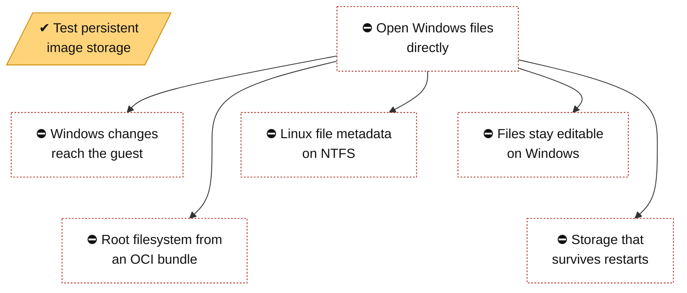

<!-- Generated by build.py from roadmap/nodes.yaml. Do not edit. -->

# fs - files

Scope: host files, bind mounts, image storage.

[Back to the page](../../roadmap.md) · [legend](../../roadmap.md#legend)

<!-- BEGIN GENERATED: track-fs -->

<!-- END GENERATED: track-fs -->

## Node table

<!-- BEGIN GENERATED: table-fs -->
| id | title | kind | lane | state | outcome | start | end | depends_on | replaced_by | qualified_by | headline | evidence |
|---|---|---|---|---|---|---|---|---|---|---|---|---|
| `fs-compat-layer-not-boundary` | Compatibility layer, not security boundary | owner-decision | owner | done | n/a | 2026-11-26 | 2026-11-26 |  |  |  |  | docs/adr/0005-host-files-accessed-directly.md |
| `fs-persistent-image-storage` | Test persistent image storage | experiment | linux-ci | done | mixed | 2026-11-26 | 2026-11-26 | workloads-podman-on-gvisor-linux |  |  | 3.7 s with overlay | docs/results/0a-linux.md |
| `fs-windows-directfs` | Open Windows files directly | feature | windows-ci | blocked | unrated |  |  | sentry-windows-build, fs-compat-layer-not-boundary |  |  |  |  |
| `fs-change-notifications` | Windows changes reach the guest | feature | windows-ci | blocked | unrated |  |  | fs-windows-directfs |  |  |  |  |
| `fs-linux-metadata-on-ntfs` | Linux file metadata on NTFS | feature | windows-ci | blocked | unrated |  |  | fs-windows-directfs |  |  |  |  |
| `fs-handles-do-not-block-users` | Files stay editable on Windows | feature | windows-ci | blocked | unrated |  |  | fs-windows-directfs |  |  |  |  |
| `fs-persistent-storage-choice` | Choose the persistent storage | owner-decision | owner | blocked | n/a |  |  | fs-persistent-image-storage, fs-windows-directfs |  |  |  |  |
| `fs-root-filesystem-source` | Root filesystem from an OCI bundle | feature | windows-ci | blocked | unrated |  |  | fs-windows-directfs |  |  |  |  |
| `fs-persistent-storage-impl` | Storage that survives restarts | feature | windows-ci | blocked | unrated |  |  | fs-persistent-storage-choice |  |  |  |  |

### Details per node

| id | title | verdict | headline | in plain words | notes | confirmed | waiting on | queue order | order reason |
|---|---|---|---|---|---|---|---|---|---|
| `fs-compat-layer-not-boundary` | Compatibility layer, not security boundary |  |  | The sandbox may open the user's files directly with the user's rights; it isolates containers from each other, not from the user. |  |  |  |  |  |
| `fs-persistent-image-storage` | Test persistent image storage | Podman's image store on a gofer-mounted host directory works for pull, build and run and survives a sandbox restart (python:3-slim pull 3.7 s with overlay, 7.2 s with vfs, against 1.7 s natively; a 3000-file build 5.2 s against 1.7 s natively), while the in-sandbox tmpfs is faster but lost on restar | 3.7 s with overlay | Find a writable filesystem inside the sandbox that survives a restart, and how fast each option is. | Done when: pull/build timings on tmpfs and on a host directory, and the overlay restart test, are in docs/results/0a-linux.md. |  |  |  |  |
| `fs-windows-directfs` | Open Windows files directly |  |  | The Sentry opens NTFS files itself for bind mounts, with its own caches, instead of going through a file protocol. | Done when: the gofer's Windows backend implements open, create, readdir, stat, rename, unlink, link, symlink and xattr calls; a Linux guest edits a Windows folder correctly. |  |  |  |  |
| `fs-change-notifications` | Windows changes reach the guest |  |  | Edits made on Windows invalidate the Sentry's caches and arrive in the guest as inotify events. | Done when: a file changed in Explorer is visible in the guest within one second and fires an inotify event. |  |  |  |  |
| `fs-linux-metadata-on-ntfs` | Linux file metadata on NTFS |  |  | Owner, mode bits, symlinks and special files survive on NTFS, using a fixed owner and alternate data streams. | Done when: chmod, chown, symlink and mknod round-trip through a Windows folder. |  |  |  |  |
| `fs-handles-do-not-block-users` | Files stay editable on Windows |  |  | The Sentry holds Windows file handles only briefly, so editors and git can still rename and delete files. | Done when: git checkout and an editor save on Windows succeed while a guest has the folder open. |  |  |  |  |
| `fs-persistent-storage-choice` | Choose the persistent storage |  |  | Pick how a writable filesystem survives restarts: NTFS with metadata, one big image file, or an in-memory store with a cache. | Done when: an ADR records the choice with the measurements from Phase 0. |  |  |  |  |
| `fs-root-filesystem-source` | Root filesystem from an OCI bundle |  |  | The guest's root filesystem comes from an unpacked OCI bundle directory on Windows. | Done when: busybox boots from a rootfs directory unpacked on NTFS. |  |  |  |  |
| `fs-persistent-storage-impl` | Storage that survives restarts |  |  | Implement the chosen writable filesystem so data inside the sandbox outlives a restart. | Done when: files and image layers written in the guest are there after the sandbox restarts. |  |  |  |  |
<!-- END GENERATED: table-fs -->
