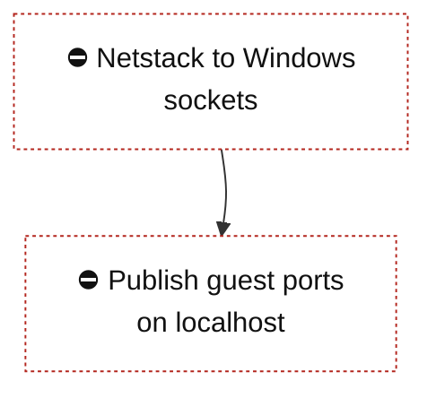

<!-- Generated by build.py from roadmap/nodes.yaml. Do not edit. -->

# net - network

Scope: netstack to Windows sockets, port forwarding.

[Back to the page](../../roadmap.md) · [legend](../../roadmap.md#legend)

<!-- BEGIN GENERATED: track-net -->

<!-- END GENERATED: track-net -->

## Node table

<!-- BEGIN GENERATED: table-net -->
| id | title | kind | lane | state | outcome | start | end | depends_on | replaced_by | qualified_by | headline | evidence |
|---|---|---|---|---|---|---|---|---|---|---|---|---|
| `net-netstack-windows-link` | Netstack to Windows sockets | feature | windows-ci | blocked | unrated |  |  | sentry-windows-build |  |  |  |  |
| `net-port-forwarding` | Publish guest ports on localhost | feature | windows-ci | blocked | unrated |  |  | net-netstack-windows-link |  |  |  |  |

### Details per node

| id | title | verdict | headline | in plain words | notes | confirmed | waiting on | queue order | order reason |
|---|---|---|---|---|---|---|---|---|---|
| `net-netstack-windows-link` | Netstack to Windows sockets |  |  | gVisor's own TCP/IP stack sends guest traffic out through ordinary Windows sockets, like a user-space NAT. | Done when: a guest resolves DNS and downloads over HTTPS on Windows without admin. |  |  |  |  |
| `net-port-forwarding` | Publish guest ports on localhost |  |  | A port opened in the guest becomes reachable on the Windows machine's localhost. | Done when: a guest web server answers on localhost on Windows. |  |  |  |  |
<!-- END GENERATED: table-net -->
