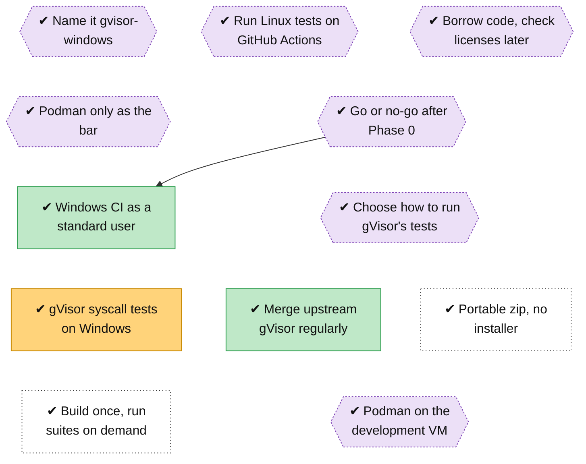

<!-- Generated by build.py from roadmap/nodes.yaml. Do not edit. -->

# ops - operations

Scope: CI, packaging, owner decisions on process.

[Back to the page](../../roadmap.md) · [legend](../../roadmap.md#legend)

<!-- BEGIN GENERATED: track-ops -->

<!-- END GENERATED: track-ops -->

## Node table

<!-- BEGIN GENERATED: table-ops -->
| id | title | kind | lane | state | outcome | start | end | depends_on | replaced_by | qualified_by | headline | evidence |
|---|---|---|---|---|---|---|---|---|---|---|---|---|
| `ops-name-and-fork` | Name it gvisor-windows | owner-decision | owner | done | n/a | 2026-11-26 | 2026-11-26 |  |  |  |  | docs/adr/0003-fork-of-the-go-branch.md |
| `ops-linux-tests-on-actions` | Run Linux tests on GitHub Actions | owner-decision | owner | done | n/a | 2026-11-26 | 2026-11-26 |  |  |  |  | docs/adr/0003-fork-of-the-go-branch.md |
| `ops-borrow-code` | Borrow code, check licenses later | owner-decision | owner | done | n/a | 2026-11-26 | 2026-11-26 |  |  |  |  | docs/adr/0003-fork-of-the-go-branch.md; NOTICE |
| `ops-phase0-go-no-go` | Go or no-go after Phase 0 | owner-decision | owner | done | n/a | 2026-11-26 | 2026-11-26 | workloads-podman-on-gvisor-linux, research-gvisor-benchmark, platform-elf-alignment-survey, fs-persistent-image-storage, platform-trap-cost, platform-4k-section-views, platform-tls-register, platform-restricted-stub, sentry-go-fault-recovery, runsc-measure-cli |  |  |  | docs/adr/0004-phase-0-results.md |
| `ops-podman-only-the-bar` | Podman only as the bar | owner-decision | owner | done | n/a | 2026-11-26 | 2026-11-26 |  |  |  |  | docs/adr/0002-what-done-means.md |
| `ops-windows-ci-standard-user` | Windows CI as a standard user | tooling | windows-ci | done | successful | 2026-11-26 | 2026-11-26 | ops-phase0-go-no-go |  |  |  | docs/results/2-windows-network.md |
| `ops-syscall-test-strategy` | Choose how to run gVisor's tests | owner-decision | owner | done | n/a | 2026-11-26 | 2026-11-26 |  |  |  |  | docs/adr/0009-running-gvisors-tests.md |
| `ops-syscall-tests-on-windows` | gVisor syscall tests on Windows | feature | windows-ci | done | mixed | 2026-11-26 | 2026-11-27 | ops-syscall-test-strategy, platform-static-guest-from-memory |  |  | 83.6% | docs/results/4-syscall-tests.md |
| `ops-upstream-merges` | Merge upstream gVisor regularly | tooling | linux-ci | done | successful | 2026-11-27 | 2026-11-27 |  |  |  |  | docs/results/3d-clocks-upstream.md |
| `ops-portable-packaging` | Portable zip, no installer | feature | windows-ci | done | unrated | 2026-11-27 | 2026-11-27 | runsc-container-on-windows |  |  |  | tools/windows/ci/README-release.md; tools/windows/ci/release-test.ps1; docs/adr/0023-podman-bundle-in-its-own-repo.md |
| `ops-run-on-a-work-machine` | Try it on a real work machine | owner-decision | owner | next | n/a |  |  |  |  |  |  |  |
| `ops-ci-build-once` | Build once, run suites on demand | tooling | windows-ci | done | unrated | 2026-11-27 | 2026-11-27 |  |  |  |  | docs/results/6-ci.md |
| `ops-podman-on-the-dev-vm` | Podman on the development VM | owner-decision | owner | done | successful | 2026-11-27 | 2026-11-28 |  |  |  |  | docs/results/1p-rewrite-heap.md; docs/results/5-podman-windows.md |

### Details per node

| id | title | verdict | headline | in plain words | notes | confirmed | waiting on | queue order | order reason |
|---|---|---|---|---|---|---|---|---|---|
| `ops-name-and-fork` | Name it gvisor-windows |  |  | The project is an unofficial fork of gVisor's Go branch called gvisor-windows. |  |  |  |  |  |
| `ops-linux-tests-on-actions` | Run Linux tests on GitHub Actions |  |  | Everything that needs a Linux host runs on GitHub's hosted runners. |  |  |  |  |  |
| `ops-borrow-code` | Borrow code, check licenses later |  |  | Code from other projects may be reused; its origin is recorded so the owner can review licences later. |  |  |  |  |  |
| `ops-phase0-go-no-go` | Go or no-go after Phase 0 |  |  | Go: the owner asked for the full project; ADR 0004 lists the conditions. | Input: docs/adr/0004-phase-0-results.md (recommendation: go, with conditions). |  |  |  |  |
| `ops-podman-only-the-bar` | Podman only as the bar |  |  | The project is gVisor for Windows hosts; Podman is only the workload that shows enough features work. |  |  |  |  |  |
| `ops-windows-ci-standard-user` | Windows CI as a standard user | a standard user on stock windows-latest can resolve DNS, fetch https://github.com and publish a guest port on 127.0.0.1 through a netstack NAT with no admin rights, and CI proves the account really was unprivileged. |  | CI on windows-latest creates a standard user and runs every Windows test as that user. | Done when: a workflow runs a test as a freshly created non-admin user and fails if anything needs elevation. |  |  |  |  |
| `ops-syscall-test-strategy` | Choose how to run gVisor's tests |  |  | The Go branch ships no tests; decide whether gVisor's unit and syscall tests run from a master checkout with Bazel or get ported. | Done when: an ADR records the choice. |  |  |  |  |
| `ops-syscall-tests-on-windows` | gVisor syscall tests on Windows | 83.6% of the cases that pass on Linux pass (11298 of 14620, 138 of 256 binaries complete) | 83.6% | gVisor's own syscall test suite runs against the Windows port to show which Linux calls work. | Done when: the suite runs in CI on Windows and its pass rate is published. |  |  |  |  |
| `ops-upstream-merges` | Merge upstream gVisor regularly | a weekly workflow now merges `google/gvisor` `go` into a branch from `windows`, builds it and opens an issue when that fails |  | Regularly take in upstream gVisor's Go branch so the port does not drift. | Weekly workflow merges google/gvisor go into an upstream-merge-<date> branch, builds both GOOS, and opens or updates one issue on conflict or build failure; dry run merged 4 commits cleanly. |  |  |  |  |
| `ops-portable-packaging` | Portable zip, no installer |  |  | Ship runsc for Windows as a zip or per-user installer that needs no admin. | The Podman bundle moved to lhns/podman-portable (ADR 0023); this repo ships runsc.exe plus a hello bundle, tested from a fresh standard user profile. Draft releases come from release.yml after the heavy suites pass on the same sha. |  |  |  |  |
| `ops-run-on-a-work-machine` | Try it on a real work machine |  |  | All evidence comes from GitHub hosted Windows images; the owner runs runsc.exe once on a work machine to check FSGSBASE and whether security software tolerates the generated stub being debugged. | Defender with real-time protection already tolerated the debugged stubs on the development VM. What the work machine adds: corporate security software and native mode (FSGSBASE). Report: does podman-portable.exe v0.4.0 start (SmartScreen or a security product blocking it?), does `podman-portable.exe podman run --rm alpine echo ok` print ok, and which CPU mode status reports. |  |  |  |  |
| `ops-ci-build-once` | Build once, run suites on demand |  |  | One ci.yml builds runsc.exe and the test binaries once and calls every Windows suite; worker branches start no runs and dispatch only what they need. About 62 to 40 job-minutes per push. | Next lever: merge the 16 small Linux acceptance jobs. Also uploads a runsc-windows-amd64-<shortsha> package (runsc.exe, hello bundle, README) for trying it on a work machine. |  |  |  |  |
| `ops-podman-on-the-dev-vm` | Podman on the development VM | an unmodified Podman 6.2.0 engine passes all ten acceptance steps on the development VM without FSGSBASE, XSAVE or AVX, started from the podman-portable v0.4.0 release |  | Podman has passed in rewrite-fxsave mode only on CI runners that force it; on the development VM (no FSGSBASE, XSAVE or AVX) only runsc bundles ran, because the engine opens a network listener. | Owner allowed the run. All 10 steps passed with podman-portable v0.4.0 in rewrite-fxsave mode; run.ps1 now also works under Windows PowerShell 5.1. Microsoft Defender real-time protection, behaviour monitoring and tamper protection were on during the run. |  |  |  |  |

### Folded items per node

- `ops-syscall-tests-on-windows`: gVisor syscall tests on Windows
  - Linux runsc 81.5%, Windows with network 77.3% of 14620 cases (2026-11-27, commit 63612b2a1)
- `ops-portable-packaging`: Portable zip, no installer
  - CI uploads a runsc-windows-amd64-<shortsha> package (runsc.exe, hello bundle, README, NOTICE, LICENSE) on each push to windows (2026-11-27, commit 20ac3fb3b)
  - Published gvisor-windows v0.1.0 (pre-release, runsc for Windows and Linux) from release run 46093187743 and podman-portable v0.1.0 (single exe and zip) (2026-11-28, commit b907ae6aa)
  - Published gvisor-windows v0.2.0 by hand from the gated assets of release run 46110083701: its publish step was refused because workflow files on windows changed during the gates; podman-portable v0.2.0 and v0.3.0 were published by its release workflow (2026-11-28, commit c3a491380)
  - podman-portable v0.4.0: the engine pipe name carries the user (a constant name blocked a second user on one machine); two-user isolation tests on Windows and Linux (2026-11-28, commit c3a491380)
- `ops-ci-build-once`: Build once, run suites on demand
  - Owner decision: CI on push only, no scheduled test runs; repeats are dispatched when needed (2026-11-28, commit 8760b32fc)
  - Artifacts: one download per run (runsc-windows-amd64-<shortsha>), job hand-offs as tmp- with 1-day retention or from cache, logs only on failure with results in job summaries (2026-11-28, commit 01a68d038)
<!-- END GENERATED: table-ops -->
