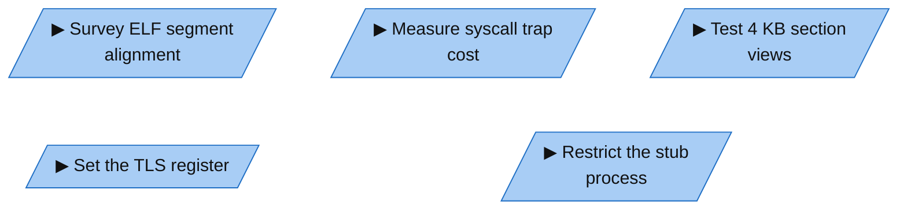

<!-- Generated by build.py from roadmap/nodes.yaml. Do not edit. -->

# platform - platform

Scope: stub processes, syscall trap, memory mapping, TLS.

[Back to the page](../../roadmap.md) · [legend](../../roadmap.md#legend)

<!-- BEGIN GENERATED: track-platform -->

<!-- END GENERATED: track-platform -->

## Node table

<!-- BEGIN GENERATED: table-platform -->
| id | title | kind | lane | state | outcome | start | end | depends_on | replaced_by | qualified_by | headline | evidence |
|---|---|---|---|---|---|---|---|---|---|---|---|---|
| `platform-elf-alignment-survey` | Survey ELF segment alignment | experiment | linux-ci | in-progress | unrated | 2026-11-26 |  | research-gvisor-base |  |  |  |  |
| `platform-trap-cost` | Measure syscall trap cost | experiment | windows-local | in-progress | unrated | 2026-11-26 |  | research-gvisor-base |  |  |  |  |
| `platform-4k-section-views` | Test 4 KB section views | experiment | windows-local | in-progress | unrated | 2026-11-26 |  | research-gvisor-base |  |  |  |  |
| `platform-tls-register` | Set the TLS register | experiment | windows-local | in-progress | unrated | 2026-11-26 |  | research-gvisor-base |  |  |  |  |
| `platform-restricted-stub` | Restrict the stub process | experiment | windows-local | in-progress | unrated | 2026-11-26 |  | research-gvisor-base |  |  |  |  |

### Details per node

| id | title | verdict | headline | in plain words | notes | confirmed | waiting on | queue order | order reason |
|---|---|---|---|---|---|---|---|---|---|
| `platform-elf-alignment-survey` | Survey ELF segment alignment |  |  | Count how often program files place code at addresses Windows cannot map directly (64 KB alignment). | Done when: per-image counts are in docs/results/0a-linux.md. |  |  |  |  |
| `platform-trap-cost` | Measure syscall trap cost |  |  | Measure what it costs to catch one Linux system call on Windows and hand it to another process. | Done when: S1 results are in docs/results/0b-windows.md. |  |  |  |  |
| `platform-4k-section-views` | Test 4 KB section views |  |  | Check whether Windows can map shared memory at the 4 KB steps Linux programs expect, instead of 64 KB. | Done when: S2 results are in docs/results/0b-windows.md. |  |  |  |  |
| `platform-tls-register` | Set the TLS register |  |  | Check whether a normal Windows program can set the register Linux programs use for thread-local data; without it native execution fails. | Go/no-go. Done when: S3 results are in docs/results/0b-windows.md. |  |  |  |  |
| `platform-restricted-stub` | Restrict the stub process |  |  | Check that the process running Linux code can be locked down, so a missed system call does little harm. | Done when: S4 results are in docs/results/0b-windows.md. |  |  |  |  |
<!-- END GENERATED: table-platform -->
