<!-- Generated by build.py from roadmap/nodes.yaml. Do not edit. -->

# platform - platform

Scope: stub processes, syscall trap, memory mapping, TLS.

[Back to the page](../../roadmap.md) · [legend](../../roadmap.md#legend)

```mermaid
flowchart TB
    platform_elf_alignment_survey[/"✔ Survey ELF segment<br/>alignment"/]
    platform_trap_cost[/"✔ Measure syscall trap<br/>cost"/]
    platform_4k_section_views[/"✔ Test 4 KB section<br/>views"/]
    platform_tls_register[/"✔ Set the TLS register"/]
    platform_restricted_stub[/"✔ Restrict the stub<br/>process"/]
    platform_zpoline_hooks[/"✖ Hook syscalls like<br/>zpoline"/]
    platform_exception_stack[/"✔ Check what<br/>exceptions do to<br/>stacks"/]
    platform_veh_on_guest_stack_unsafe>"✔ Exceptions overwrite<br/>guest stacks"]
    platform_debug_event_cost[/"✔ Measure debugger<br/>fault handling"/]
    platform_syscall_site_survey[/"✔ Survey patchable<br/>syscall sites"/]
    platform_faults_per_exec[/"✔ Count page faults<br/>per exec"/]
    platform_stub_controller["✔ Stub and controller<br/>prototype"]
    platform_page_verification["✔ Scan code pages for<br/>syscalls"]
    platform_syscall_fast_path[/"✔ Patch syscall sites<br/>into jumps"/]
    platform_fs_base_repair["✔ Restore the TLS<br/>register after<br/>switches"]
    platform_controller_wakeups["✔ Controller waits<br/>without busy polling"]
    platform_winstub["✔ Windows platform for<br/>the Sentry"]
    platform_fp_state["✔ Save and restore FPU<br/>and SSE state"]
    platform_static_guest_from_memory["✔ Run a static guest<br/>from memory"]
    platform_retire_prototype["✔ Retire the stub<br/>prototype"]
    platform_memory_release>"✔ Give freed guest<br/>memory back"]
    platform_fast_process_start["✔ Start guest<br/>processes fast"]
    platform_split_syscall_unpatched>"✔ Syscalls split<br/>across mappings"]
    platform_map_files_without_sections>"✔ Map files not in the<br/>memory file"]
    platform_own_vdso["✔ Own vDSO for clock<br/>calls"]
    platform_busybox_on_windows["✔ Run busybox under<br/>the Sentry"]
    platform_veneer_address_in_child>"✔ Veneer addresses<br/>differ after clone"]
    platform_no_fsgsbase_fallback["✔ Support CPUs without<br/>FSGSBASE"]
    platform_rare_hang_under_exec_load>"✔ Rare hang under<br/>heavy exec load"]
    platform_unsupported_errno>"✔ Unsupported platform<br/>calls return errnos"]
    platform_recycle_stubs["✔ Reuse stub processes<br/>across exec"]
    platform_avx512_state_lost>"✔ AVX-512 state lost<br/>across stops"]
    platform_avx_on_non_avx_cpu>"✔ glibc runs AVX code<br/>on a non-AVX CPU"]
    platform_fs_veneer_capacity>"✔ More room for %fs<br/>veneers"]
    platform_rewrite_mode_slow_engine>"✔ Podman engine stalls<br/>in rewrite mode"]
    platform_rewrite_glibc_init_crash>"✔ Static glibc crashes<br/>at start in rewrite<br/>mode"]
    platform_unrewritten_fs_in_library>"✔ Unrewritten %fs site<br/>in a library"]
    platform_rewrite_heap_corruption>"✔ glibc heap errors in<br/>rewrite mode"]
    platform_exception_dispatch_depth[/"✔ Measure exception<br/>stack use"/]
    platform_resume_inside_fs_window>"✔ Thread resumed<br/>inside a patch window"]
    platform_fault_under_fs_jump>"✔ Fault reported under<br/>a patch jump"]
    platform_64k_mapping_conflicts["⏸ Handle 64 KB mapping<br/>conflicts"]
    platform_hardware_acceleration["⏸ Use hardware<br/>acceleration when<br/>available"]
    platform_binary_translation_fallback["⏸ Binary translation<br/>as a fallback"]
    platform_elf_alignment_survey ~~~ platform_tls_register
    platform_trap_cost ~~~ platform_restricted_stub
    platform_4k_section_views ~~~ platform_zpoline_hooks
    platform_tls_register ~~~ platform_exception_stack
    platform_restricted_stub ~~~ platform_exception_stack
    platform_zpoline_hooks ~~~ platform_exception_stack
    platform_exception_stack ~~~ platform_veh_on_guest_stack_unsafe
    platform_exception_stack ~~~ platform_debug_event_cost
    platform_exception_stack ~~~ platform_syscall_site_survey
    platform_veh_on_guest_stack_unsafe ~~~ platform_faults_per_exec
    platform_debug_event_cost ~~~ platform_faults_per_exec
    platform_syscall_site_survey ~~~ platform_faults_per_exec
    platform_faults_per_exec ~~~ platform_stub_controller
    platform_stub_controller ~~~ platform_page_verification
    platform_stub_controller ~~~ platform_syscall_fast_path
    platform_stub_controller ~~~ platform_fs_base_repair
    platform_page_verification ~~~ platform_controller_wakeups
    platform_syscall_fast_path ~~~ platform_controller_wakeups
    platform_fs_base_repair ~~~ platform_controller_wakeups
    platform_controller_wakeups ~~~ platform_winstub
    platform_winstub ~~~ platform_fp_state
    platform_fp_state ~~~ platform_static_guest_from_memory
    platform_static_guest_from_memory ~~~ platform_retire_prototype
    platform_static_guest_from_memory ~~~ platform_memory_release
    platform_static_guest_from_memory ~~~ platform_fast_process_start
    platform_retire_prototype ~~~ platform_split_syscall_unpatched
    platform_memory_release ~~~ platform_map_files_without_sections
    platform_fast_process_start ~~~ platform_own_vdso
    platform_split_syscall_unpatched ~~~ platform_busybox_on_windows
    platform_map_files_without_sections ~~~ platform_veneer_address_in_child
    platform_own_vdso ~~~ platform_veneer_address_in_child
    platform_busybox_on_windows ~~~ platform_no_fsgsbase_fallback
    platform_veneer_address_in_child ~~~ platform_rare_hang_under_exec_load
    platform_veneer_address_in_child ~~~ platform_unsupported_errno
    platform_no_fsgsbase_fallback ~~~ platform_recycle_stubs
    platform_rare_hang_under_exec_load ~~~ platform_avx512_state_lost
    platform_unsupported_errno ~~~ platform_avx_on_non_avx_cpu
    platform_recycle_stubs ~~~ platform_fs_veneer_capacity
    platform_avx512_state_lost ~~~ platform_rewrite_mode_slow_engine
    platform_avx_on_non_avx_cpu ~~~ platform_rewrite_glibc_init_crash
    platform_fs_veneer_capacity ~~~ platform_unrewritten_fs_in_library
    platform_rewrite_mode_slow_engine ~~~ platform_rewrite_heap_corruption
    platform_rewrite_glibc_init_crash ~~~ platform_exception_dispatch_depth
    platform_unrewritten_fs_in_library ~~~ platform_resume_inside_fs_window
    platform_rewrite_heap_corruption ~~~ platform_fault_under_fs_jump
    platform_exception_dispatch_depth ~~~ platform_64k_mapping_conflicts
    platform_resume_inside_fs_window ~~~ platform_hardware_acceleration
    platform_fault_under_fs_jump ~~~ platform_binary_translation_fallback
    platform_64k_mapping_conflicts ~~~ platform_binary_translation_fallback
    platform_trap_cost -.-> platform_veh_on_guest_stack_unsafe
    platform_tls_register -.-> platform_veh_on_guest_stack_unsafe
    platform_trap_cost --> platform_exception_stack
    platform_exception_stack --> platform_veh_on_guest_stack_unsafe
    platform_exception_stack --> platform_debug_event_cost
    platform_elf_alignment_survey --> platform_syscall_site_survey
    platform_debug_event_cost --> platform_stub_controller
    platform_syscall_site_survey --> platform_stub_controller
    platform_faults_per_exec --> platform_stub_controller
    platform_stub_controller --> platform_page_verification
    platform_stub_controller --> platform_syscall_fast_path
    platform_stub_controller --> platform_fs_base_repair
    platform_stub_controller --> platform_controller_wakeups
    platform_controller_wakeups --> platform_winstub
    platform_winstub --> platform_fp_state
    platform_fs_base_repair --> platform_static_guest_from_memory
    platform_fp_state --> platform_static_guest_from_memory
    platform_static_guest_from_memory --> platform_retire_prototype
    platform_static_guest_from_memory --> platform_fast_process_start
    platform_stub_controller --> platform_own_vdso
    platform_veneer_address_in_child --> platform_no_fsgsbase_fallback
    platform_no_fsgsbase_fallback --> platform_recycle_stubs
    platform_winstub --> platform_hardware_acceleration
    platform_debug_event_cost --> platform_binary_translation_fallback
    linkStyle 49,50 stroke:#e69500,stroke-width:3px,stroke-dasharray:2 3
    classDef vsucc fill:#2e9e4f,stroke:#1b6b34,color:#fff
    classDef succ fill:#bfe8c8,stroke:#2e9e4f,color:#111
    classDef mixed fill:#ffd37a,stroke:#c98a00,color:#111
    classDef bad fill:#f28b82,stroke:#b3261e,color:#111
    classDef dead fill:#e6e6e6,stroke:#777,stroke-dasharray:5 5,color:#555
    classDef inprog fill:#a8cdf5,stroke:#1f6fc5,color:#111
    classDef next fill:#fff,stroke:#333,color:#111
    classDef blocked fill:#fff,stroke:#b3261e,stroke-dasharray:2 2,color:#111
    classDef parked fill:#f3f3f3,stroke:#999,color:#555
    classDef unrated fill:#fff,stroke:#333,stroke-dasharray:1 3,color:#111
    classDef gate fill:#d9c2f0,stroke:#7b3fb5,color:#111
    classDef decided fill:#ece0f7,stroke:#7b3fb5,stroke-dasharray:2 2,color:#111
    classDef finding fill:#ffe0b2,stroke:#d84315,stroke-width:2px,color:#111
    classDef waiting fill:#e3f2fd,stroke:#1f6fc5,stroke-dasharray:5 5,color:#111
    class platform_elf_alignment_survey,platform_trap_cost,platform_4k_section_views,platform_exception_stack,platform_veh_on_guest_stack_unsafe,platform_debug_event_cost,platform_faults_per_exec,platform_stub_controller,platform_page_verification,platform_syscall_fast_path,platform_controller_wakeups,platform_winstub,platform_fp_state,platform_static_guest_from_memory,platform_retire_prototype,platform_memory_release,platform_split_syscall_unpatched,platform_map_files_without_sections,platform_own_vdso,platform_busybox_on_windows,platform_veneer_address_in_child,platform_rare_hang_under_exec_load,platform_unsupported_errno,platform_avx512_state_lost,platform_avx_on_non_avx_cpu,platform_fs_veneer_capacity,platform_rewrite_mode_slow_engine,platform_rewrite_glibc_init_crash,platform_unrewritten_fs_in_library,platform_rewrite_heap_corruption,platform_resume_inside_fs_window,platform_fault_under_fs_jump succ
    class platform_tls_register,platform_restricted_stub,platform_syscall_site_survey,platform_no_fsgsbase_fallback,platform_exception_dispatch_depth mixed
    class platform_zpoline_hooks dead
    class platform_fs_base_repair unrated
    class platform_fast_process_start,platform_recycle_stubs vsucc
    class platform_64k_mapping_conflicts,platform_hardware_acceleration,platform_binary_translation_fallback parked
```

<!-- BEGIN GENERATED: track-platform -->

<!-- END GENERATED: track-platform -->

## Node table

<!-- BEGIN GENERATED: table-platform -->
| id | title | kind | lane | state | outcome | start | end | depends_on | replaced_by | qualified_by | headline | evidence |
|---|---|---|---|---|---|---|---|---|---|---|---|---|
| `platform-elf-alignment-survey` | Survey ELF segment alignment | experiment | linux-ci | done | successful | 2026-11-26 | 2026-11-26 | research-gvisor-base |  |  |  | docs/results/0a-linux.md |
| `platform-trap-cost` | Measure syscall trap cost | experiment | windows-local | done | successful | 2026-11-26 | 2026-11-26 | research-gvisor-base |  | platform-veh-on-guest-stack-unsafe | about 8 us per trap | docs/results/0b-windows.md |
| `platform-4k-section-views` | Test 4 KB section views | experiment | windows-local | done | successful | 2026-11-26 | 2026-11-26 | research-gvisor-base |  |  |  | docs/results/0b-windows.md |
| `platform-tls-register` | Set the TLS register | experiment | windows-local | done | mixed | 2026-11-26 | 2026-11-26 | research-gvisor-base |  | platform-veh-on-guest-stack-unsafe | about 1.1-2.2 us per repair | docs/results/0b-windows.md |
| `platform-restricted-stub` | Restrict the stub process | experiment | windows-local | done | mixed | 2026-11-26 | 2026-11-26 | research-gvisor-base |  |  |  | docs/results/0b-windows.md |
| `platform-stub-controller` | Stub and controller prototype | feature | windows-ci | done | successful | 2026-11-26 | 2026-11-26 | ops-phase0-go-no-go, platform-trap-cost, platform-4k-section-views, platform-tls-register, platform-restricted-stub, platform-exception-stack, platform-debug-event-cost, platform-syscall-site-survey, platform-faults-per-exec |  |  |  | docs/results/1a-stub-prototype.md; docs/adr/0011-stub-process-design.md; docs/adr/0012-eager-patching-and-non-blocking-debug-events.md |
| `platform-page-verification` | Scan code pages for syscalls | feature | windows-ci | done | successful | 2026-11-26 | 2026-11-26 | platform-stub-controller |  |  |  | docs/results/1a-stub-prototype.md |
| `platform-syscall-fast-path` | Patch syscall sites into jumps | experiment | windows-ci | done | successful | 2026-11-26 | 2026-11-26 | platform-stub-controller |  |  | 0.00% of executed syscalls on the ud2 path | docs/results/1a-stub-prototype.md |
| `platform-own-vdso` | Own vDSO for clock calls | feature | windows-ci | done | successful | 2026-11-27 | 2026-11-27 | platform-stub-controller |  |  |  | docs/results/1r-platform-speed.md; docs/adr/0022-fork-and-exec-without-faults-patching-or-process-creation.md |
| `platform-64k-mapping-conflicts` | Handle 64 KB mapping conflicts | feature | windows-ci | parked | unrated |  |  | sentry-memory-file-sections, platform-elf-alignment-survey |  |  |  |  |
| `platform-winstub` | Windows platform for the Sentry | feature | windows-ci | done | successful | 2026-11-26 | 2026-11-26 | platform-stub-controller, sentry-memory-file-sections, ops-syscall-test-strategy, platform-controller-wakeups |  |  |  | docs/results/1c-windows-platform.md |
| `platform-busybox-on-windows` | Run busybox under the Sentry | feature | windows-ci | done | successful | 2026-11-26 | 2026-11-26 | platform-winstub, sentry-timers-and-clocks, sentry-fault-recovery, sentry-host-stdio-and-tty, fs-root-filesystem-source, platform-fs-base-repair, platform-static-guest-from-memory, sentry-dynamic-elf-and-exec, runsc-windows-boot |  |  |  | docs/results/3-runsc-boot.md; docs/results/1f-exec-signals.md |
| `platform-hardware-acceleration` | Use hardware acceleration when available | feature | windows-ci | parked | unrated |  |  | platform-winstub |  |  |  |  |
| `platform-zpoline-hooks` | Hook syscalls like zpoline | experiment | windows-local | abandoned | dead-end | 2026-11-26 | 2026-11-26 |  |  |  |  | docs/results/0b-windows.md |
| `platform-fs-base-repair` | Restore the TLS register after switches | feature | windows-ci | done | unrated | 2026-11-26 | 2026-11-26 | platform-stub-controller |  |  |  | docs/results/1a-stub-prototype.md |
| `platform-no-fsgsbase-fallback` | Support CPUs without FSGSBASE | feature | windows-ci | done | mixed | 2026-11-27 | 2026-11-27 | platform-veneer-address-in-child |  |  |  | docs/results/1j-no-fsgsbase.md; docs/adr/0020-cpus-without-fsgsbase-rewrite-fs-accesses.md |
| `platform-exception-stack` | Check what exceptions do to stacks | experiment | windows-ci | done | successful | 2026-11-26 | 2026-11-26 | platform-trap-cost |  |  |  | docs/results/0b-windows.md |
| `platform-static-guest-from-memory` | Run a static guest from memory | feature | windows-ci | done | successful | 2026-11-26 | 2026-11-26 | platform-winstub, sentry-fault-recovery, platform-fs-base-repair, platform-fp-state |  |  |  | docs/results/1d-static-guest.md |
| `platform-veh-on-guest-stack-unsafe` | Exceptions overwrite guest stacks | defect | windows-ci | done | unrated | 2026-11-26 | 2026-11-26 | platform-exception-stack |  |  |  | docs/results/0b-windows.md; docs/adr/0010-guest-faults-via-the-debugger-syscalls-via-patching.md |
| `platform-debug-event-cost` | Measure debugger fault handling | experiment | windows-ci | done | successful | 2026-11-26 | 2026-11-26 | platform-exception-stack |  |  | about 45-60 us per fault | docs/results/0b-windows.md |
| `platform-syscall-site-survey` | Survey patchable syscall sites | experiment | linux-ci | done | mixed | 2026-11-26 | 2026-11-26 | platform-elf-alignment-survey |  |  | 62-82% of executed syscalls | docs/results/0d-syscall-sites.md |
| `platform-faults-per-exec` | Count page faults per exec | experiment | linux-ci | done | successful | 2026-11-26 | 2026-11-26 | research-gvisor-benchmark |  |  | 10-57 Sentry-handled faults | docs/results/0d-syscall-sites.md |
| `platform-binary-translation-fallback` | Binary translation as a fallback | feature | windows-ci | parked | unrated |  |  | platform-debug-event-cost |  |  |  |  |
| `platform-controller-wakeups` | Controller waits without busy polling | feature | windows-ci | done | successful | 2026-11-26 | 2026-11-26 | platform-stub-controller |  |  | 0.3 us median | docs/results/1a-stub-prototype.md |
| `platform-fp-state` | Save and restore FPU and SSE state | feature | windows-ci | done | successful | 2026-11-26 | 2026-11-26 | platform-winstub |  |  |  | docs/results/1d-static-guest.md |
| `platform-retire-prototype` | Retire the stub prototype | tooling | windows-ci | done | successful | 2026-11-26 | 2026-11-26 | platform-static-guest-from-memory |  |  |  | docs/results/1d-static-guest.md |
| `platform-memory-release` | Give freed guest memory back | defect | windows-ci | done | unrated | 2026-11-26 | 2026-11-26 |  |  |  |  | docs/results/1g-platform-memory.md; docs/adr/0016-memory-file-on-extent-sections.md |
| `platform-fast-process-start` | Start guest processes fast | feature | windows-ci | done | very-successful | 2026-11-26 | 2026-11-26 | platform-static-guest-from-memory |  |  | about 380 ms to 42 ms | docs/results/1e-platform-perf.md |
| `platform-split-syscall-unpatched` | Syscalls split across mappings | defect | windows-ci | done | unrated | 2026-11-26 | 2026-11-27 |  |  |  |  | docs/results/1c-windows-platform.md; docs/results/1e-platform-perf.md; docs/results/1m-platform-repair.md |
| `platform-map-files-without-sections` | Map files not in the memory file | defect | windows-ci | done | unrated | 2026-11-26 | 2026-11-26 |  |  |  |  | docs/results/1g-platform-memory.md; docs/adr/0016-memory-file-on-extent-sections.md |
| `platform-veneer-address-in-child` | Veneer addresses differ after clone | defect | windows-ci | done | unrated | 2026-11-27 | 2026-11-27 |  |  |  |  | docs/results/5-podman-windows.md; docs/results/1h-platform-share.md |
| `platform-rare-hang-under-exec-load` | Rare hang under heavy exec load | defect | windows-ci | done | unrated | 2026-11-27 | 2026-11-27 |  |  |  |  | docs/results/1h-platform-share.md; docs/results/1i-profile.md; docs/results/1l-platform-stability.md |
| `platform-unsupported-errno` | Unsupported platform calls return errnos | defect | windows-ci | done | unrated | 2026-11-27 | 2026-11-27 |  |  |  |  | docs/results/4-syscall-tests.md |
| `platform-recycle-stubs` | Reuse stub processes across exec | feature | windows-ci | done | very-successful | 2026-11-27 | 2026-11-27 | platform-no-fsgsbase-fallback |  |  |  | docs/results/1i-profile.md; docs/results/1r-platform-speed.md; docs/adr/0022-fork-and-exec-without-faults-patching-or-process-creation.md |
| `platform-avx512-state-lost` | AVX-512 state lost across stops | defect | windows-ci | done | unrated | 2026-11-27 | 2026-11-27 |  |  |  |  | docs/results/5-podman-windows.md; docs/results/1m-platform-repair.md |
| `platform-avx-on-non-avx-cpu` | glibc runs AVX code on a non-AVX CPU | defect | windows-local | done | unrated | 2026-11-27 | 2026-11-27 |  |  |  |  | docs/results/1j-no-fsgsbase.md; docs/results/1k-platform-next.md |
| `platform-fs-veneer-capacity` | More room for %fs veneers | defect | windows-ci | done | unrated | 2026-11-27 | 2026-11-27 |  |  |  |  | docs/results/1j-no-fsgsbase.md; docs/results/1s-veneers.md |
| `platform-rewrite-mode-slow-engine` | Podman engine stalls in rewrite mode | defect | windows-ci | done | unrated | 2026-11-27 | 2026-11-27 |  |  |  |  | docs/results/5-podman-windows.md; docs/results/1l-platform-stability.md |
| `platform-rewrite-glibc-init-crash` | Static glibc crashes at start in rewrite mode | defect | windows-ci | done | unrated | 2026-11-27 | 2026-11-27 |  |  |  |  | docs/results/5-podman-windows.md; docs/results/1l-platform-stability.md |
| `platform-unrewritten-fs-in-library` | Unrewritten %fs site in a library | defect | windows-ci | done | unrated | 2026-11-27 | 2026-11-27 |  |  |  |  | docs/results/5-podman-windows.md; docs/results/1m-platform-repair.md; docs/results/1o-rewrite-correctness.md |
| `platform-rewrite-heap-corruption` | glibc heap errors in rewrite mode | defect | windows-ci | done | unrated | 2026-11-27 | 2026-11-27 |  |  |  |  | docs/results/5-podman-windows.md; docs/results/1o-rewrite-correctness.md; docs/results/1p-rewrite-heap.md |
| `platform-exception-dispatch-depth` | Measure exception stack use | experiment | windows-ci | done | mixed | 2026-11-27 | 2026-11-27 |  |  |  |  | docs/results/0b-windows.md |
| `platform-resume-inside-fs-window` | Thread resumed inside a patch window | defect | windows-ci | done | unrated | 2026-11-27 | 2026-11-27 |  |  |  |  | docs/results/1p-rewrite-heap.md; docs/results/1q-window-resume.md |
| `platform-fault-under-fs-jump` | Fault reported under a patch jump | defect | windows-ci | done | unrated | 2026-11-27 | 2026-11-27 |  |  |  |  | docs/results/1q-window-resume.md; docs/results/1s-veneers.md |

### Details per node

| id | title | verdict | headline | in plain words | notes | confirmed | waiting on | queue order | order reason |
|---|---|---|---|---|---|---|---|---|---|
| `platform-elf-alignment-survey` | Survey ELF segment alignment | so a 64 KiB-granularity host cannot map ELF segments 1:1 and the conflict path of R2 is the common case. |  | Count how often program files place code at addresses Windows cannot map directly (64 KB alignment). | Done when: per-image counts are in docs/results/0a-linux.md. |  |  |  |  |
| `platform-trap-cost` | Measure syscall trap cost | A `ud2` caught by a raw-assembly vectored exception handler costs about 8 us per trap on this QEMU-guest machine | about 8 us per trap | Measure what it costs to catch one Linux system call on Windows and hand it to another process. | Done when: S1 results are in docs/results/0b-windows.md. |  |  |  |  |
| `platform-4k-section-views` | Test 4 KB section views | With placeholders, a non-elevated process can map section views into a child at 4 KB-aligned addresses (not 64 KB-aligned), at 4 KB-multiple file offsets, with 4 KB view sizes, and change protection per 4 KB page |  | Check whether Windows can map shared memory at the 4 KB steps Linux programs expect, instead of 64 KB. | Done when: S2 results are in docs/results/0b-windows.md. |  |  |  |  |
| `platform-tls-register` | Set the TLS register | a raw vectored exception handler that re-executes `wrfsbase` restores it transparently: guest-like `fs:[0]`/`fs:[0x28]`/`fs:[-8]` loops ran 10 s under contention with 0 wrong reads and about 1.1-2.2 us per repair | about 1.1-2.2 us per repair | Check whether a normal Windows program can set the register Linux programs use for thread-local data; without it native execution fails. | Go/no-go. Done when: S3 results are in docs/results/0b-windows.md. |  |  |  |  |
| `platform-restricted-stub` | Restrict the stub process | so the restriction reduces what it could do but does not make a missed trap harmless. |  | Check that the process running Linux code can be locked down, so a missed system call does little harm. | Done when: S4 results are in docs/results/0b-windows.md. |  |  |  |  |
| `platform-stub-controller` | Stub and controller prototype | PASS. A suspended PE stub, a Go controller that builds the address space from placeholders and 4 KB section views, eager `syscall` patching with a shared-memory trampoline and debugger-only fault handling run static glibc (non-PIE and PIE), fork+wait, threads and a static Go binary on a |  | The Sentry debugs a tiny Windows stub process that runs a static Linux program; patched syscalls arrive over shared memory and faults as debug events. | Done when: a static x86-64 binary writes, forks and exits correctly under the controller, without the Sentry; per-syscall cost recorded. First number: cost of creating a stub process and mapping its memory. |  |  |  |  |
| `platform-page-verification` | Scan code pages for syscalls | generated code is rescanned under W^X (a JIT guest gets the Linux results with no NT-kernel syscall) |  | Before guest code may run, each page is scanned for syscall instructions; patchable sites become jumps into the stub trampoline, the rest are made to fault into the debugger. | Done when: W^X holds (writes to executable pages drop execute permission and pages are re-scanned before running again), anonymous JIT memory is scanned on mmap and mprotect with PROT_EXEC, and a JIT test guest never reaches the NT kernel. Eager scanning with a real decoder already works in the prototype. |  |  |  |  |
| `platform-syscall-fast-path` | Patch syscall sites into jumps | Every syscall site of the glibc, fork and Go guests is patched (0.00% of executed syscalls on the ud2 path) | 0.00% of executed syscalls on the ud2 path | Syscall sites are patched like gVisor's usertrap into a jump through a table at 0x60000, so syscalls never raise an exception. | Done when: xor %eax,%eax and register-number sites (Go Syscall6, musl) are patched via a 5-byte relocating jump, and static glibc has under 1% of executed syscalls on the ud2 path (prototype: 38 of 135 glibc sites are ud2 at 60 us each). |  |  |  |  |
| `platform-own-vdso` | Own vDSO for clock calls | `clock_gettime`, `gettimeofday` and `time` already ran in the vDSO without a trap, and `getcpu` now does too |  | Time and CPU queries are answered inside the stub, so they need no trap at all. | Done: clock_gettime, gettimeofday and time were already trap-free through the Sentry vDSO once calibration was ready; getcpu is now answered in the stub. A guest counts zero traps in all modes. |  |  |  |  |
| `platform-64k-mapping-conflicts` | Handle 64 KB mapping conflicts |  |  | When Linux puts two file pieces inside one 64 KB Windows window, the Sentry copies them into one fresh range instead. | Parked: the ELF survey shows non-64K-aligned segments in 73-82% of files, but S2 showed 4 KB section views work with placeholders on Windows 10.0.26300, so no conflict path is needed there. Done when: needed only on Windows builds without 4 KB placeholder views. |  |  |  |  |
| `platform-winstub` | Windows platform for the Sentry | The Sentry's platform interface runs on stub processes on a hosted Windows runner |  | gVisor's platform interface implemented for Windows: address spaces, context switches and syscall delivery through stub processes. | Done when: pkg/sentry/platform/winstub passes the platform's own tests on Windows. |  |  |  |  |
| `platform-busybox-on-windows` | Run busybox under the Sentry | runs a glibc guest and busybox from a Windows-folder rootfs with stdio, exit codes, stdin, a windows-nat network, a published port |  | First end-to-end milestone: gVisor's kernel runs an unmodified busybox shell on Windows. | Done when: busybox sh runs a script with fork, exec, pipes and mmap under the Sentry on Windows as a standard user. |  |  |  |  |
| `platform-hardware-acceleration` | Use hardware acceleration when available |  |  | Where the Windows Hypervisor Platform is enabled, a second platform could run guests in a hardware VM, chosen automatically like runsc's autoplatform. | Done when: a WHPX platform is picked automatically when available and falls back to stub processes. |  |  |  |  |
| `platform-zpoline-hooks` | Hook syscalls like zpoline | A standard user cannot map memory below 0x10000, so zpoline's trampoline at address 0 cannot be ported to Windows and syscall sites must be rewritten to traps or jumps instead. |  | Rewriting each syscall into a call to a trampoline at address 0 cannot work on Windows. |  |  |  |  |  |
| `platform-fs-base-repair` | Restore the TLS register after switches |  |  | The stub sets the guest thread-local register on every return to the guest; losses from preemption arrive as debug events and the Sentry restores it. | Done in the prototype: repair via a per-thread trampoline from the debug event. A genuine null dereference costs 20 repair events before it is reported. |  |  |  |  |
| `platform-no-fsgsbase-fallback` | Support CPUs without FSGSBASE | `runsc.exe` now runs on a CPU without FSGSBASE and XSAVE (the QEMU development machine ran busybox from a host folder in rewrite mode) |  | On CPUs or VMs without the instruction to set the thread-local register (like the dev VM), rewrite every %fs-prefixed guest instruction into a veneer that reads the base from per-thread storage; chosen automatically by CPUID. | Done when: forced rewrite mode passes the guest suites and the Podman workflow on windows-latest, and runsc.exe runs busybox on the dev VM. |  |  |  |  |
| `platform-exception-stack` | Check what exceptions do to stacks | A VEH on the guest stack is not safe |  | Windows writes exception data onto the faulting thread stack; check whether that destroys data Linux code keeps there, and what happens on unmapped stacks. | Done when: S7 results are in docs/results/0b-windows.md. |  |  |  |  |
| `platform-static-guest-from-memory` | Run a static guest from memory | The real Sentry on a hosted Windows runner runs static asm, glibc (static and PIE), fork, Go and JIT guests from an in-memory tmpfs with correct output and exit codes |  | Thinnest end-to-end slice: the Sentry on Windows runs one embedded static program from its own memory filesystem, without host files, network or threads. | Done when: a static hello-world and a static program that forks and execs run under the Sentry in Windows CI. |  |  |  |  |
| `platform-veh-on-guest-stack-unsafe` | Exceptions overwrite guest stacks |  |  | Windows writes about 3 KB of exception data below the faulting thread stack pointer, so in-process handlers can corrupt Linux code; faults must go to the Sentry as debugger instead. |  |  |  |  |  |
| `platform-debug-event-cost` | Measure debugger fault handling | A debugger-per-stub costs about 45-60 us per fault without touching the thread context | about 45-60 us per fault | Measure what handling a guest fault as debugger costs without touching thread context, how many events a process start makes, and whether many stubs can be debugged at once. | Done when: S8 results are in docs/results/0b-windows.md. |  |  |  |  |
| `platform-syscall-site-survey` | Survey patchable syscall sites | stock usertrap patching covers only 62-82% of executed syscalls (23% on musl) | 62-82% of executed syscalls | Count how many syscall instructions in real images can be patched into jumps, and how many would need the slow debugger path. | Done when: per-image counts by site class are in docs/results/0d-syscall-sites.md. |  |  |  |  |
| `platform-faults-per-exec` | Count page faults per exec | a fork+exec costs 10-57 Sentry-handled faults | 10-57 Sentry-handled faults | Count how many page faults gVisor takes for one fork plus exec on Linux; times the debugger cost this gives the Windows process-start cost. | Done when: faults per fork+exec and the mm MapUnit/precommit behaviour are in docs/results/0d-syscall-sites.md. |  |  |  |  |
| `platform-binary-translation-fallback` | Binary translation as a fallback |  |  | Translate guest code (as the owner's v3compat does with DynamoRIO on Linux) only if debugger faults or unpatchable syscalls prove too slow, or to support CPUs without FSGSBASE. | Parked to keep complexity down (ADR 0010). Reopen if S8, the syscall-site survey or faults per exec give tens of ms per exec. Starting points from v3compat: unseg() %fs/%gs rewrite in src/expand.c, off-stack helper thunk, cmake/FetchDynamoRIO.cmake, translation stress tests; its measured DynamoRIO overhead is 1.15-1.67x on plain code but 2.4x (Node) to 13x (Java) on JIT startup. |  |  |  |  |
| `platform-controller-wakeups` | Controller waits without busy polling | an event hand-off keeps the patched syscall at 0.3 us median | 0.3 us median | The prototype controller polls all stubs on one thread and starves guests on small machines; replace it with spin-then-wait hand-offs per stub thread. | Done when: the Go guest runs on a 4-vCPU runner with no FS-base losses caused by controller starvation and syscall latency stays near 0.3 us. |  |  |  |  |
| `platform-fp-state` | Save and restore FPU and SSE state | the stubs keep the guests' vector state across every kind of stop |  | Guest floating-point and vector registers must survive every switch into the Sentry and back; the platform does not carry them yet. | Done when: a guest using SSE/AVX across syscalls, faults and signals keeps its register values, and the Sentry sees the right xsave size for signal frames. |  |  |  |  |
| `platform-retire-prototype` | Retire the stub prototype | The real Sentry on a hosted Windows runner runs static asm, glibc (static and PIE), fork, Go and JIT guests from an in-memory tmpfs with correct output and exit codes |  | The prototype under tools/windows/stubproto duplicates the platform code; once its test guests run under the Sentry, delete it. | Done when: tools/windows/stubproto and its workflow are removed and its guests run through the Sentry in CI. |  |  |  |  |
| `platform-memory-release` | Give freed guest memory back |  |  | Decommitted guest memory only partly leaves the working set and never reduces commit charge, because pages stay committed in 1 GB sections. | Fixed when: a guest that allocates and frees 1 GB returns it to Windows (working set and commit charge), measured in CI. |  |  |  |  |
| `platform-fast-process-start` | Start guest processes fast | A free window for the Windows loader plus cached, parallel scanning cut a glibc hello from about 380 ms to 42 ms and fork + wait to about 10 ms extra | about 380 ms to 42 ms | A guest process takes 280-560 ms to start through the Sentry, against 18 ms for a bare stub; profile the gap and keep a pool of ready stubs. | Done when: static glibc hello starts and exits through the Sentry in under 50 ms median on windows-latest, and fork+waitpid adds under 50 ms; the profile is written up. |  |  |  |  |
| `platform-split-syscall-unpatched` | Syscalls split across mappings |  |  | A syscall instruction whose two bytes fall into two separately mapped ranges is not found by the scan, so it would reach the Windows kernel. | Fixed: seams are re-decoded from a real instruction boundary when the lower piece arrives; the Debian case was a patch window spanning nop padding into a function entry (now a branch target). A process instrumentation callback tripwire ends the address space if a syscall ever returns into guest text. |  |  |  |  |
| `platform-map-files-without-sections` | Map files not in the memory file |  |  | The platform can only map pages of the Sentry memory file; erofs image pages (and any other memmap.File) make the guest fault on its first instruction. | Fixed when: runsc run boots busybox from an erofs image root (mkfs.erofs --all-root) on windows-latest. |  |  |  |  |
| `platform-veneer-address-in-child` | Veneer addresses differ after clone |  |  | A syscall through a relocated veneer returns into the veneer; after clone into a new address space the veneers sit elsewhere, so the child resumes on a zero page and crashes. | Fixed: patch windows end at the syscall where possible, other veneers get a platform-wide address per site; clonesys cases are required. |  |  |  |  |
| `platform-rare-hang-under-exec-load` | Rare hang under heavy exec load |  |  | A guest that forks many children hangs now and then: about 1 in 50 gopodman runs, and 9 in 48 fork+exec loops through runsc.exe with the exclusive root cache (2 in 48 with the shared cache); the shell waits in wait4 with no child task. Syscall-test runs show the same root: a stub process that never finishes starting (one thread in a kernel wait), and newAS/Release wait forever on it. The Podman engine also hangs in vforkStop (2 of 8 runs): the vfork child never gets its new address space. | Fixed: debug-event and context buffers lived on the Go stack and were handed to Windows as raw addresses; a moved stack made WaitForDebugEvent write into dead memory and the wrong event got continued, freezing whole stubs. Heap buffers: 300/300 fork+exec in all three modes. |  |  |  |  |
| `platform-unsupported-errno` | Unsupported platform calls return errnos |  |  | arch_prctl(ARCH_SET_GS) and ptrace preparation return a raw error from the platform instead of an errno, so the Sentry panics with "Unknown syscall 158". | Fixed when: arch_prctl_test fails cleanly (EPERM or ENOTSUP) instead of crashing the Sentry. |  |  |  |  |
| `platform-recycle-stubs` | Reuse stub processes across exec | the 100x fork+exec loop through `runsc.exe` went from 2.0 to 3.6 s to 0.4 to 0.6 s in all three legs, past the 0.87 s target (4x faster than 3.47 s) |  | Each fork+exec starts two stub processes at about 10 ms each; recycling a stub on release and execve and mapping memory up front would cut process start further. | Done: 100 fork+exec take 0.36-0.57 s in all three modes (was 2.07/3.34/3.56 s): eager mapping at fork, exec and brk, a patched-text cache, recycled stub processes and reused stub threads (ADR 0022). |  |  |  |  |
| `platform-avx512-state-lost` | AVX-512 state lost across stops |  |  | Podman's Go GC crashed at 0xfffffffffffffff8; a likely cause was found: a straddling instruction at a text-piece start swallowed Go's mov %fs:-8 load, now fixed. AVX-512 stays hidden until repeated acceptance runs are clean. | Fixed: not AVX-512 state but the native %fs repair giving up after 20 repairs in 5 ms; the debugger now decides from the fault address whether a base was lost. A Go reproducer died 12/12 with the old rule and passes 12/12 now. |  |  |  |  |
| `platform-avx-on-non-avx-cpu` | glibc runs AVX code on a non-AVX CPU |  |  | On the dev VM a static glibc hello dies with SIGILL on vmovd (AVX) in start-up code, although the CPU has no AVX; busybox runs fine. | Not a platform bug: the runner's static glibc runs AVX in init_cpu_features; guests are now built in debian:bookworm. Found on the way: text pieces starting inside an instruction were decoded from garbage, now decoded with the tail of the piece below. |  |  |  |  |
| `platform-fs-veneer-capacity` | More room for %fs veneers |  |  | python3 with libpython and libc needs about 8500 %fs veneers against room for about 7000, and 24% of far %fs sites in Rust PIE binaries such as netavark fall back to the 100 us debugger path. | Met: with the 32 MiB area python3 sends 0.008% of %fs executions to the debugger and netavark 0.17%, all far under 1%; counters under GVISOR_PROFSTATS. |  |  |  |  |
| `platform-rewrite-mode-slow-engine` | Podman engine stalls in rewrite mode |  |  | With %fs rewriting, the Podman engine answers version after 29-52 s instead of 2 s and then goes silent; no acceptance run completed in 8 tries. | Fixed: the same frozen-stub bug plus a full veneer area; a 32 MiB %fs veneer area brings the engine to native speed. |  |  |  |  |
| `platform-rewrite-glibc-init-crash` | Static glibc crashes at start in rewrite mode |  |  | The static glibc fsstress guest dies with SIGSEGV in libc init right after set_tid_address in rewrite mode, every run; native mode runs it. | Fixed: a %fs instruction straddling two text pieces ran natively; it is now run by the debugger from a veneer. |  |  |  |  |
| `platform-unrewritten-fs-in-library` | Unrewritten %fs site in a library |  |  | In rewrite mode the engine once died at start with SIGSEGV addr=0x28 during a cgo call, which looks like a %fs:0x28 stack-canary access with a zero base in a shared library. | Fixed: decoder length bugs (vzeroupper, BMI/EVEX/CET) left 30 %fs sites in glibc unrewritten; the decoder now matches objdump on libc, ld.so, busybox, sqlite and Go. The engine crash in sqlite was a NULL pointer from the heap corruption, not a %fs site. |  |  |  |  |
| `platform-rewrite-heap-corruption` | glibc heap errors in rewrite mode |  |  | In rewrite mode, aptrename dies with free(): invalid size and apt inside builds with segfaults or double free; native mode runs them, so a %fs veneer likely computes or clobbers something wrong. | Fixed: Unmap refused any range reaching the sealed %fs veneer area, so released pages stayed mapped in the stub; it now unmaps around stub views. aptrename passes in rewrite; podman rewrite 8 of 8 all steps in the second run. |  |  |  |  |
| `platform-exception-dispatch-depth` | Measure exception stack use | Dispatch writes 4512 bytes below RSP on every AVX-512 runner CPU whatever the thread dirtied (clean, ymm and zmm/k state all the same) |  | How far below the stack pointer Windows writes when it delivers an exception on AVX-512 CPUs, against what Go reserves; safecopy keeps its stack headroom helper. |  |  |  |  |  |
| `platform-resume-inside-fs-window` | Thread resumed inside a patch window |  |  | In rewrite mode the platform can move a thread out of a veneer to an address inside the patch window; a Go signal handler then returns there and runs nop filler (one engine crash in 16 rewrite runs). | Fixed: int3 filler sends a thread returning into a window to its veneer; interrupts wait only while a thread would be reported under the jump. Open: a displaced-instruction fault under the jump (no known case). |  |  |  |  |
| `platform-fault-under-fs-jump` | Fault reported under a patch jump |  |  | A fault in an instruction displaced into a veneer can still be reported at an address under the jump; a signal handler returning there with ret would run the jump bytes. No case is known. | Fixed: a fault under the jump is reported at the window start only when the earlier displaced instructions re-run with the same result and write nothing the faulting one reads; otherwise the planner refuses the window. TestFSFaultUnderJump covers repair-and-sigreturn. |  |  |  |  |

### Folded items per node

- `platform-tls-register`: Set the TLS register
  - Fails on the QEMU-guest dev machine without FSGSBASE (2026-11-26, commit 22d422737)
  - Base lost on every deschedule, repaired by a fault handler (2026-11-26, commit 0b867b6a3)
- `platform-restricted-stub`: Restrict the stub process
  - Low-integrity child dies at startup on the hosted runner, 0xC0000142 (2026-11-26, session record)
- `platform-stub-controller`: Stub and controller prototype
  - Patched syscall 0.30 us, ud2 path 60 us, process start 17.7 ms, fork 19.8 ms (2026-11-26, commit 00421bf4e)
  - Trap table moved to 0xB0000: Windows maps fixed regions at 0x10000-0x94000 (2026-11-26, commit 00421bf4e)
  - One view per 4 KB page: parts of a view cannot be unmapped (2026-11-26, commit 00421bf4e)
- `platform-page-verification`: Scan code pages for syscalls
  - Views must be mapped RWX and lowered, raising map cost to 7.9 us per page (2026-11-26, commit b5cc61e9b)
- `platform-winstub`: Windows platform for the Sentry
  - Six platform tests pass with the real memory file (2026-11-26, commit 40d02cbde)
- `platform-no-fsgsbase-fallback`: Support CPUs without FSGSBASE
  - Dev VM lacks FSGSBASE, XSAVE, OSXSAVE and AVX; runsc.exe refuses to start (2026-11-27, session record)
  - Static glibc hello still dies with SIGILL on an AVX instruction on the dev VM (2026-11-27, commit d5e97d844)
  - About 1.4 ns more per %fs access in rewrite mode (2026-11-27, commit d5e97d844)
- `platform-static-guest-from-memory`: Run a static guest from memory
  - Process start through the Sentry 280-560 ms, fork +260-410 ms (2026-11-26, commit 3708f1a28)
- `platform-controller-wakeups`: Controller waits without busy polling
  - Remaining 8-9 %fs repairs per Go run follow debug events, which stop all threads (2026-11-26, commit b5cc61e9b)
- `platform-fast-process-start`: Start guest processes fast
  - Merged head: glibc hello 35 ms median, shell pipelines 150-170 ms (2026-11-26, commit 8fb9b94b9)
- `platform-rare-hang-under-exec-load`: Rare hang under heavy exec load
  - Debug loop no longer waits forever after TerminateProcess; unverified because CI did not reproduce the hang (2026-11-27, commit d5e97d844)
  - Bounded anchor waits, thread restart and stub abandonment: 98 of 100 pass with the exclusive cache, 16 of 16 shared (2026-11-27, commit 0c354f20)
- `platform-recycle-stubs`: Reuse stub processes across exec
  - Background spare stubs gave no gain: process creation is not the dominant fork+exec cost (2026-11-27, commit 1dab61a25)
  - Profile: 100 fork+exec take 2.49 s, 1.33 s with two spare address spaces; 87% of CPU time waits in the debug loop, about 30 access-violation events per exec (2026-11-27, commit a147990f1)
- `platform-fs-veneer-capacity`: More room for %fs veneers
  - A 32 MiB veneer area and PIE load base near it; 1-5% of far sites in high-mapped libraries still use the debugger (2026-11-27, commit 73227a2f1)
<!-- END GENERATED: table-platform -->
