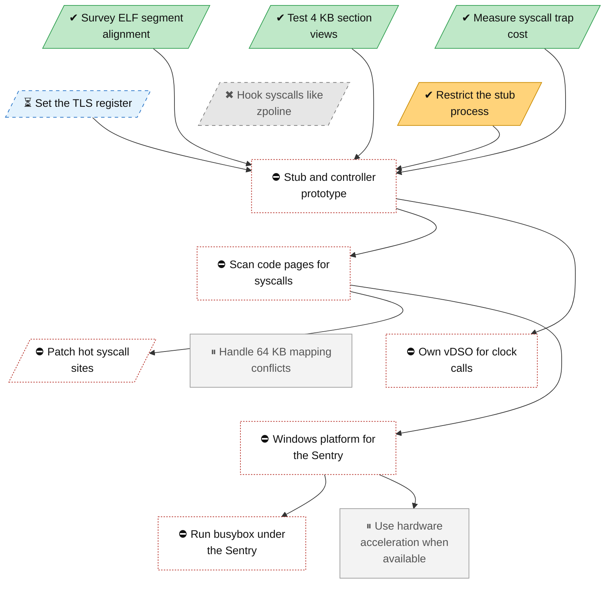

<!-- Generated by build.py from roadmap/nodes.yaml. Do not edit. -->

# platform - platform

Scope: stub processes, syscall trap, memory mapping, TLS.

[Back to the page](../../roadmap.md) · [legend](../../roadmap.md#legend)

<!-- BEGIN GENERATED: track-platform -->

<!-- END GENERATED: track-platform -->

## Node table

<!-- BEGIN GENERATED: table-platform -->
| id | title | kind | lane | state | outcome | start | end | depends_on | replaced_by | qualified_by | headline | evidence |
|---|---|---|---|---|---|---|---|---|---|---|---|---|
| `platform-elf-alignment-survey` | Survey ELF segment alignment | experiment | linux-ci | done | successful | 2026-11-26 | 2026-11-26 | research-gvisor-base |  |  |  | docs/results/0a-linux.md |
| `platform-trap-cost` | Measure syscall trap cost | experiment | windows-local | done | successful | 2026-11-26 | 2026-11-26 | research-gvisor-base |  |  | about 8 us per trap | docs/results/0b-windows.md |
| `platform-4k-section-views` | Test 4 KB section views | experiment | windows-local | done | successful | 2026-11-26 | 2026-11-26 | research-gvisor-base |  |  |  | docs/results/0b-windows.md |
| `platform-tls-register` | Set the TLS register | experiment | windows-local | in-progress | unrated | 2026-11-26 |  | research-gvisor-base |  |  |  | docs/results/0b-windows.md |
| `platform-restricted-stub` | Restrict the stub process | experiment | windows-local | done | mixed | 2026-11-26 | 2026-11-26 | research-gvisor-base |  |  |  | docs/results/0b-windows.md |
| `platform-stub-controller` | Stub and controller prototype | feature | windows-local | blocked | unrated |  |  | ops-phase0-go-no-go, platform-trap-cost, platform-4k-section-views, platform-tls-register, platform-restricted-stub |  |  |  |  |
| `platform-page-verification` | Scan code pages for syscalls | feature | windows-local | blocked | unrated |  |  | platform-stub-controller |  |  |  |  |
| `platform-syscall-fast-path` | Patch hot syscall sites | experiment | windows-local | blocked | unrated |  |  | platform-page-verification |  |  |  |  |
| `platform-own-vdso` | Own vDSO for clock calls | feature | windows-local | blocked | unrated |  |  | platform-stub-controller |  |  |  |  |
| `platform-64k-mapping-conflicts` | Handle 64 KB mapping conflicts | feature | windows-local | parked | unrated |  |  | sentry-memory-file-sections, platform-elf-alignment-survey |  |  |  |  |
| `platform-winstub` | Windows platform for the Sentry | feature | windows-local | blocked | unrated |  |  | platform-stub-controller, platform-page-verification, sentry-memory-file-sections, ops-syscall-test-strategy |  |  |  |  |
| `platform-busybox-on-windows` | Run busybox under the Sentry | feature | windows-local | blocked | unrated |  |  | platform-winstub, sentry-event-loop-iocp, sentry-timers-and-clocks, sentry-fault-recovery, sentry-host-stdio-and-tty, fs-root-filesystem-source |  |  |  |  |
| `platform-hardware-acceleration` | Use hardware acceleration when available | feature | windows-local | parked | unrated |  |  | platform-winstub |  |  |  |  |
| `platform-zpoline-hooks` | Hook syscalls like zpoline | experiment | windows-local | abandoned | dead-end | 2026-11-26 | 2026-11-26 |  |  |  |  | docs/results/0b-windows.md |

### Details per node

| id | title | verdict | headline | in plain words | notes | confirmed | waiting on | queue order | order reason |
|---|---|---|---|---|---|---|---|---|---|
| `platform-elf-alignment-survey` | Survey ELF segment alignment | so a 64 KiB-granularity host cannot map ELF segments 1:1 and the conflict path of R2 is the common case. |  | Count how often program files place code at addresses Windows cannot map directly (64 KB alignment). | Done when: per-image counts are in docs/results/0a-linux.md. |  |  |  |  |
| `platform-trap-cost` | Measure syscall trap cost | A `ud2` caught by a raw-assembly vectored exception handler costs about 8 us per trap on this QEMU-guest machine | about 8 us per trap | Measure what it costs to catch one Linux system call on Windows and hand it to another process. | Done when: S1 results are in docs/results/0b-windows.md. |  |  |  |  |
| `platform-4k-section-views` | Test 4 KB section views | With placeholders, a non-elevated process can map section views into a child at 4 KB-aligned addresses (not 64 KB-aligned), at 4 KB-multiple file offsets, with 4 KB view sizes, and change protection per 4 KB page |  | Check whether Windows can map shared memory at the 4 KB steps Linux programs expect, instead of 64 KB. | Done when: S2 results are in docs/results/0b-windows.md. |  |  |  |  |
| `platform-tls-register` | Set the TLS register |  |  | Check whether a normal Windows program can set the register Linux programs use for thread-local data; without it native execution fails. | Go/no-go. Done when: S3 results are in docs/results/0b-windows.md. |  | measuring FS base loss and fault-based repair on hosted runners |  |  |
| `platform-restricted-stub` | Restrict the stub process | so the restriction reduces what it could do but does not make a missed trap harmless. |  | Check that the process running Linux code can be locked down, so a missed system call does little harm. | Done when: S4 results are in docs/results/0b-windows.md. |  |  |  |  |
| `platform-stub-controller` | Stub and controller prototype |  |  | A tiny Windows process runs a static Linux program while a second process catches and answers its system calls. | Done when: a static x86-64 binary writes, forks and exits correctly under the controller, without the Sentry; per-syscall cost recorded. |  |  |  |  |
| `platform-page-verification` | Scan code pages for syscalls |  |  | Before guest code may run, each page is scanned for every instruction that enters the Windows kernel and those are rewritten to traps. | Done when: no page is ever writable and executable at once; a test binary with syscall, sysenter, int and JIT-generated code never reaches the NT kernel. |  |  |  |  |
| `platform-syscall-fast-path` | Patch hot syscall sites |  |  | Call sites that trapped once are patched to jump straight into the controller hand-off, avoiding the exception cost. | Done when: a getpid loop runs measurably faster than the trap-only path, with the numbers written up. |  |  |  |  |
| `platform-own-vdso` | Own vDSO for clock calls |  |  | Time and CPU queries are answered inside the stub, so they need no trap at all. | Done when: clock_gettime, gettimeofday and getcpu run without a trap and return correct values. |  |  |  |  |
| `platform-64k-mapping-conflicts` | Handle 64 KB mapping conflicts |  |  | When Linux puts two file pieces inside one 64 KB Windows window, the Sentry copies them into one fresh range instead. | Parked: the ELF survey shows non-64K-aligned segments in 73-82% of files, but S2 showed 4 KB section views work with placeholders on Windows 10.0.26300, so no conflict path is needed there. Done when: needed only on Windows builds without 4 KB placeholder views. |  |  |  |  |
| `platform-winstub` | Windows platform for the Sentry |  |  | gVisor's platform interface implemented for Windows: address spaces, context switches and syscall delivery through stub processes. | Done when: pkg/sentry/platform/winstub passes the platform's own tests on Windows. |  |  |  |  |
| `platform-busybox-on-windows` | Run busybox under the Sentry |  |  | First end-to-end milestone: gVisor's kernel runs an unmodified busybox shell on Windows. | Done when: busybox sh runs a script with fork, exec, pipes and mmap under the Sentry on Windows as a standard user. |  |  |  |  |
| `platform-hardware-acceleration` | Use hardware acceleration when available |  |  | Where the Windows Hypervisor Platform is enabled, a second platform could run guests in a hardware VM, chosen automatically like runsc's autoplatform. | Done when: a WHPX platform is picked automatically when available and falls back to stub processes. |  |  |  |  |
| `platform-zpoline-hooks` | Hook syscalls like zpoline | A standard user cannot map memory below 0x10000, so zpoline's trampoline at address 0 cannot be ported to Windows and syscall sites must be rewritten to traps or jumps instead. |  | Rewriting each syscall into a call to a trampoline at address 0 cannot work on Windows. |  |  |  |  |  |

### Folded items per node

- `platform-tls-register`: Set the TLS register
  - Fails on the QEMU-guest dev machine without FSGSBASE (2026-11-26, commit 22d422737)
  - Works on a hosted runner, but the base is lost after Sleep (2026-11-26, session record)
<!-- END GENERATED: table-platform -->
