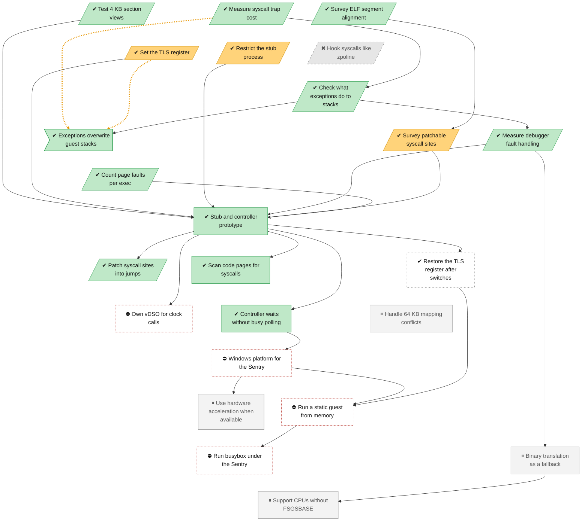

<!-- Generated by build.py from roadmap/nodes.yaml. Do not edit. -->

# platform - platform

Scope: stub processes, syscall trap, memory mapping, TLS.

[Back to the page](../../roadmap.md) · [legend](../../roadmap.md#legend)

<!-- BEGIN GENERATED: track-platform -->

<!-- END GENERATED: track-platform -->

## Node table

<!-- BEGIN GENERATED: table-platform -->
| id | title | kind | lane | state | outcome | start | end | depends_on | replaced_by | qualified_by | headline | evidence |
|---|---|---|---|---|---|---|---|---|---|---|---|---|
| `platform-elf-alignment-survey` | Survey ELF segment alignment | experiment | linux-ci | done | successful | 2026-11-26 | 2026-11-26 | research-gvisor-base |  |  |  | docs/results/0a-linux.md |
| `platform-trap-cost` | Measure syscall trap cost | experiment | windows-local | done | successful | 2026-11-26 | 2026-11-26 | research-gvisor-base |  | platform-veh-on-guest-stack-unsafe | about 8 us per trap | docs/results/0b-windows.md |
| `platform-4k-section-views` | Test 4 KB section views | experiment | windows-local | done | successful | 2026-11-26 | 2026-11-26 | research-gvisor-base |  |  |  | docs/results/0b-windows.md |
| `platform-tls-register` | Set the TLS register | experiment | windows-local | done | mixed | 2026-11-26 | 2026-11-26 | research-gvisor-base |  | platform-veh-on-guest-stack-unsafe | about 1.1-2.2 us per repair | docs/results/0b-windows.md |
| `platform-restricted-stub` | Restrict the stub process | experiment | windows-local | done | mixed | 2026-11-26 | 2026-11-26 | research-gvisor-base |  |  |  | docs/results/0b-windows.md |
| `platform-stub-controller` | Stub and controller prototype | feature | windows-ci | done | successful | 2026-11-26 | 2026-11-26 | ops-phase0-go-no-go, platform-trap-cost, platform-4k-section-views, platform-tls-register, platform-restricted-stub, platform-exception-stack, platform-debug-event-cost, platform-syscall-site-survey, platform-faults-per-exec |  |  |  | docs/results/1a-stub-prototype.md; docs/adr/0011-stub-process-design.md; docs/adr/0012-eager-patching-and-non-blocking-debug-events.md |
| `platform-page-verification` | Scan code pages for syscalls | feature | windows-ci | done | successful | 2026-11-26 | 2026-11-26 | platform-stub-controller |  |  |  | docs/results/1a-stub-prototype.md |
| `platform-syscall-fast-path` | Patch syscall sites into jumps | experiment | windows-ci | done | successful | 2026-11-26 | 2026-11-26 | platform-stub-controller |  |  | 0.00% of executed syscalls on the ud2 path | docs/results/1a-stub-prototype.md |
| `platform-own-vdso` | Own vDSO for clock calls | feature | windows-ci | blocked | unrated |  |  | platform-stub-controller |  |  |  |  |
| `platform-64k-mapping-conflicts` | Handle 64 KB mapping conflicts | feature | windows-ci | parked | unrated |  |  | sentry-memory-file-sections, platform-elf-alignment-survey |  |  |  |  |
| `platform-winstub` | Windows platform for the Sentry | feature | windows-ci | blocked | unrated |  |  | platform-stub-controller, sentry-memory-file-sections, ops-syscall-test-strategy, platform-controller-wakeups |  |  |  |  |
| `platform-busybox-on-windows` | Run busybox under the Sentry | feature | windows-ci | blocked | unrated |  |  | platform-winstub, sentry-event-loop-iocp, sentry-timers-and-clocks, sentry-fault-recovery, sentry-host-stdio-and-tty, fs-root-filesystem-source, platform-fs-base-repair, platform-static-guest-from-memory |  |  |  |  |
| `platform-hardware-acceleration` | Use hardware acceleration when available | feature | windows-ci | parked | unrated |  |  | platform-winstub |  |  |  |  |
| `platform-zpoline-hooks` | Hook syscalls like zpoline | experiment | windows-local | abandoned | dead-end | 2026-11-26 | 2026-11-26 |  |  |  |  | docs/results/0b-windows.md |
| `platform-fs-base-repair` | Restore the TLS register after switches | feature | windows-ci | done | unrated | 2026-11-26 | 2026-11-26 | platform-stub-controller |  |  |  | docs/results/1a-stub-prototype.md |
| `platform-no-fsgsbase-fallback` | Support CPUs without FSGSBASE | feature | windows-ci | parked | unrated |  |  | platform-binary-translation-fallback |  |  |  |  |
| `platform-exception-stack` | Check what exceptions do to stacks | experiment | windows-ci | done | successful | 2026-11-26 | 2026-11-26 | platform-trap-cost |  |  |  | docs/results/0b-windows.md |
| `platform-static-guest-from-memory` | Run a static guest from memory | feature | windows-ci | blocked | unrated |  |  | platform-winstub, sentry-fault-recovery, platform-fs-base-repair |  |  |  |  |
| `platform-veh-on-guest-stack-unsafe` | Exceptions overwrite guest stacks | defect | windows-ci | done | unrated | 2026-11-26 | 2026-11-26 | platform-exception-stack |  |  |  | docs/results/0b-windows.md; docs/adr/0010-guest-faults-via-the-debugger-syscalls-via-patching.md |
| `platform-debug-event-cost` | Measure debugger fault handling | experiment | windows-ci | done | successful | 2026-11-26 | 2026-11-26 | platform-exception-stack |  |  | about 45-60 us per fault | docs/results/0b-windows.md |
| `platform-syscall-site-survey` | Survey patchable syscall sites | experiment | linux-ci | done | mixed | 2026-11-26 | 2026-11-26 | platform-elf-alignment-survey |  |  | 62-82% of executed syscalls | docs/results/0d-syscall-sites.md |
| `platform-faults-per-exec` | Count page faults per exec | experiment | linux-ci | done | successful | 2026-11-26 | 2026-11-26 | research-gvisor-benchmark |  |  | 10-57 Sentry-handled faults | docs/results/0d-syscall-sites.md |
| `platform-binary-translation-fallback` | Binary translation as a fallback | feature | windows-ci | parked | unrated |  |  | platform-debug-event-cost |  |  |  |  |
| `platform-controller-wakeups` | Controller waits without busy polling | feature | windows-ci | done | successful | 2026-11-26 | 2026-11-26 | platform-stub-controller |  |  | 0.3 us median | docs/results/1a-stub-prototype.md |

### Details per node

| id | title | verdict | headline | in plain words | notes | confirmed | waiting on | queue order | order reason |
|---|---|---|---|---|---|---|---|---|---|
| `platform-elf-alignment-survey` | Survey ELF segment alignment | so a 64 KiB-granularity host cannot map ELF segments 1:1 and the conflict path of R2 is the common case. |  | Count how often program files place code at addresses Windows cannot map directly (64 KB alignment). | Done when: per-image counts are in docs/results/0a-linux.md. |  |  |  |  |
| `platform-trap-cost` | Measure syscall trap cost | A `ud2` caught by a raw-assembly vectored exception handler costs about 8 us per trap on this QEMU-guest machine | about 8 us per trap | Measure what it costs to catch one Linux system call on Windows and hand it to another process. | Done when: S1 results are in docs/results/0b-windows.md. |  |  |  |  |
| `platform-4k-section-views` | Test 4 KB section views | With placeholders, a non-elevated process can map section views into a child at 4 KB-aligned addresses (not 64 KB-aligned), at 4 KB-multiple file offsets, with 4 KB view sizes, and change protection per 4 KB page |  | Check whether Windows can map shared memory at the 4 KB steps Linux programs expect, instead of 64 KB. | Done when: S2 results are in docs/results/0b-windows.md. |  |  |  |  |
| `platform-tls-register` | Set the TLS register | a raw vectored exception handler that re-executes `wrfsbase` restores it transparently: guest-like `fs:[0]`/`fs:[0x28]`/`fs:[-8]` loops ran 10 s under contention with 0 wrong reads and about 1.1-2.2 us per repair | about 1.1-2.2 us per repair | Check whether a normal Windows program can set the register Linux programs use for thread-local data; without it native execution fails. | Go/no-go. Done when: S3 results are in docs/results/0b-windows.md. |  |  |  |  |
| `platform-restricted-stub` | Restrict the stub process | so the restriction reduces what it could do but does not make a missed trap harmless. |  | Check that the process running Linux code can be locked down, so a missed system call does little harm. | Done when: S4 results are in docs/results/0b-windows.md. |  |  |  |  |
| `platform-stub-controller` | Stub and controller prototype | PASS. A suspended PE stub, a Go controller that builds the address space from placeholders and 4 KB section views, eager `syscall` patching with a shared-memory trampoline and debugger-only fault handling run static glibc (non-PIE and PIE), fork+wait, threads and a static Go binary on a |  | The Sentry debugs a tiny Windows stub process that runs a static Linux program; patched syscalls arrive over shared memory and faults as debug events. | Done when: a static x86-64 binary writes, forks and exits correctly under the controller, without the Sentry; per-syscall cost recorded. First number: cost of creating a stub process and mapping its memory. |  |  |  |  |
| `platform-page-verification` | Scan code pages for syscalls | generated code is rescanned under W^X (a JIT guest gets the Linux results with no NT-kernel syscall) |  | Before guest code may run, each page is scanned for syscall instructions; patchable sites become jumps into the stub trampoline, the rest are made to fault into the debugger. | Done when: W^X holds (writes to executable pages drop execute permission and pages are re-scanned before running again), anonymous JIT memory is scanned on mmap and mprotect with PROT_EXEC, and a JIT test guest never reaches the NT kernel. Eager scanning with a real decoder already works in the prototype. |  |  |  |  |
| `platform-syscall-fast-path` | Patch syscall sites into jumps | Every syscall site of the glibc, fork and Go guests is patched (0.00% of executed syscalls on the ud2 path) | 0.00% of executed syscalls on the ud2 path | Syscall sites are patched like gVisor's usertrap into a jump through a table at 0x60000, so syscalls never raise an exception. | Done when: xor %eax,%eax and register-number sites (Go Syscall6, musl) are patched via a 5-byte relocating jump, and static glibc has under 1% of executed syscalls on the ud2 path (prototype: 38 of 135 glibc sites are ud2 at 60 us each). |  |  |  |  |
| `platform-own-vdso` | Own vDSO for clock calls |  |  | Time and CPU queries are answered inside the stub, so they need no trap at all. | Done when: clock_gettime, gettimeofday and getcpu run without a trap and return correct values. |  |  |  |  |
| `platform-64k-mapping-conflicts` | Handle 64 KB mapping conflicts |  |  | When Linux puts two file pieces inside one 64 KB Windows window, the Sentry copies them into one fresh range instead. | Parked: the ELF survey shows non-64K-aligned segments in 73-82% of files, but S2 showed 4 KB section views work with placeholders on Windows 10.0.26300, so no conflict path is needed there. Done when: needed only on Windows builds without 4 KB placeholder views. |  |  |  |  |
| `platform-winstub` | Windows platform for the Sentry |  |  | gVisor's platform interface implemented for Windows: address spaces, context switches and syscall delivery through stub processes. | Done when: pkg/sentry/platform/winstub passes the platform's own tests on Windows. |  |  |  |  |
| `platform-busybox-on-windows` | Run busybox under the Sentry |  |  | First end-to-end milestone: gVisor's kernel runs an unmodified busybox shell on Windows. | Done when: busybox sh runs a script with fork, exec, pipes and mmap under the Sentry on Windows as a standard user. |  |  |  |  |
| `platform-hardware-acceleration` | Use hardware acceleration when available |  |  | Where the Windows Hypervisor Platform is enabled, a second platform could run guests in a hardware VM, chosen automatically like runsc's autoplatform. | Done when: a WHPX platform is picked automatically when available and falls back to stub processes. |  |  |  |  |
| `platform-zpoline-hooks` | Hook syscalls like zpoline | A standard user cannot map memory below 0x10000, so zpoline's trampoline at address 0 cannot be ported to Windows and syscall sites must be rewritten to traps or jumps instead. |  | Rewriting each syscall into a call to a trampoline at address 0 cannot work on Windows. |  |  |  |  |  |
| `platform-fs-base-repair` | Restore the TLS register after switches |  |  | The stub sets the guest thread-local register on every return to the guest; losses from preemption arrive as debug events and the Sentry restores it. | Done in the prototype: repair via a per-thread trampoline from the debug event. A genuine null dereference costs 20 repair events before it is reported. |  |  |  |  |
| `platform-no-fsgsbase-fallback` | Support CPUs without FSGSBASE |  |  | On CPUs or VMs without the instruction to set the register, rewrite the guest's %fs accesses instead. | Done when: a glibc program runs on a machine without FSGSBASE. |  |  |  |  |
| `platform-exception-stack` | Check what exceptions do to stacks | A VEH on the guest stack is not safe |  | Windows writes exception data onto the faulting thread stack; check whether that destroys data Linux code keeps there, and what happens on unmapped stacks. | Done when: S7 results are in docs/results/0b-windows.md. |  |  |  |  |
| `platform-static-guest-from-memory` | Run a static guest from memory |  |  | Thinnest end-to-end slice: the Sentry on Windows runs one embedded static program from its own memory filesystem, without host files, network or threads. | Done when: a static hello-world and a static program that forks and execs run under the Sentry in Windows CI. |  |  |  |  |
| `platform-veh-on-guest-stack-unsafe` | Exceptions overwrite guest stacks |  |  | Windows writes about 3 KB of exception data below the faulting thread stack pointer, so in-process handlers can corrupt Linux code; faults must go to the Sentry as debugger instead. |  |  |  |  |  |
| `platform-debug-event-cost` | Measure debugger fault handling | A debugger-per-stub costs about 45-60 us per fault without touching the thread context | about 45-60 us per fault | Measure what handling a guest fault as debugger costs without touching thread context, how many events a process start makes, and whether many stubs can be debugged at once. | Done when: S8 results are in docs/results/0b-windows.md. |  |  |  |  |
| `platform-syscall-site-survey` | Survey patchable syscall sites | stock usertrap patching covers only 62-82% of executed syscalls (23% on musl) | 62-82% of executed syscalls | Count how many syscall instructions in real images can be patched into jumps, and how many would need the slow debugger path. | Done when: per-image counts by site class are in docs/results/0d-syscall-sites.md. |  |  |  |  |
| `platform-faults-per-exec` | Count page faults per exec | a fork+exec costs 10-57 Sentry-handled faults | 10-57 Sentry-handled faults | Count how many page faults gVisor takes for one fork plus exec on Linux; times the debugger cost this gives the Windows process-start cost. | Done when: faults per fork+exec and the mm MapUnit/precommit behaviour are in docs/results/0d-syscall-sites.md. |  |  |  |  |
| `platform-binary-translation-fallback` | Binary translation as a fallback |  |  | Translate guest code (as the owner's v3compat does with DynamoRIO on Linux) only if debugger faults or unpatchable syscalls prove too slow, or to support CPUs without FSGSBASE. | Parked to keep complexity down (ADR 0010). Reopen if S8, the syscall-site survey or faults per exec give tens of ms per exec. Starting points from v3compat: unseg() %fs/%gs rewrite in src/expand.c, off-stack helper thunk, cmake/FetchDynamoRIO.cmake, translation stress tests; its measured DynamoRIO overhead is 1.15-1.67x on plain code but 2.4x (Node) to 13x (Java) on JIT startup. |  |  |  |  |
| `platform-controller-wakeups` | Controller waits without busy polling | an event hand-off keeps the patched syscall at 0.3 us median | 0.3 us median | The prototype controller polls all stubs on one thread and starves guests on small machines; replace it with spin-then-wait hand-offs per stub thread. | Done when: the Go guest runs on a 4-vCPU runner with no FS-base losses caused by controller starvation and syscall latency stays near 0.3 us. |  |  |  |  |

### Folded items per node

- `platform-tls-register`: Set the TLS register
  - Fails on the QEMU-guest dev machine without FSGSBASE (2026-11-26, commit 22d422737)
  - Base lost on every deschedule, repaired by a fault handler (2026-11-26, commit 0b867b6a3)
- `platform-restricted-stub`: Restrict the stub process
  - Low-integrity child dies at startup on the hosted runner, 0xC0000142 (2026-11-26, session record)
- `platform-stub-controller`: Stub and controller prototype
  - Patched syscall 0.30 us, ud2 path 60 us, process start 17.7 ms, fork 19.8 ms (2026-11-26, commit 00421bf4e)
  - Trap table moved to 0xB0000: Windows maps fixed regions at 0x10000-0x94000 (2026-11-26, commit 00421bf4e)
  - One view per 4 KB page: parts of a view cannot be unmapped (2026-11-26, commit 00421bf4e)
- `platform-page-verification`: Scan code pages for syscalls
  - Views must be mapped RWX and lowered, raising map cost to 7.9 us per page (2026-11-26, commit b5cc61e9b)
- `platform-controller-wakeups`: Controller waits without busy polling
  - Remaining 8-9 %fs repairs per Go run follow debug events, which stop all threads (2026-11-26, commit b5cc61e9b)
<!-- END GENERATED: table-platform -->
