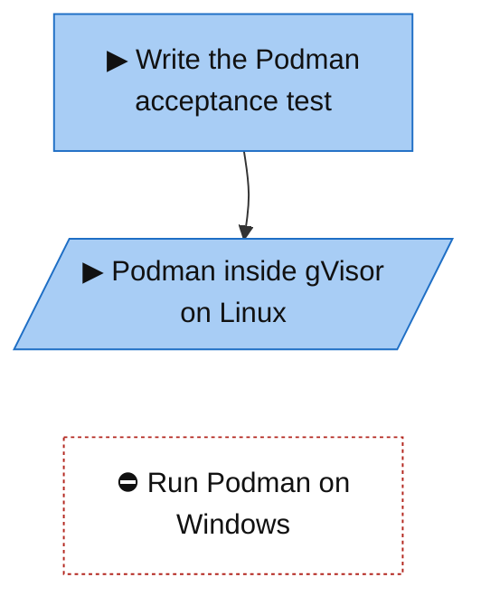

<!-- Generated by build.py from roadmap/nodes.yaml. Do not edit. -->

# podman - podman

Scope: Podman engine inside the sandbox, Windows front-end, acceptance test.

[Back to the page](../../roadmap.md) · [legend](../../roadmap.md#legend)

<!-- BEGIN GENERATED: track-podman -->

<!-- END GENERATED: track-podman -->

## Node table

<!-- BEGIN GENERATED: table-podman -->
| id | title | kind | lane | state | outcome | start | end | depends_on | replaced_by | qualified_by | headline | evidence |
|---|---|---|---|---|---|---|---|---|---|---|---|---|
| `podman-acceptance-test` | Write the Podman acceptance test | tooling | linux-ci | in-progress | unrated | 2026-11-26 |  | research-gvisor-base |  |  |  |  |
| `podman-inside-gvisor-linux` | Podman inside gVisor on Linux | experiment | linux-ci | in-progress | unrated | 2026-11-26 |  | podman-acceptance-test |  |  |  |  |
| `podman-acceptance-on-windows` | Run Podman on Windows | feature | windows-local | blocked | unrated | 2026-11-26 |  | ops-phase0-go-no-go |  |  |  |  |

### Details per node

| id | title | verdict | headline | in plain words | notes | confirmed | waiting on | queue order | order reason |
|---|---|---|---|---|---|---|---|---|---|
| `podman-acceptance-test` | Write the Podman acceptance test |  |  | One test of ten steps defines when Podman counts as working: pull, run, build, mounts, ports, compose, restart, isolation. | Done when: the test exists under test/e2e/podman-acceptance and passes against native Podman on Linux. |  |  |  |  |
| `podman-inside-gvisor-linux` | Podman inside gVisor on Linux |  |  | Check on Linux whether Podman's engine runs inside gVisor at all; this is the baseline for the Windows port. | Done when: the acceptance test ran against Podman inside runsc and docs/results/0a-linux.md records each step. |  |  |  |  |
| `podman-acceptance-on-windows` | Run Podman on Windows |  |  | The goal: a standard Windows user runs Podman containers with no admin, VM, WSL or Hyper-V. | Done when: all 10 acceptance steps pass in CI on windows-latest as a standard user. |  |  |  |  |
<!-- END GENERATED: table-podman -->
