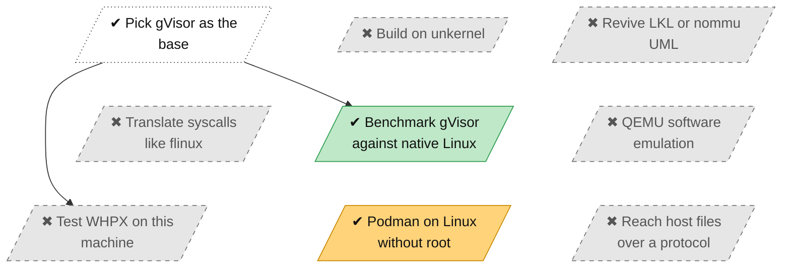

<!-- Generated by build.py from roadmap/nodes.yaml. Do not edit. -->

# research - research

Scope: choosing the base and rejected designs.

[Back to the page](../../roadmap.md) · [legend](../../roadmap.md#legend)

<!-- BEGIN GENERATED: track-research -->

<!-- END GENERATED: track-research -->

## Node table

<!-- BEGIN GENERATED: table-research -->
| id | title | kind | lane | state | outcome | start | end | depends_on | replaced_by | qualified_by | headline | evidence |
|---|---|---|---|---|---|---|---|---|---|---|---|---|
| `research-gvisor-base` | Pick gVisor as the base | experiment | none | done | unrated | 2026-11-17 | 2026-11-26 |  |  |  |  | docs/adr/0001-port-gvisor-to-windows-hosts.md |
| `research-lkl-nommu` | Revive LKL or nommu UML | experiment | none | abandoned | dead-end | 2026-11-26 | 2026-11-26 |  |  |  |  | docs/adr/0001-port-gvisor-to-windows-hosts.md |
| `research-unkernel` | Build on unkernel | experiment | none | abandoned | dead-end | 2026-11-26 | 2026-11-26 |  |  |  |  | docs/adr/0001-port-gvisor-to-windows-hosts.md |
| `research-flinux-translation` | Translate syscalls like flinux | experiment | none | abandoned | dead-end | 2026-11-26 | 2026-11-26 |  |  |  |  | docs/adr/0001-port-gvisor-to-windows-hosts.md |
| `research-qemu-emulation` | QEMU software emulation | experiment | none | abandoned | dead-end | 2026-11-26 | 2026-11-26 |  |  |  |  | docs/adr/0001-port-gvisor-to-windows-hosts.md |
| `research-gvisor-benchmark` | Benchmark gVisor against native Linux | experiment | linux-ci | done | successful | 2026-11-26 | 2026-11-26 | research-gvisor-base |  |  | 5.3 s against 0.9 s | docs/results/0a-linux.md |
| `research-whpx-this-machine` | Test WHPX on this machine | experiment | windows-local | abandoned | dead-end | 2026-11-26 | 2026-11-26 | research-gvisor-base |  |  |  | docs/results/0b-windows.md |
| `research-file-protocol` | Reach host files over a protocol | experiment | none | abandoned | dead-end | 2026-11-26 | 2026-11-26 |  |  |  |  | docs/adr/0005-host-files-accessed-directly.md |
| `research-linux-rootless-podman` | Podman on Linux without root | experiment | linux-ci | done | mixed | 2026-11-28 | 2026-11-28 |  |  |  |  | docs/results/0e-linux-rootless.md |

### Details per node

| id | title | verdict | headline | in plain words | notes | confirmed | waiting on | queue order | order reason |
|---|---|---|---|---|---|---|---|---|---|
| `research-gvisor-base` | Pick gVisor as the base |  |  | Of all ways to run Linux code on Windows without admin, gVisor's user-space Linux kernel is the only one that already runs containers. |  |  |  |  |  |
| `research-lkl-nommu` | Revive LKL or nommu UML | Real Linux kernel, but nommu mode has no `fork()` and no memory protection between processes; LKL dropped Windows hosts in 2020; nommu UML is unmerged (v14, Feb 2026). |  | Running the real Linux kernel as a library was rejected: without memory management it cannot fork, and its Windows support is gone. |  |  |  |  |  |
| `research-unkernel` | Build on unkernel | Runs Linux compiled to wasm off Linux today, but guest code is always emulated (aarch64 only), so it cannot run x86 user code natively. |  | Linux compiled to WebAssembly runs anywhere, but it always emulates the programs, so it cannot reach native speed. |  |  |  |  |  |
| `research-flinux-translation` | Translate syscalls like flinux | Translates Linux syscalls onto Windows calls; has no namespaces, cgroups or overlay, so it cannot host a container engine without writing a kernel. |  | Mapping each Linux call onto a Windows call cannot provide what containers need, such as namespaces and cgroups. |  |  |  |  |  |
| `research-qemu-emulation` | QEMU software emulation | Works today, but software emulation of the whole machine is several times slower; WHPX needs a one-time admin step. |  | Emulating a whole computer in software works but is several times slower, so it is no base for the port. |  |  |  |  |  |
| `research-gvisor-benchmark` | Benchmark gVisor against native Linux | runsc/systrap was about 5x slower on fork+exec (2000 `/bin/true`: 5.3 s against 0.9 s), 2 to 3 times slower on small-file work on a bind mount, about 1.1x to 1.4x on CPU-bound work | 5.3 s against 0.9 s | Measure how much slower process start, small files and CPU work are inside gVisor than natively. | Done when: the benchmark table is in docs/results/0a-linux.md. |  |  |  |  |
| `research-whpx-this-machine` | Test WHPX on this machine | WHPX cannot be used on this machine as a standard user (QEMU reports "WHPX: No accelerator found"), so only QEMU software emulation (TCG) works here |  | Check whether QEMU can use the Windows hypervisor here without admin, as a fast stopgap. | Done when: S6 results are in docs/results/0b-windows.md. |  |  |  |  |
| `research-file-protocol` | Reach host files over a protocol | Here the Sentry is the kernel and runs on the same machine as the files; gVisor has no NFS client. |  | Serving Windows files to the sandbox over NFS, 9P or gVisor's lisafs was rejected: the sandbox runs on the same machine and can open them itself. |  |  |  |  |  |
| `research-linux-rootless-podman` | Podman on Linux without root | feasible with 1 known fix (host networking works today, 9 of 10 steps pass) |  | This branch's runsc runs an unmodified Podman engine as an ordinary Linux user without Docker; 9 of 10 steps pass with host networking. | Spike for a Linux bundle in lhns/podman-portable. |  |  |  |  |

### Folded items per node

- `research-gvisor-base`: Pick gVisor as the base
  - Low addresses unmappable for a standard user, so zpoline cannot work (2026-11-26, session record)
  - Sandbox side measured: 265 packages, 88 using Linux host calls (2026-11-26, session record)
  - gVisor's gofer uses lisafs, not 9P; directfs exists (2026-11-26, session record)
<!-- END GENERATED: table-research -->
