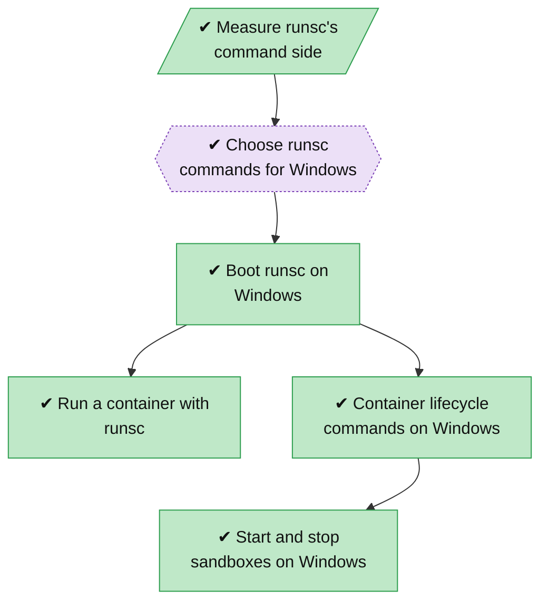

<!-- Generated by build.py from roadmap/nodes.yaml. Do not edit. -->

# runsc - runsc

Scope: gVisor's runtime on Windows hosts: commands, sandbox lifecycle, OCI bundles.

[Back to the page](../../roadmap.md) · [legend](../../roadmap.md#legend)

<!-- BEGIN GENERATED: track-runsc -->

<!-- END GENERATED: track-runsc -->

## Node table

<!-- BEGIN GENERATED: table-runsc -->
| id | title | kind | lane | state | outcome | start | end | depends_on | replaced_by | qualified_by | headline | evidence |
|---|---|---|---|---|---|---|---|---|---|---|---|---|
| `runsc-container-on-windows` | Run a container with runsc | feature | windows-ci | done | successful | 2026-11-26 | 2026-11-26 | runsc-windows-boot, fs-windows-directfs, sentry-threads-and-signals, ops-windows-ci-standard-user |  |  |  | docs/results/3-runsc-boot.md |
| `runsc-measure-cli` | Measure runsc's command side | experiment | none | done | successful | 2026-11-26 | 2026-11-26 | research-gvisor-base |  |  | about 42k lines | docs/results/runsc-command-side.md |
| `runsc-windows-commands` | Choose runsc commands for Windows | owner-decision | owner | done | n/a | 2026-11-26 | 2026-11-26 | runsc-measure-cli |  |  |  | docs/adr/0008-runsc-on-windows.md |
| `runsc-sandbox-lifecycle` | Start and stop sandboxes on Windows | feature | windows-ci | done | successful | 2026-11-27 | 2026-11-27 | runsc-windows-lifecycle-commands |  |  |  | docs/results/3b-runsc-speed-lifecycle.md |
| `runsc-windows-boot` | Boot runsc on Windows | feature | windows-ci | done | successful | 2026-11-26 | 2026-11-26 | platform-static-guest-from-memory, runsc-windows-commands |  |  |  | docs/results/3-runsc-boot.md; docs/adr/0017-runsc-run-boots-in-process.md |
| `runsc-windows-lifecycle-commands` | Container lifecycle commands on Windows | feature | windows-ci | done | successful | 2026-11-27 | 2026-11-27 | runsc-windows-boot |  |  |  | docs/results/3b-runsc-speed-lifecycle.md; docs/adr/0019-sandbox-process-and-control-pipe.md |

### Details per node

| id | title | verdict | headline | in plain words | notes | confirmed | waiting on | queue order | order reason |
|---|---|---|---|---|---|---|---|---|---|
| `runsc-container-on-windows` | Run a container with runsc | `runsc.exe run` on stock Windows boots the real Loader in-process and runs a glibc guest and busybox from a Windows-folder rootfs with stdio, exit codes, stdin, a windows-nat network, a published port and a ConPTY-driven terminal with resize and Ctrl-C, as a standard user |  | The main goal: gVisor's runtime runs an OCI container on Windows for a standard user, with no admin, VM, WSL or Hyper-V. | Done: runsc.exe run starts an OCI bundle on windows-latest as a standard user with output and exit code. Lifecycle commands (create/start/exec/...) are tracked separately and do not gate this. |  |  |  |  |
| `runsc-measure-cli` | Measure runsc's command side | runsc's container-management side adds 35 packages and about 42k lines beyond the sandbox, of which about 31k lines in 17 packages use Linux host calls | about 42k lines | Measure how much of runsc's container management (commands, sandbox, gofer, cli) is Linux-only. | Done when: the Linux-only parts of runsc/cmd, container, sandbox, gofer and cli are listed with sizes. |  |  |  |  |
| `runsc-windows-commands` | Choose runsc commands for Windows |  |  | Decide which runsc commands the Windows build supports first and how it is driven. | Done when: an ADR lists the supported commands and the OCI bundle layout on Windows. |  |  |  |  |
| `runsc-sandbox-lifecycle` | Start and stop sandboxes on Windows | runsc.exe now runs the full create/start/exec/kill/delete lifecycle on a detached sandbox with a user-only control pipe |  | runsc creates, starts, signals and deletes a sandbox process on Windows that outlives runsc.exe. | Done when: runsc create/start/kill/delete work on Windows and leave no processes behind. |  |  |  |  |
| `runsc-windows-boot` | Boot runsc on Windows | `runsc.exe run` on stock Windows boots the real Loader in-process and runs a glibc guest and busybox from a Windows-folder rootfs with stdio, exit codes, stdin, a windows-nat network, a published port and a ConPTY-driven terminal with resize and Ctrl-C, as a standard user |  | runsc's real boot path on Windows (spec, mounts, stdio, network) replaces the test harness that builds the kernel by hand. | Done when: runsc boot on Windows starts a sandbox from an OCI spec with the windows-nat network and a tmpfs or directfs root, and the static guests pass through it. |  |  |  |  |
| `runsc-windows-lifecycle-commands` | Container lifecycle commands on Windows | runsc.exe now runs the full create/start/exec/kill/delete lifecycle on a detached sandbox with a user-only control pipe |  | create, start, state, kill, delete, exec, ps and list need a sandbox process that outlives runsc.exe and a named control pipe; only run and version exist today. | Done when: Podman-style lifecycle (create, start, exec, kill, delete, state, list) works on Windows against a sandbox process, tested in CI. |  |  |  |  |

### Folded items per node

- `runsc-windows-boot`: Boot runsc on Windows
  - Each runsc run takes 0.4-0.5 s (2026-11-26, commit 7f1e94454)
<!-- END GENERATED: table-runsc -->
