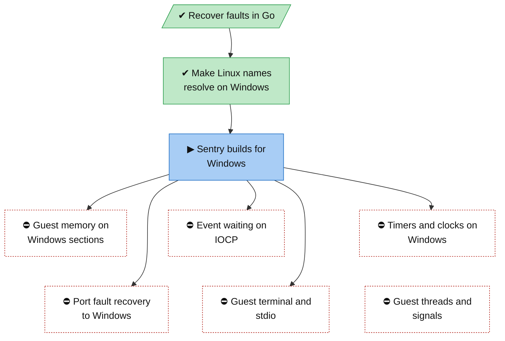

<!-- Generated by build.py from roadmap/nodes.yaml. Do not edit. -->

# sentry - sentry

Scope: Windows host layers for gVisor's Sentry.

[Back to the page](../../roadmap.md) · [legend](../../roadmap.md#legend)

<!-- BEGIN GENERATED: track-sentry -->

<!-- END GENERATED: track-sentry -->

## Node table

<!-- BEGIN GENERATED: table-sentry -->
| id | title | kind | lane | state | outcome | start | end | depends_on | replaced_by | qualified_by | headline | evidence |
|---|---|---|---|---|---|---|---|---|---|---|---|---|
| `sentry-go-fault-recovery` | Recover faults in Go | experiment | windows-local | done | successful | 2026-11-26 | 2026-11-26 | research-gvisor-base |  |  | about 6 us per fault | docs/results/0b-windows.md |
| `sentry-windows-build` | Sentry builds for Windows | feature | windows-ci | in-progress | unrated | 2026-11-26 |  | sentry-unix-shim, sentry-go-fault-recovery |  |  |  | docs/results/1b-windows-build.md |
| `sentry-memory-file-sections` | Guest memory on Windows sections | feature | windows-ci | blocked | unrated |  |  | sentry-windows-build, platform-4k-section-views, ops-syscall-test-strategy |  |  |  |  |
| `sentry-event-loop-iocp` | Event waiting on IOCP | feature | windows-ci | blocked | unrated |  |  | sentry-windows-build, ops-syscall-test-strategy |  |  |  |  |
| `sentry-timers-and-clocks` | Timers and clocks on Windows | feature | windows-ci | blocked | unrated |  |  | sentry-windows-build, ops-syscall-test-strategy |  |  |  |  |
| `sentry-fault-recovery` | Port fault recovery to Windows | feature | windows-ci | blocked | unrated |  |  | sentry-windows-build, sentry-go-fault-recovery |  |  |  |  |
| `sentry-host-stdio-and-tty` | Guest terminal and stdio | feature | windows-ci | blocked | unrated |  |  | sentry-windows-build |  |  |  |  |
| `sentry-threads-and-signals` | Guest threads and signals | feature | windows-ci | blocked | unrated |  |  | platform-winstub |  |  |  |  |
| `sentry-unix-shim` | Make Linux names resolve on Windows | feature | none | done | successful | 2026-11-26 | 2026-11-26 | ops-phase0-go-no-go |  |  | 25 hand-edited shared files | docs/adr/0006-a-linux-abi-shim-for-x-sys-unix.md; docs/results/1b-windows-build.md |

### Details per node

| id | title | verdict | headline | in plain words | notes | confirmed | waiting on | queue order | order reason |
|---|---|---|---|---|---|---|---|---|---|
| `sentry-go-fault-recovery` | Recover faults in Go | is recoverable via `debug.SetPanicOnFault(true)` + `recover` at about 6 us per fault | about 6 us per fault | Check that the Go kernel process can survive reading bad guest memory on Windows, as it does on Linux. | Done when: S5 results are in docs/results/0b-windows.md. |  |  |  |  |
| `sentry-windows-build` | Sentry builds for Windows |  |  | gVisor's kernel compiles as a Windows program, with host-specific parts stubbed out. | Done when: the Sentry process starts on Windows and reaches its init without a guest. Compiling is done; Linux-specific assembly (safecopy handler, hosttid, cpuid) still has to be replaced. |  |  |  |  |
| `sentry-memory-file-sections` | Guest memory on Windows sections |  |  | The Sentry's memory file becomes a Windows section object, allocated in 64 KB units. | Done when: pgalloc allocates, maps into a stub and copy-on-write-breaks memory on Windows; mm tests pass. |  |  |  |  |
| `sentry-event-loop-iocp` | Event waiting on IOCP |  |  | Waiting for many host events at once (epoll on Linux) moves to Windows completion ports. | Done when: fdnotifier's Windows backend delivers readiness for sockets and pipes; its tests pass. |  |  |  |  |
| `sentry-timers-and-clocks` | Timers and clocks on Windows |  |  | The Sentry's clocks and timers run on Windows' high-resolution timers. | Done when: sleep, timerfd and clock tests pass inside a guest on Windows. |  |  |  |  |
| `sentry-fault-recovery` | Port fault recovery to Windows |  |  | The Sentry's safe copies of guest memory recover from access violations on Windows instead of crashing. | Done when: pkg/safecopy's Windows variant returns an error for a faulting guest address under concurrent copies. |  |  |  |  |
| `sentry-host-stdio-and-tty` | Guest terminal and stdio |  |  | A guest program's input, output and terminal connect to the Windows console (ConPTY), including Ctrl-C. | Done when: an interactive guest shell works in Windows Terminal with resize and Ctrl-C. |  |  |  |  |
| `sentry-threads-and-signals` | Guest threads and signals |  |  | Multi-threaded guests (such as Go programs) get one stub thread per guest thread, with signals delivered correctly. | Done when: a multi-threaded Go program and a signal-handling test run correctly under the Sentry on Windows. |  |  |  |  |
| `sentry-unix-shim` | Make Linux names resolve on Windows | the sandbox side compiles for Windows with 25 hand-edited shared files and one x/sys shim | 25 hand-edited shared files | A Windows copy of x/sys/unix defines the Linux constants and types and stubs the calls, so the Sentry compiles with few edits. | Done when: ./runsc/boot type-checks for GOOS=windows with Linux-only subsystems excluded by build tags. |  |  |  |  |

### Folded items per node

- `sentry-windows-build`: Sentry builds for Windows
  - GOOS=windows build of runsc/boot succeeds, CI green (2026-11-26, commit 3b38a4660)
<!-- END GENERATED: table-sentry -->
