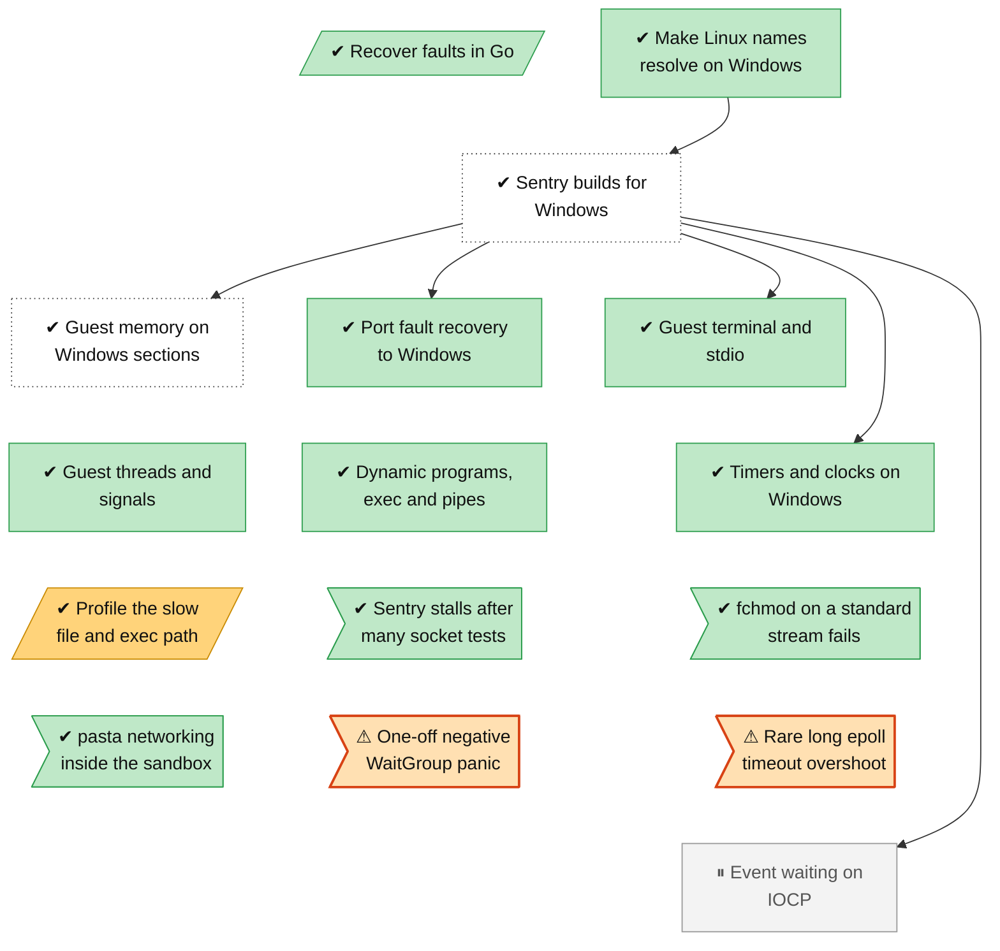

<!-- Generated by build.py from roadmap/nodes.yaml. Do not edit. -->

# sentry - sentry

Scope: Windows host layers for gVisor's Sentry.

[Back to the page](../../roadmap.md) · [legend](../../roadmap.md#legend)

<!-- BEGIN GENERATED: track-sentry -->

<!-- END GENERATED: track-sentry -->

## Node table

<!-- BEGIN GENERATED: table-sentry -->
| id | title | kind | lane | state | outcome | start | end | depends_on | replaced_by | qualified_by | headline | evidence |
|---|---|---|---|---|---|---|---|---|---|---|---|---|
| `sentry-go-fault-recovery` | Recover faults in Go | experiment | windows-local | done | successful | 2026-11-26 | 2026-11-26 | research-gvisor-base |  |  | about 6 us per fault | docs/results/0b-windows.md |
| `sentry-windows-build` | Sentry builds for Windows | feature | none | done | unrated | 2026-11-26 | 2026-11-26 | sentry-unix-shim, sentry-go-fault-recovery |  |  |  | docs/results/1b-windows-build.md; docs/results/1b-sentry-host-basics.md |
| `sentry-memory-file-sections` | Guest memory on Windows sections | feature | windows-ci | done | unrated | 2026-11-26 | 2026-11-26 | sentry-windows-build, platform-4k-section-views, ops-syscall-test-strategy |  |  |  | docs/results/1b-sentry-host-basics.md; docs/adr/0013-memory-file-on-reserved-sections.md; docs/results/1c-windows-platform.md |
| `sentry-event-loop-iocp` | Event waiting on IOCP | feature | windows-ci | parked | unrated |  |  | sentry-windows-build, ops-syscall-test-strategy |  |  |  |  |
| `sentry-timers-and-clocks` | Timers and clocks on Windows | feature | windows-ci | done | successful | 2026-11-27 | 2026-11-27 | sentry-windows-build, ops-syscall-test-strategy |  |  |  | docs/results/3d-clocks-upstream.md |
| `sentry-fault-recovery` | Port fault recovery to Windows | feature | none | done | successful | 2026-11-26 | 2026-11-26 | sentry-windows-build, sentry-go-fault-recovery |  |  | 1.3 us per fault | docs/results/1b-sentry-host-basics.md |
| `sentry-host-stdio-and-tty` | Guest terminal and stdio | feature | windows-ci | done | successful | 2026-11-26 | 2026-11-26 | sentry-windows-build |  |  |  | docs/results/3-runsc-boot.md; docs/adr/0017-runsc-run-boots-in-process.md |
| `sentry-threads-and-signals` | Guest threads and signals | feature | windows-ci | done | successful | 2026-11-26 | 2026-11-26 | platform-winstub |  |  |  | docs/results/1f-exec-signals.md |
| `sentry-unix-shim` | Make Linux names resolve on Windows | feature | none | done | successful | 2026-11-26 | 2026-11-26 | ops-phase0-go-no-go |  |  | 25 hand-edited shared files | docs/adr/0006-a-linux-abi-shim-for-x-sys-unix.md; docs/results/1b-windows-build.md |
| `sentry-dynamic-elf-and-exec` | Dynamic programs, exec and pipes | feature | windows-ci | done | successful | 2026-11-26 | 2026-11-26 | platform-static-guest-from-memory |  |  |  | docs/results/1f-exec-signals.md |
| `sentry-profile-small-file-path` | Profile the slow file and exec path | experiment | windows-ci | done | mixed | 2026-11-27 | 2026-11-27 | workloads-end-to-end-speed |  |  | 6x to 12x faster | docs/results/1i-profile.md |
| `sentry-netpoll-failure` | Sentry stalls after many socket tests | defect | windows-ci | done | unrated | 2026-11-27 | 2026-11-27 |  |  |  |  | docs/results/4-syscall-tests.md |
| `sentry-fchmod-std-stream` | fchmod on a standard stream fails | defect | windows-ci | done | unrated | 2026-11-27 | 2026-11-27 |  |  |  |  | docs/results/5-podman-windows.md |
| `sentry-pasta-in-sandbox` | pasta networking inside the sandbox | defect | windows-ci | done | unrated | 2026-11-27 | 2026-11-27 |  |  |  |  | docs/results/5-podman-windows.md |
| `sentry-waitgroup-panic` | One-off negative WaitGroup panic | defect | windows-ci | next | unrated | 2026-11-27 |  |  |  |  |  | docs/results/0b-windows.md |
| `sentry-epoll-timeout-overshoot` | Rare long epoll timeout overshoot | defect | windows-ci | next | unrated | 2026-11-27 |  |  |  |  |  | docs/results/3d-clocks-upstream.md |

### Details per node

| id | title | verdict | headline | in plain words | notes | confirmed | waiting on | queue order | order reason |
|---|---|---|---|---|---|---|---|---|---|
| `sentry-go-fault-recovery` | Recover faults in Go | is recoverable via `debug.SetPanicOnFault(true)` + `recover` at about 6 us per fault | about 6 us per fault | Check that the Go kernel process can survive reading bad guest memory on Windows, as it does on Linux. | Done when: S5 results are in docs/results/0b-windows.md. |  |  |  |  |
| `sentry-windows-build` | Sentry builds for Windows |  |  | gVisor's kernel compiles as a Windows program, with host-specific parts stubbed out. | Done when: the Sentry process starts on Windows and reaches its init without a guest. Reached on 2026-11-26: the init of every package up to runsc/boot passes on windows-latest (safecopy handler, clocks, task size and minimum address replaced; hosttid and cpuid worked as they are). |  |  |  |  |
| `sentry-memory-file-sections` | Guest memory on Windows sections |  |  | The Sentry's memory file becomes Windows section objects, one per 1 GB chunk. | Mapping memory-file sections into stubs is exercised by the platform tests; freed memory is only partly returned to Windows (ADR 0013). |  |  |  |  |
| `sentry-event-loop-iocp` | Event waiting on IOCP |  |  | Waiting for many host events at once (epoll on Linux) moves to Windows completion ports. | Parked: runsc on Windows registers no host FDs (stdio, terminal and NAT use goroutine pumps), so no IOCP backend is needed unless host-FD imports, hostinet or host Unix sockets are added. |  |  |  |  |
| `sentry-timers-and-clocks` | Timers and clocks on Windows | sleeps, clocks, timerfd, POSIX and interval timers and poll/select/epoll timeouts already behave correctly in a guest on Windows in all three legs (every wait within 1 ms of the requested time, no Sentry change needed) |  | The Sentry's clocks and timers run on Windows' high-resolution timers. | A clocks guest (sleep, clocks, timerfd, POSIX timers, itimers, timeouts) passes in all three legs; no Sentry change needed. One epoll timeout overshoot of 212 ms seen once in 12 leg runs. |  |  |  |  |
| `sentry-fault-recovery` | Port fault recovery to Windows | pkg/safecopy recovers faults on Windows through a vectored exception handler (1.3 us per fault, 292 upstream subtests passing) | 1.3 us per fault | The Sentry's safe copies of guest memory recover from access violations on Windows instead of crashing. | Done when: pkg/safecopy's Windows variant returns an error for a faulting guest address under concurrent copies. |  |  |  |  |
| `sentry-host-stdio-and-tty` | Guest terminal and stdio | `runsc.exe run` on stock Windows boots the real Loader in-process and runs a glibc guest and busybox from a Windows-folder rootfs with stdio, exit codes, stdin, a windows-nat network, a published port and a ConPTY-driven terminal with resize and Ctrl-C, as a standard user |  | A guest program's input, output and terminal connect to the Windows console (ConPTY), including Ctrl-C. | Done when: an interactive guest shell works in Windows Terminal with resize and Ctrl-C. |  |  |  |  |
| `sentry-threads-and-signals` | Guest threads and signals | Under the real Sentry on `windows-latest`, dynamic glibc and musl programs with `dlopen`, execve chains, fork+exec+wait, busybox shell pipelines |  | Multi-threaded guests (such as Go programs) get one stub thread per guest thread, with signals delivered correctly. | Done when: a multi-threaded Go program and a signal-handling test run correctly under the Sentry on Windows. |  |  |  |  |
| `sentry-unix-shim` | Make Linux names resolve on Windows | the sandbox side compiles for Windows with 25 hand-edited shared files and one x/sys shim | 25 hand-edited shared files | A Windows copy of x/sys/unix defines the Linux constants and types and stubs the calls, so the Sentry compiles with few edits. | Done when: ./runsc/boot type-checks for GOOS=windows with Linux-only subsystems excluded by build tags. |  |  |  |  |
| `sentry-dynamic-elf-and-exec` | Dynamic programs, exec and pipes | Under the real Sentry on `windows-latest`, dynamic glibc and musl programs with `dlopen`, execve chains, fork+exec+wait, busybox shell pipelines |  | Run dynamically linked programs with their interpreter and shared libraries, exec a second program, and connect processes with pipes. | Done when: a dynamic glibc and a dynamic musl program, an exec chain and a shell pipeline (static busybox sh -c "echo a \| cat") pass under the Sentry on Windows. |  |  |  |  |
| `sentry-profile-small-file-path` | Profile the slow file and exec path | trusting the Sentry's cache of the root folder made it 6x to 12x faster | 6x to 12x faster | Creating a file on tmpfs costs about 1 ms and a fork+exec 32 ms on Windows; find where the time goes (syscall round trips, page faults, debug events, Sentry work) and fix the top causes. | Done when: a profile is written up and untar of 20k files on tmpfs and fork+exec are each at least 4x faster than today. |  |  |  |  |
| `sentry-netpoll-failure` | Sentry stalls after many socket tests |  |  | After a few hundred socket test cases in one kernel the Sentry dies with "fatal error: runtime: netpoll failed" or stalls; about 1,700 syscall-test cases fail only because of this. | Cause found: not a handle leak or the netpoller; a stub process that never starts (about 1 per 100-1500 guest processes) leaves the Sentry waiting forever in newAS/Release. Moved to the platform hang defect. |  |  |  |  |
| `sentry-fchmod-std-stream` | fchmod on a standard stream fails |  |  | conmon logs "Failed to chmod stderr" and container logs are lost, so the compose check cannot read them. | Fixed: pipefs refused every mode change with EPERM; it now keeps the mode like Linux. fchmod test required in windows-runsc. |  |  |  |  |
| `sentry-pasta-in-sandbox` | pasta networking inside the sandbox |  |  | buildah RUN uses pasta, which fails: /proc/sys/net/ipv4/ip_local_port_range is missing and switching into the namespace returns EPERM. | ip_local_port_range now printed with a tab; the setns EPERM is pasta dropping its capabilities, not a Sentry bug. Builds use BUILDAH_ISOLATION=oci. |  |  |  |  |
| `sentry-waitgroup-panic` | One-off negative WaitGroup panic |  |  | A "negative WaitGroup counter" panic seen once in safecopy tests is not explained by stack overrun and did not recur in 1600 runs. | Fixed when: the cause is found, or it does not recur for a month; pkg/safecopy tests run on every push to windows (windows-sentry in ci.yml). |  |  |  |  |
| `sentry-epoll-timeout-overshoot` | Rare long epoll timeout overshoot |  |  | A 30 ms timer signal meant to interrupt epoll_wait took 212 ms once in about 12 leg runs (rewrite-fxsave); the clocks test now retries, so CI would hide a repeat. | Fixed when: the cause is known (runner stall or Sentry delay, e.g. interrupt retry waits in rewrite mode) and the check passes without retries in 30 runs. |  |  |  |  |

### Folded items per node

- `sentry-windows-build`: Sentry builds for Windows
  - GOOS=windows build of runsc/boot succeeds, CI green (2026-11-26, commit 3b38a4660)
- `sentry-threads-and-signals`: Guest threads and signals
  - A new process inside a guest costs 0.9-1.2 s; busybox pipelines take 3.3-3.8 s (2026-11-26, session record)
- `sentry-profile-small-file-path`: Profile the slow file and exec path
  - Fork+exec only 1.7-2.1x faster with a pool of ready address spaces; stub creation is the floor (2026-11-27, commit 1d513a109)
<!-- END GENERATED: table-sentry -->
