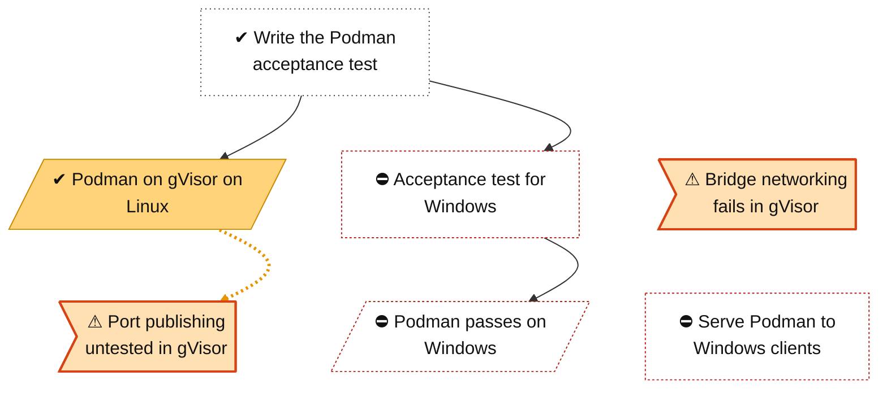

<!-- Generated by build.py from roadmap/nodes.yaml. Do not edit. -->

# workloads - workloads

Scope: workloads that measure compatibility; the Podman acceptance test is the bar.

[Back to the page](../../roadmap.md) · [legend](../../roadmap.md#legend)

<!-- BEGIN GENERATED: track-workloads -->

<!-- END GENERATED: track-workloads -->

## Node table

<!-- BEGIN GENERATED: table-workloads -->
| id | title | kind | lane | state | outcome | start | end | depends_on | replaced_by | qualified_by | headline | evidence |
|---|---|---|---|---|---|---|---|---|---|---|---|---|
| `workloads-acceptance-test` | Write the Podman acceptance test | tooling | linux-ci | done | unrated | 2026-11-26 | 2026-11-26 | research-gvisor-base |  |  |  | test/e2e/podman-acceptance/run.sh; docs/results/0a-linux.md |
| `workloads-podman-on-gvisor-linux` | Podman on gVisor on Linux | experiment | linux-ci | done | mixed | 2026-11-26 | 2026-11-26 | workloads-acceptance-test |  | workloads-gvisor-bridge-netlink, workloads-gvisor-port-publishing |  | docs/results/0a-linux.md |
| `workloads-podman-on-windows` | Podman passes on Windows | experiment | windows-ci | blocked | unrated |  |  | runsc-container-on-windows, workloads-acceptance-test-windows, net-port-forwarding, fs-persistent-storage-choice, fs-change-notifications, fs-linux-metadata-on-ntfs |  |  |  |  |
| `workloads-acceptance-test-windows` | Acceptance test for Windows | tooling | windows-ci | blocked | unrated |  |  | workloads-acceptance-test |  |  |  |  |
| `workloads-podman-harness` | Serve Podman to Windows clients | tooling | windows-ci | blocked | unrated |  |  | runsc-container-on-windows, net-port-forwarding |  |  |  |  |
| `workloads-gvisor-bridge-netlink` | Bridge networking fails in gVisor | defect | linux-ci | next | unrated |  |  |  |  |  |  | docs/results/0a-linux.md |
| `workloads-gvisor-port-publishing` | Port publishing untested in gVisor | defect | linux-ci | next | unrated |  |  |  |  |  |  | docs/results/0a-linux.md |
| `workloads-bar-host-network` | Does host networking meet the bar | owner-decision | owner | next | n/a |  |  |  |  |  |  | docs/adr/0004-phase-0-results.md |

### Details per node

| id | title | verdict | headline | in plain words | notes | confirmed | waiting on | queue order | order reason |
|---|---|---|---|---|---|---|---|---|---|
| `workloads-acceptance-test` | Write the Podman acceptance test |  |  | One test of ten steps defines when Podman counts as working: pull, run, build, mounts, ports, compose, restart, isolation. | Done when: the test exists under test/e2e/podman-acceptance and passes against native Podman on Linux. |  |  |  |  |
| `workloads-podman-on-gvisor-linux` | Podman on gVisor on Linux | passes all 10 acceptance steps when containers use host networking, the store is on a host directory (kernel overlayfs or vfs) and runsc runs with `--in-sandbox-cgroup=v2`; with the default bridge network netavark fails on its netlink socket, so only steps 1, 2 and 5 pass |  | Run the acceptance test on stock gVisor on Linux; whatever fails there is a gap in gVisor itself, not in the port. | Done when: the acceptance test ran against Podman inside runsc and docs/results/0a-linux.md records each step. |  |  |  |  |
| `workloads-podman-on-windows` | Podman passes on Windows |  |  | The bar for enough features: an unmodified Podman engine passes the acceptance test on gVisor on Windows. | Done when: all 10 acceptance steps pass in CI on windows-latest as a standard user. |  |  |  |  |
| `workloads-acceptance-test-windows` | Acceptance test for Windows |  |  | The ten acceptance steps written for Windows, driving the stock Podman and docker clients. | Done when: a PowerShell twin of the test runs the same ten steps and reports each one. |  |  |  |  |
| `workloads-podman-harness` | Serve Podman to Windows clients |  |  | The test harness runs the Podman engine on runsc and exposes its API to the stock Windows clients. | Done when: podman version from a Windows client reaches the engine running on runsc. |  |  |  |  |
| `workloads-gvisor-bridge-netlink` | Bridge networking fails in gVisor |  |  | In stock gVisor, Podman's default bridge network fails because netavark cannot open its netlink socket; only host networking works. | Open gap in gVisor itself. Fixed when: the acceptance test passes with the default bridge network on stock runsc. |  |  |  |  |
| `workloads-gvisor-port-publishing` | Port publishing untested in gVisor |  |  | Publishing container ports with -p and service-name lookup in compose never worked or were never exercised inside gVisor. | Fixed when: -p and compose service names pass inside stock runsc. |  |  |  |  |
| `workloads-bar-host-network` | Does host networking meet the bar |  |  | On Linux, steps 7 and 8 only passed with host networking; decide whether that counts or -p and compose service names are required. |  |  |  |  |  |

### Folded items per node

- `workloads-acceptance-test`: Write the Podman acceptance test
  - Native Podman baseline passes all 10 steps (2026-11-26, commit 0d3203400)
<!-- END GENERATED: table-workloads -->
