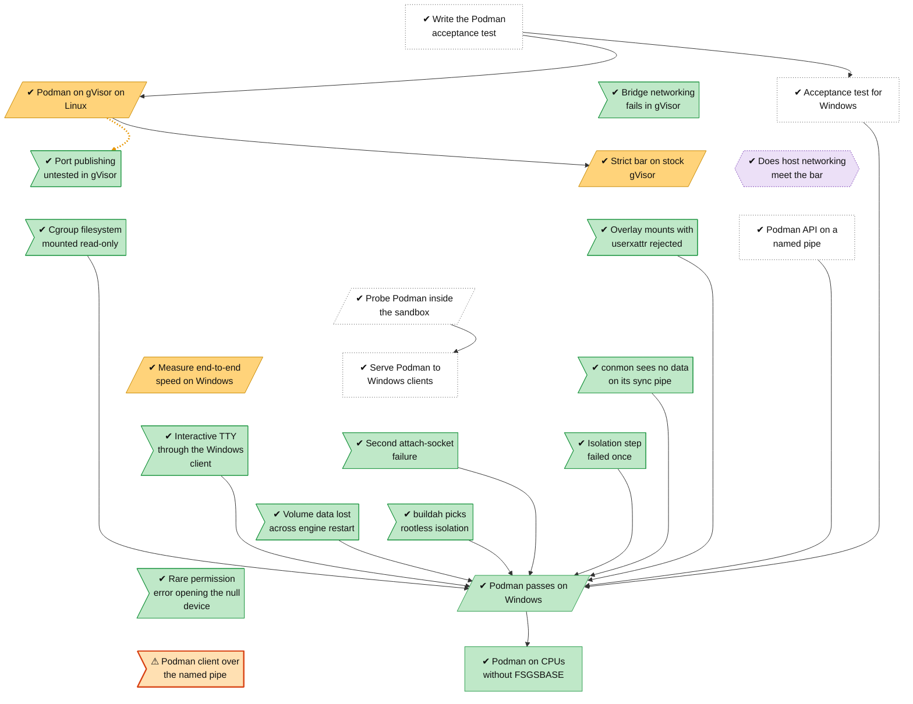

<!-- Generated by build.py from roadmap/nodes.yaml. Do not edit. -->

# workloads - workloads

Scope: workloads that measure compatibility; the Podman acceptance test is the bar.

[Back to the page](../../roadmap.md) · [legend](../../roadmap.md#legend)

<!-- BEGIN GENERATED: track-workloads -->

<!-- END GENERATED: track-workloads -->

## Node table

<!-- BEGIN GENERATED: table-workloads -->
| id | title | kind | lane | state | outcome | start | end | depends_on | replaced_by | qualified_by | headline | evidence |
|---|---|---|---|---|---|---|---|---|---|---|---|---|
| `workloads-acceptance-test` | Write the Podman acceptance test | tooling | linux-ci | done | unrated | 2026-11-26 | 2026-11-26 | research-gvisor-base |  |  |  | test/e2e/podman-acceptance/run.sh; docs/results/0a-linux.md |
| `workloads-podman-on-gvisor-linux` | Podman on gVisor on Linux | experiment | linux-ci | done | mixed | 2026-11-26 | 2026-11-26 | workloads-acceptance-test |  | workloads-gvisor-bridge-netlink, workloads-gvisor-port-publishing |  | docs/results/0a-linux.md |
| `workloads-podman-on-windows` | Podman passes on Windows | experiment | windows-ci | done | successful | 2026-11-27 | 2026-11-27 | runsc-container-on-windows, workloads-acceptance-test-windows, net-port-forwarding, fs-persistent-storage-choice, fs-change-notifications, fs-linux-metadata-on-ntfs, net-bridge-networking, workloads-gvisor-cgroupfs-readonly, net-nftables-thread-safety, platform-split-syscall-unpatched, workloads-podman-api-named-pipe, fs-standard-user-delete-rights, workloads-conmon-sync-pipe, workloads-overlay-userxattr, fs-case-sensitivity-without-admin, platform-rare-hang-under-exec-load, sentry-netpoll-failure, fs-unix-sockets-on-host-folders, workloads-conmon-attach-second-cause, sentry-fchmod-std-stream, sentry-pasta-in-sandbox, platform-avx512-state-lost, fs-copied-file-too-short, workloads-tty-through-windows-client, workloads-isolation-flake, platform-rewrite-mode-slow-engine, workloads-volume-lost-on-restart, platform-rewrite-glibc-init-crash, fs-host-folder-mtime-resolution, fs-layer-store-corrupt-after-restart, workloads-buildah-thinks-rootless |  |  | All ten Podman steps pass, native mode | docs/results/5-podman-windows.md; docs/adr/0002-what-done-means.md |
| `workloads-acceptance-test-windows` | Acceptance test for Windows | tooling | windows-ci | done | unrated | 2026-11-26 | 2026-11-26 | workloads-acceptance-test |  |  |  | docs/results/5-podman-windows.md |
| `workloads-podman-harness` | Serve Podman to Windows clients | tooling | windows-ci | done | unrated | 2026-11-26 | 2026-11-27 | runsc-container-on-windows, net-port-forwarding, workloads-podman-probe |  |  |  | docs/results/5-podman-windows.md |
| `workloads-gvisor-bridge-netlink` | Bridge networking fails in gVisor | defect | linux-ci | done | unrated | 2026-11-26 | 2026-11-26 |  |  |  |  | docs/results/0a-linux.md; docs/results/0c-linux-strict-bar.md; docs/results/1n-bridge-networking.md |
| `workloads-gvisor-port-publishing` | Port publishing untested in gVisor | defect | linux-ci | done | unrated | 2026-11-26 | 2026-11-26 |  |  |  |  | docs/results/0a-linux.md; docs/results/1n-bridge-networking.md |
| `workloads-bar-host-network` | Does host networking meet the bar | owner-decision | owner | done | n/a | 2026-11-26 | 2026-11-26 |  |  |  |  | docs/adr/0004-phase-0-results.md |
| `workloads-strict-bar-linux` | Strict bar on stock gVisor | experiment | linux-ci | done | mixed | 2026-11-26 | 2026-11-26 | workloads-podman-on-gvisor-linux |  |  |  | docs/results/0c-linux-strict-bar.md |
| `workloads-gvisor-cgroupfs-readonly` | Cgroup filesystem mounted read-only | defect | linux-ci | done | unrated | 2026-11-26 | 2026-11-26 |  |  |  |  | docs/results/1n-bridge-networking.md |
| `workloads-podman-api-named-pipe` | Podman API on a named pipe | feature | windows-ci | done | unrated | 2026-11-26 | 2026-11-26 | runsc-windows-boot |  |  |  | docs/results/5-podman-windows.md |
| `workloads-podman-probe` | Probe Podman inside the sandbox | experiment | windows-ci | done | unrated | 2026-11-26 | 2026-11-26 | platform-busybox-on-windows, platform-map-files-without-sections |  |  |  | docs/results/5-podman-windows.md |
| `workloads-end-to-end-speed` | Measure end-to-end speed on Windows | experiment | windows-ci | done | mixed | 2026-11-27 | 2026-11-27 | runsc-windows-boot |  |  | 16x to 170x slower | docs/results/3b-runsc-speed-lifecycle.md |
| `workloads-conmon-sync-pipe` | conmon sees no data on its sync pipe | defect | windows-ci | done | unrated | 2026-11-26 | 2026-11-27 | platform-veneer-address-in-child |  |  |  | docs/results/5-podman-windows.md |
| `workloads-overlay-userxattr` | Overlay mounts with userxattr rejected | defect | windows-ci | done | unrated | 2026-11-26 | 2026-11-27 |  |  |  |  | docs/results/5-podman-windows.md |
| `workloads-conmon-attach-second-cause` | Second attach-socket failure | defect | windows-ci | done | unrated | 2026-11-27 | 2026-11-27 |  |  |  |  | docs/results/5-podman-windows.md |
| `workloads-tty-through-windows-client` | Interactive TTY through the Windows client | defect | windows-ci | done | unrated | 2026-11-27 | 2026-11-27 |  |  |  |  | docs/results/5-podman-windows.md |
| `workloads-isolation-flake` | Isolation step failed once | defect | windows-ci | done | unrated | 2026-11-27 | 2026-11-27 |  |  |  |  | docs/results/5-podman-windows.md |
| `workloads-volume-lost-on-restart` | Volume data lost across engine restart | defect | windows-ci | done | unrated | 2026-11-27 | 2026-11-27 |  |  |  |  | docs/results/5-podman-windows.md |
| `workloads-buildah-thinks-rootless` | buildah picks rootless isolation | defect | windows-ci | done | unrated | 2026-11-27 | 2026-11-27 |  |  |  |  | docs/results/5-podman-windows.md; docs/adr/0002-what-done-means.md |
| `workloads-dev-null-eacces` | Rare permission error opening the null device | defect | windows-ci | done | unrated | 2026-11-27 | 2026-11-27 |  |  |  |  | docs/results/5-podman-windows.md; docs/results/2r-step5-overlay.md |
| `workloads-podman-without-fsgsbase` | Podman on CPUs without FSGSBASE | feature | windows-ci | done | successful | 2026-11-27 | 2026-11-27 | workloads-podman-on-windows, platform-unrewritten-fs-in-library, platform-rewrite-heap-corruption, platform-resume-inside-fs-window |  |  | Podman passes without FSGSBASE too | docs/results/5-podman-windows.md; docs/results/1q-window-resume.md; docs/results/1p-rewrite-heap.md |
| `workloads-podman-client-on-pipe` | Podman client over the named pipe | defect | windows-ci | next | unrated | 2026-11-28 |  |  |  |  |  | tools/windows/ci/README-release.md |

### Details per node

| id | title | verdict | headline | in plain words | notes | confirmed | waiting on | queue order | order reason |
|---|---|---|---|---|---|---|---|---|---|
| `workloads-acceptance-test` | Write the Podman acceptance test |  |  | One test of ten steps defines when Podman counts as working: pull, run, build, mounts, ports, compose, restart, isolation. | Done when: the test exists under test/e2e/podman-acceptance and passes against native Podman on Linux. |  |  |  |  |
| `workloads-podman-on-gvisor-linux` | Podman on gVisor on Linux | passes all 10 acceptance steps when containers use host networking, the store is on a host directory (kernel overlayfs or vfs) and runsc runs with `--in-sandbox-cgroup=v2`; with the default bridge network netavark fails on its netlink socket, so only steps 1, 2 and 5 pass |  | Run the acceptance test on stock gVisor on Linux; whatever fails there is a gap in gVisor itself, not in the port. | Done when: the acceptance test ran against Podman inside runsc and docs/results/0a-linux.md records each step. |  |  |  |  |
| `workloads-podman-on-windows` | Podman passes on Windows | an unmodified Podman 6.2.0 engine passes all ten acceptance steps on gVisor on Windows as a standard user in native mode, 8 of 8 runs twice, under the conditions listed in ADR 0002 | All ten Podman steps pass, native mode | The bar for enough features: an unmodified Podman engine passes the acceptance test on gVisor on Windows. | Native mode (CPUs with FSGSBASE), runs 45976796134 and 45985526511. CPUs without FSGSBASE are the follow-up node. |  |  |  |  |
| `workloads-acceptance-test-windows` | Acceptance test for Windows |  |  | The ten acceptance steps written for Windows, driving the stock Podman and docker clients. | Done when: a PowerShell twin of the test runs the same ten steps and reports each one. |  |  |  |  |
| `workloads-podman-harness` | Serve Podman to Windows clients |  |  | The test harness runs the Podman engine on runsc and exposes its API to the stock Windows clients. | Engine on runsc.exe with the erofs podman image, graceful stop, stock Windows clients over a named pipe; the remaining differences from a stock service are listed in ADR 0002. |  |  |  |  |
| `workloads-gvisor-bridge-netlink` | Bridge networking fails in gVisor |  |  | netavark dies on setsockopt(NETLINK_DUMP_STRICT_CHK) (ENOPROTOOPT) and then on RTM_SETLINK with NLM_F_CREATE (EINVAL); nftables (NETLINK_NETFILTER) is only enabled by a test-only flag. | Open gap in gVisor itself. Fixed when: the acceptance test passes with the default bridge network on stock runsc. |  |  |  |  |
| `workloads-gvisor-port-publishing` | Port publishing untested in gVisor |  |  | Publishing container ports with -p and service-name lookup in compose never worked or were never exercised inside gVisor. | Fixed when: -p and compose service names pass inside stock runsc. |  |  |  |  |
| `workloads-bar-host-network` | Does host networking meet the bar |  |  | Decided: host networking is only an interim state; -p and compose service names are required. |  |  |  |  |  |
| `workloads-strict-bar-linux` | Strict bar on stock gVisor | Stock runsc passes the strict bar in no tested configuration |  | Find out what stock gVisor on Linux needs for -p port publishing and compose service names, across Podman versions and network modes. | Done when: docs/results/0c-linux-strict-bar.md records the matrix and the precise gVisor gaps. |  |  |  |  |
| `workloads-gvisor-cgroupfs-readonly` | Cgroup filesystem mounted read-only |  |  | With Podman managing cgroups, crun cannot write cgroup.subtree_control because gVisor mounts /sys/fs/cgroup read-only; a remount makes it pass. | Fixed in the harness, not in gVisor: Docker writes ro into the OCI spec for unprivileged containers; the engine container now runs with docker --privileged. |  |  |  |  |
| `workloads-podman-api-named-pipe` | Podman API on a named pipe |  |  | Expose the Podman engine API on a Windows named pipe owned by the user, instead of a loopback TCP port. | Done for the docker CLI; stock podman 5.3.1 cannot dial npipe, so the podman client uses a forwarded AF_UNIX socket. |  |  |  |  |
| `workloads-podman-probe` | Probe Podman inside the sandbox |  |  | Right after busybox works, run podman --version and podman info inside the sandbox; their failures are the real gap list. | Done when: the gap list is written up in docs/results. |  |  |  |  |
| `workloads-end-to-end-speed` | Measure end-to-end speed on Windows | CPU-bound work runs at native speed, but small-file and process-creation workloads are 16x to 170x slower than na | 16x to 170x slower | Run the Phase 0 workloads (fork+exec loop, untar of small files, a CPU job) through runsc.exe on Windows and compare with runsc and native on Linux. | Done when: a table of Windows vs Linux runsc vs native is in docs/results. |  |  |  |  |
| `workloads-conmon-sync-pipe` | conmon sees no data on its sync pipe |  |  | Every podman run fails with "conmon bytes \"\": found \x00": conmon reads nothing from its sync pipe while creating the first container inside the sandbox on Windows. | Fixed: containers are created and started; podman run -d -p works end to end (step 7 passes). |  |  |  |  |
| `workloads-overlay-userxattr` | Overlay mounts with userxattr rejected |  |  | podman build fails: the Sentry overlay rejects the userxattr option (or the layer setup) when Podman storage sits on a Windows folder. | Fixed when: podman build of a small Containerfile passes inside the Windows sandbox. |  |  |  |  |
| `workloads-conmon-attach-second-cause` | Second attach-socket failure |  |  | Even with container directories on a tmpfs, Podman's connect to conmon's attach socket is refused; a second cause is not isolated. | No separate cause: with the host-folder socket fix, podman run --rm alpine echo ok prints ok. |  |  |  |  |
| `workloads-tty-through-windows-client` | Interactive TTY through the Windows client |  |  | The Windows podman client says "The input device is not a TTY" inside the ConPTY test driver, so the interactive step cannot type into the container. | Fixed in the harness: ttydrive now sets STARTF_USESTDHANDLES with NULL handles so the child gets the pseudoconsole; step 4 passed 7 of 7 runs. |  |  |  |  |
| `workloads-isolation-flake` | Isolation step failed once |  |  | Remaining acceptance flakes: step 3 sometimes loses the race between --rm cleanup and attach (podman remote, widened by sandbox slowness), and step 10 once timed out with the engine and a new Go helper idle for 123 s, which looks like the stuck process start. | Fixed: change-stream overflow invalidated dentries with mounts on them, which unmounted container /dev and /tmp; invalidation now keeps mounted dentries. |  |  |  |  |
| `workloads-volume-lost-on-restart` | Volume data lost across engine restart |  |  | In 2 of 5 complete native runs, the named volume written before the engine restart is empty afterwards (step 9). | Harness cause: an old static_dir workaround put libpod's database on a tmpfs. The database now lives on the storage folder; a runsc restart test is required. |  |  |  |  |
| `workloads-buildah-thinks-rootless` | buildah picks rootless isolation |  |  | Without BUILDAH_ISOLATION=oci every build fails in pasta, because buildah resolves the default isolation to rootless inside the sandbox, although euid, uid_map and capabilities all look rootful. | Fixed in the Sentry: the root user namespace now has Linux's fixed inode 0xEFFFFFFD in /proc/self/ns/user, which c/storage checks; BUILDAH_ISOLATION=oci removed, native 8 of 8 with all 10 steps. |  |  |  |  |
| `workloads-dev-null-eacces` | Rare permission error opening the null device |  |  | Intermittently, apt's unprivileged _apt user gets "cannot create /dev/null: Permission denied" inside a build container, so step 5 fails; dpkg's "cannot stat" of an extracted .deb also still shows up rarely. | Not reproduced on current windows: step 5 passed 80 of 80 native runs; the failures were on heads before the mount-keeping and atomic-replace fixes. A devnull guest test guards it. |  |  |  |  |
| `workloads-podman-without-fsgsbase` | Podman on CPUs without FSGSBASE | an unmodified Podman 6.2.0 engine passes all ten acceptance steps on gVisor on Windows as a standard user in all three CPU modes, 24 of 24 runs on the merged head, under the conditions listed in ADR 0002. | Podman passes without FSGSBASE too | The same acceptance in rewrite mode, which older CPUs and this development VM need because they cannot set the %fs base from user mode. | Run 46041026851 on the merged head: native, rewrite and rewrite-fxsave each 8 of 8 with all 10 steps. |  |  |  |  |
| `workloads-podman-client-on-pipe` | Podman client over the named pipe |  |  | The stock Windows podman client connects over a unix socket path without a drive letter, so the zip only works from drive C:; the docker CLI uses the named pipe. | Now in lhns/podman-portable (the bundle); fixed when the stock podman client works from any drive, tested by its CI. |  |  |  |  |

### Folded items per node

- `workloads-acceptance-test`: Write the Podman acceptance test
  - Native Podman baseline passes all 10 steps (2026-11-26, commit 0d3203400)
- `workloads-podman-harness`: Serve Podman to Windows clients
  - Podman 6.2.0 pulls and stores images on a Windows folder; steps 1-2 pass (2026-11-26, commit 61c8b8f92)
  - Runtime -p via the forwarder expose API works as a standard user (2026-11-26, commit 61c8b8f92)
  - Steps 1, 2 and 7 pass; nginx published with -p answers on 127.0.0.1 (2026-11-27, commit 159f62dc1)
  - Eight of ten acceptance steps pass; tty and build remain (2026-11-27, commit 0f4d0b353)
  - Native: 7 of 8 runs pass every step but the build; no hangs or GC crashes in 16 runs (2026-11-27, commit 74e8f4a70)
  - Graceful engine stop via runsc kill TERM; GODEBUG and stale env workarounds removed; no GC crash or hang in 16 runs (2026-11-27, commit 8b655ef58)
  - Native: steps 1-4 and 6-8 pass 8 of 8; steps 9-10 fail only after a failed build left an undeletable layer directory (2026-11-27, commit 8b655ef58)
- `workloads-conmon-sync-pipe`: conmon sees no data on its sync pipe
  - Cause 1 fixed: FIFO opens on host folders were rejected by policy, now in-Sentry named pipes (2026-11-27, commit 9ab48dea3)
- `workloads-overlay-userxattr`: Overlay mounts with userxattr rejected
  - Overlay upperdir must be tmpfs; /var/tmp is now a tmpfs in the engine spec (2026-11-27, commit 9ab48dea3)
- `workloads-podman-without-fsgsbase`: Podman on CPUs without FSGSBASE
  - Rewrite Podman: all 10 steps 7 of 8, then 8 of 8 (runs 46016231319, 46020575644) (2026-11-27, commit bce41cf19)
<!-- END GENERATED: table-workloads -->
